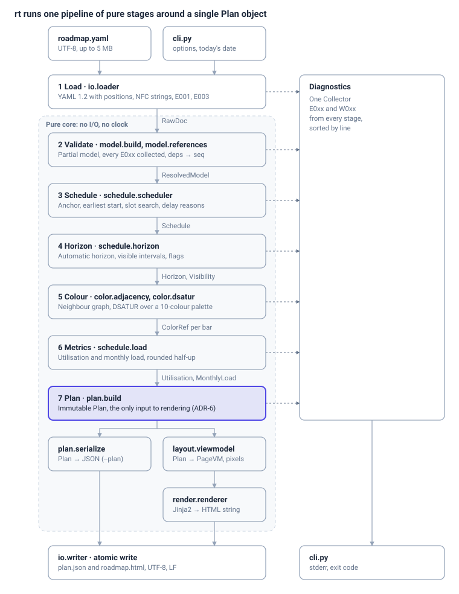

# rt — Architecture and Design Specification

Oct 23, 2026 · @Artur

Revised Oct 29, 2026: CR-1 products (sections 4.2, 5, 6.1, 6.5, 7.1, 10).
Revised Oct 31, 2026: CR-2 team indicators (sections 4, 5, 6.1, 6.9, 7.3, 7.4, 10).
Revised Nov 7, 2026: CR-3 locked projects (sections 5, 6.2, 6.3, 6.8, 7.3, 7.4).

**rt is built as a Python 3.12 command-line package with two runtime dependencies (ruamel.yaml, Jinja2), organised as a pipeline of pure functions around one immutable `Plan` object.** This document supplements the requirements specification ("RS"); where the two differ, the RS wins unless section 13 here lists an agreed clarification. Section numbers prefixed "RS" point into the requirements.

## 1. Decisions at a glance

| ID | Decision | Main reason | Alternatives rejected |
| --- | --- | --- | --- |
| ADR-1 | Python 3.12+ | The scheduling oracle that produced the expected fixtures is Python; plan JSON number formatting matches Python's `json` byte for byte | Go (single binary, but re-deriving fixture formatting), TypeScript/Node |
| ADR-2 | ruamel.yaml (round-trip loader) | YAML 1.2, line/column for every node, duplicate-key detection | PyYAML (YAML 1.1: `NO` → false), strictyaml |
| ADR-3 | Jinja2 with `autoescape=True`, `StrictUndefined` | Safe HTML escaping by default (RS OUT-4), readable templates | f-strings, Mako |
| ADR-4 | Hand-written validator, not Pydantic or jsonschema at runtime | Exact error codes, messages and positions per RS 9; collects all errors | Pydantic (error mapping fragile), jsonschema (no line numbers) |
| ADR-5 | Pure core: scheduler, colouring, load and layout do no I/O and read no clock | Unit-testable in isolation; deterministic output (RS NF-4) | — |
| ADR-6 | `Plan` is the single seam between computing and rendering | RS PL rule: HTML MUST come from exactly the plan | Renderer reading the model directly |
| ADR-7 | All rounding through `decimal.Decimal` with `ROUND_HALF_UP` | Python's `round()` rounds half to even, which breaks RS OUT-8, OUT-13, OUT-33 | built-in `round()` |
| ADR-8 | NFC-normalise every user string at load time | One rule for matching, output and messages (RS IN-8) | Normalising only at comparison |
| ADR-9 | The whole page scrolls (no inner scroll box); header sticky top, label column sticky left | CSS tooltips are not clipped; works in print | `overflow-x: auto` wrapper |
| ADR-10 | No JavaScript in the output | RS OUT-2; simpler, printable, deterministic | Small inline JS for tooltips |
| ADR-11 | Dependency connectors as one inline SVG per subdomain card, beneath the bars | Precise orthogonal routes, cheap to generate | CSS borders per segment |
| ADR-12 | Distribution: `uv tool install` / `pipx` wheel, plus PyInstaller single-file binaries per OS on release | Covers developers and non-Python users (RS NF-2) | Wheel only |
| ADR-13 | Every command builds its whole output in memory and writes it once, as bytes, through IOPort | Gives RS ST-2 (nothing on stdout after a failure), byte-identical stdout and file output (ST-4), and one place to handle a closed pipe (ST-6) | Streaming writes as output is produced |
| ADR-14 | CSV via the stdlib csv module with rt's own delimiter detection; conversion reuses the YAML validator by building the same ruamel tree with CSV positions; ruamel round-trip for the base file and for emitting | No new dependency; one validator for YAML and CSV; base comments survive (RS CV-13) | pandas (heavy), csv.Sniffer (unreliable on one header line), a separate CSV validator |

## 2. Tech stack

Runtime has exactly two third-party packages; everything else is the standard library or development tooling.

### 2.1 Runtime

| Component | Choice | Version | Used for |
| --- | --- | --- | --- |
| Language | CPython | ≥ 3.12, tested on 3.12 and 3.13 | Everything |
| YAML | `ruamel.yaml` | ≥ 0.19.1, < 0.20; the lock file pins the exact version because emitter output is part of the convert contract | Loading with positions (`CommentedMap.lc`), YAML 1.2, duplicate keys |
| Templates | `Jinja2` | ≥ 3.1, < 4 | HTML generation with auto-escaping |
| CLI parsing | `argparse` (stdlib) | — | Subcommands, help ≤ 80 columns (RS NF-9) |
| Dates | `datetime.date`, `calendar` (stdlib) | — | Calendar arithmetic; no time zones, no `datetime.now()` outside the CLI layer |
| Numbers | `decimal` (stdlib) | — | Half-up rounding (ADR-7) |
| Text | `unicodedata` (stdlib) | — | NFC normalisation |
| Suggestions | `difflib` + own Levenshtein (≤ 30 lines) | — | "Did you mean" with edit distance ≤ 2 (RS IN-3) |
| JSON | `json` (stdlib) | — | Plan output, `--format json` diagnostics, `rt schema` |
| Resources | `importlib.resources` | — | Bundled CSS, templates, schema, example files |
| CSV | `csv (stdlib)` | — | Reading CSV project lists for rt convert (RS 3.4), strict mode, newline='' |

### 2.2 Development

| Tool | Purpose | Gate in CI |
| --- | --- | --- |
| `uv` | Environments, lock file (`uv.lock`), builds | — |
| `ruff` | Lint and format | Zero findings |
| `mypy --strict` | Static types | Zero errors |
| `pytest`, `pytest-cov` | Tests and coverage | ≥ 90 % on core packages (RS NF-8) |
| `hypothesis` | Property-based tests for scheduler and colouring | Part of test suite |
| `lxml` (cssselect) | Structural assertions on generated HTML | Part of test suite |
| `jsonschema` | Cross-checks shipped schema against the validator | Part of test suite |
| `playwright` | Screenshot review in Chromium, Firefox, WebKit (RS NF-6) | Release pipeline, manual approval |
| `pyinstaller` | Single-file binaries | Release pipeline |
| `hatchling` | Build backend | — |

## 3. Architecture overview

rt is a straight pipeline: the edge reads the file and options, seven stages turn them into one immutable Plan, and two branches turn that Plan into files. Every stage reports problems to a single diagnostics collector instead of raising errors.



Only the input row, Load, the writer and `cli.py` touch files, streams or the clock; everything inside the dashed area is pure, which is what makes the core unit-testable and the output reproducible.

`rt convert` is a second, shorter pipeline over the same parts: a CSV source replaces Load, stage 2 validates the result with positions pointing into the CSV, and a YAML emitter replaces stages 3–7 (section 6.8). Every command, both pipelines included, reads its input and writes its output through one `IOPort`, which handles files and standard streams alike (section 8.4).

## 4. Package layout and modules

Code lives in one `src`-layout package `rt`; each pipeline stage is a subpackage whose public functions are listed below and re-exported from its `__init__.py`. Nothing outside `cli.py` and `io/` touches files, streams, the clock or environment variables.

### 4.1 Repository tree

```
rt/
├─ pyproject.toml
├─ uv.lock
├─ README.md
├─ src/rt/
│  ├─ __init__.py            # __version__
│  ├─ __main__.py            # python -m rt → cli.main()
│  ├─ cli.py                 # argparse, exit codes, stdout/stderr, clock
│  ├─ app.py                 # use cases: render, validate, convert, init, schema
│  ├─ diagnostics.py         # Diagnostic, Code, Collector, formatters, suggest()
│  ├─ timeutil.py            # Month, add_months, days_in_month, fmt dates
│  ├─ decimalutil.py         # half_up(), px(), pct()
│  ├─ io/
│  │  ├─ loader.py           # text → RawDoc (ruamel nodes + positions)
│  │  ├─ writer.py           # atomic file write
│  │  └─ streams.py          # IOPort: input from path or stdin, output to file or stdout, closed pipe
│  ├─ model/
│  │  ├─ types.py            # frozen dataclasses (section 5.1)
│  │  ├─ fields.py           # field specs: types, ranges, patterns
│  │  ├─ build.py            # RawDoc → Model + diagnostics (structure)
│  │  └─ references.py       # teams, sizes, ids, depends_on, uniqueness
│  ├─ convert/
│  │  ├─ csv_source.py       # decode, detect delimiter, records with start lines
│  │  ├─ columns.py          # header matching, --map, E103/E104/W020
│  │  ├─ values.py           # size, start, ongoing, depends_on parsing
│  │  ├─ skeleton.py         # generated settings, subdomains, teams, slug ids
│  │  ├─ merge.py            # base round-trip, replace/append projects, team resolution
│  │  └─ emit.py             # ruamel dump settings, header comment
│  ├─ schedule/
│  │  ├─ slots.py            # SlotBoard: per-slot sorted intervals, overlap test
│  │  ├─ scheduler.py        # schedule(model, mode, anchor) → Schedule
│  │  ├─ horizon.py          # anchor(), auto horizon, visibility, flags
│  │  ├─ indicators.py       # team indicators: DEV per slot, DEV per QA, bands, flags
│  │  └─ load.py             # utilisation, monthly load
│  ├─ color/
│  │  ├─ palette.py          # PALETTE, custom colour derivation, contrast
│  │  ├─ adjacency.py        # lanes → neighbour sets
│  │  └─ dsatur.py           # assign_colors()
│  ├─ plan/
│  │  ├─ types.py            # Plan, PlannedProject, TeamPlan, MonthlyLoad
│  │  ├─ build.py            # orchestrates schedule → horizon → colour → load
│  │  └─ serialize.py        # plan → JSON text (RS 8)
│  ├─ layout/
│  │  ├─ geometry.py         # x(date), bar boxes, connector routes, quarter marks
│  │  └─ viewmodel.py        # Plan → PageVM (strings, classes, attributes)
│  ├─ render/
│  │  ├─ renderer.py         # PageVM → HTML string
│  │  ├─ templates/          # *.html.j2 (section 7.2)
│  │  └─ static/rt.css       # inlined into <style>
│  └─ resources/
│     ├─ roadmap.schema.json
│     ├─ roadmap.example.yaml
│     └─ roadmap.minimal.yaml
├─ tests/
│  ├─ unit/  property/  golden/  cli/  html/  perf/
│  └─ fixtures/              # RS companion files, copied verbatim
└─ tools/
   ├─ reference_plan.py      # oracle that generated the expected plans
   └─ gen_stress.py          # 50 teams / 500 projects / 60 months
```

### 4.2 Public interfaces

| Module | Function | Signature (abridged) | Rules |
| --- | --- | --- | --- |
| `io.loader` | `load_text` | `(text: str, source: str) -> tuple[RawDoc \| None, list[Diagnostic]]` | E001, E003; strips UTF-8 BOM; NFC on every scalar string |
| `model.build` | `build_model` | `(raw: RawDoc, diags: Collector) -> Model \| None` | E002, E004, E010–E013, E042, E043; parses `products`; returns `None` if any error |
| `model.references` | `check_references` | `(model: Model, diags: Collector) -> ResolvedModel \| None` | E020–E025, E030–E039; resolves `depends_on` to `seq` |
| `schedule.horizon` | `anchor` | `(cfg: Settings) -> date` | RS SC-12; needs only explicit horizon start or `today` |
| `schedule.scheduler` | `schedule` | `(m: ResolvedModel, mode: Mode, anchor: date, diags) -> Schedule \| None` | RS SC-5 to SC-8, SC-13; E060, E061 |
| `schedule.horizon` | `resolve_horizon` | `(m, s: Schedule, cfg) -> Horizon` | RS SC-9; W012 |
| `schedule.horizon` | `visibility` | `(s, h: Horizon) -> dict[int, Visibility]` | RS SC-10; flags; W002–W004 |
| `color.adjacency` | `neighbours` | `(m, s, vis, gap_days) -> dict[int, frozenset[int]]` | RS CO-1 to CO-3 |
| `color.dsatur` | `product_keys` | `(m, diags) -> dict[str, ColorKey]` | RS CO-4 step 2: product pins, then automatic `10…31, 0…9`; W014 |
| `color.dsatur` | `assign_colors` | `(m, vis, nb, diags, products) -> dict[int, ColorRef]` | RS CO-4 to CO-7: project pins and product bars pre-coloured, DSATUR over `0…9`; W007, W009 |
| `schedule.load` | `utilisation`, `monthly_load` | `(m, s, h) -> …` | RS OUT-13, OUT-32 |
| `schedule.indicators` | `team_indicators` | `(teams, norms: TeamNorms) -> Indicators` | RS 7.13 TI-1 to TI-7; exact fractions, median band or norms, flags |
| `plan.build` | `build_plan` | `(m, s, h, vis, colors, load, diags, product_colors) -> Plan` | Assembles; adds W001, W005, W006, W008, W010, W011, W013 |
| `plan.serialize` | `to_json` | `(plan: Plan) -> str` | RS PL-1 to PL-6 |
| `layout.viewmodel` | `build_page` | `(plan: Plan, opts: RenderOptions) -> PageVM` | All formatting and pixel maths |
| `render.renderer` | `render_html` | `(page: PageVM) -> str` | No logic beyond loops and conditionals |
| `app` | `run_render`, `run_validate`, run\_convert, `run_init`, `run_schema` | `(args: Options, io: IOPort) -> int` | Returns exit code; `IOPort` wraps files and streams so tests can fake them |
| `io.streams` | `IOPort` | `read(spec) -> (bytes, source_name); write(spec, data: bytes); stdin_is_tty() -> bool` | spec = path or '-'; RS ST-1 to ST-8; real and fake implementations |
| `convert.csv_source` | `read_csv` | `(data: bytes, source, encoding, delimiter \| None, diags) -> CsvTable \| None` | RS CV-1 to CV-5; E101, E102, E106 |
| `convert` | `convert_csv` | `(table: CsvTable, base: RawDoc \| None, opts: ConvertOptions, diags) -> str \| None` | RS CV-6 to CV-20; returns YAML text, or None when any error was collected |

## 5. Data model

Every type is a `@dataclass(frozen=True, slots=True)` or `NamedTuple`; collections are tuples or `MappingProxyType`, so no stage can change another stage's data. Projects are identified everywhere by `seq` (1-based file order).

### 5.1 Input model (`model.types`)

| Type | Fields | Notes |
| --- | --- | --- |
| `Pos` | `line`, `col` | 1-based; carried by every entity for diagnostics; plus source: the file name, \<stdin>, or the CSV name for rows that rt convert produced |
| `Month` | `year`, `month` | `NamedTuple`, so ordering and hashing are free; `.first_day() -> date`, `.next()` |
| `Settings` | `title`, `subtitle`, `horizon_start: Month \| None`, `horizon_end: Month \| None`, `today: date`, `month_width`, `content_language`, `on_conflict: Mode`, `adjacency_gap_days` | CLI overrides already applied (RS CLI-1) |
| `Size` | `label`, `weeks` | Kept in declaration order (legend order) |
| `Capacity` | `developers`, `product_managers`, `analysts`, `testers` | Defaults 0; `.total` property |
| `Team` | `id`, `name`, `subdomain_id`, `slots`, `capacity`, `pos` | `slots` = `parallel_projects` |
| `Subdomain` | `id`, `name`, `description`, `team_ids: tuple[str, ...]`, `pos` |  |
| `Product` | `id`, `name`, `domain_id`, `owner`, `description`, `color: ColorSpec \| None`, `pos` | `domain_id` = the owning subdomain (RS 3.2) |
| `Project` | `seq`, `id`, `name`, `team_id`, `start: Month \| None`, `size: str \| None`, `ongoing`, `depends_on_refs: tuple[str, ...]`, `description`, `color: ColorSpec \| None`, `pos`, `product_id: str \| None` | `pos` = first key of the mapping (RS 9 location rule); `product_id` `None` = standalone |
| `Band`, `TeamNorms` | `Band(min, max: Fraction \| None)`; `TeamNorms(devs_per_slot, devs_per_qa: Band \| None)` | `team_norms` (RS 3.2), bounds kept exact as written |
| `Model` | `settings`, `sizes`, `subdomains`, `teams`, `projects`, `products`, `team_norms` | Structure valid, references not yet checked; `products` in file order (legend order) |
| `ResolvedModel` | `Model` + `deps: Mapping[int, tuple[int, ...]]`, `weeks: Mapping[int, int \| None]` | Output of `check_references`; the only input the scheduler accepts |

### 5.2 Computed types

| Type | Fields | Notes |
| --- | --- | --- |
| `Interval` | `start: date`, `end: date \| None` | `None` = ongoing (∞); `overlaps()` implements RS SC-3 |
| `Placement` | `seq`, `lane`, `overflow`, `requested: date \| None`, `earliest`, `start`, `end`, `delay_days`, `delay_reason` | One per project |
| `Schedule` | `placements: tuple[Placement, ...]`, `lane_count: Mapping[str, int]` | Indexed by `seq - 1` |
| `Horizon` | `start: Month`, `end: Month`, `h0: date`, `h1: date`, `days` | `h1` = first day after the horizon |
| `Visibility` | `start: date \| None`, `end: date \| None`, `flags: frozenset[str]` | `None` when hidden |
| `ColorRef` | `index: int \| None`, `name: str \| None`, `fill`, `accent`, `text` | `index` `None` for custom hex |
| `Plan` | Mirrors RS 8 field for field, plus `palette` and the resolved `Model` reference | `plan.serialize` writes fields in dataclass order, so the order in the type IS the JSON key order |
| `TeamPlan` indicator fields, `TeamIndicatorsPlan` | `developers`, `testers`, `devs_per_slot`, `devs_per_qa`, `indicator_flags` after `utilization`; `Plan.team_indicators` (`IndicatorPlan(all, median, low, high, source)` per indicator) right after `teams`; the exact `Indicators` ride along as a non-serialised field for the page | RS PL-8 |
| `PlannedProject.product`, `ProductPlan` | `product` after `team`; `ProductPlan(id, name, domain, owner, color_index, color_name, color_fill, projects)` plus its `ColorRef` (not serialised) in `Plan.products`, right after `teams` | RS PL-7 |

### 5.3 View model (`layout.viewmodel`)

The view model holds only display-ready values: strings already formatted, pixel values already rounded as strings (`"110.39"`), CSS classes and `data-*` attribute dicts already built. Templates never compute.

| Type | Holds |
| --- | --- |
| `PageVM` | title, subtitle, lang, horizon label, as-of label, legend items (sizes and product chips), timeline width, year / quarter / month columns, today mark, optional `SummaryVM`, sections, warnings, version |
| `SectionVM` | subdomain id, name, description, counts, height, teams, connector paths (`d` strings) |
| `TeamVM` | name, role badges, people total, slot label, utilisation percent and bar width, lanes, indicator chips (`IndicatorVM`: text, mark, glyph, title; short texts for one-slot teams) and indicator `data` hooks |
| `LaneVM` | number label (`1`, `+1`), overflow flag, bars |
| `BarVM` | `left`, `width`, fill / accent / text colours, label, size chip, glyph flags, delay pill, lead-line box, `title` text (with the `Product: … · owned by …` line), `aria-label`, `data` attributes (incl. `data-product`) |
| `LegendProductVM` | product id, name, ` · domain · owner` text, colour index, fill / accent / text colours, chip tooltip |
| `SummaryVM` | KPI tiles, month headers, rows (kind, name, indent, cells with value text, bin class, tooltip, `data` attributes), `CompositionVM` (team composition rows: subdomain, team, all, median, band) |

## 6. Algorithms

All algorithms are deterministic, quadratic at worst, and comfortably inside the 2-second budget for 500 projects (RS NF-3). The RS defines the rules; this section fixes how to implement them.

### 6.1 Order of computation

The anchor depends only on settings, while the automatic horizon depends on the schedule, so the order is fixed:

1. `anchor(settings)` — explicit horizon start (file or `--from`), else the 1st of `today`'s month.
2. `schedule(model, mode, anchor)` — placements for every project.
3. `resolve_horizon(model, schedule, settings)` — automatic parts of the horizon.
4. `visibility(schedule, horizon)` — visible intervals and flags.
5. `neighbours(...)`, then `product_keys(...)` (product colours, W014), then `assign_colors(...)`.
6. `utilisation(...)` and `monthly_load(...)`.
7. `build_plan(...)` — computes `team_indicators(...)` (pure, independent of the schedule), assembles, and emits the remaining warnings.

### 6.2 Scheduler

`SlotBoard` keeps, per team, a list of lanes; each lane is a list of `Interval` sorted by start. A lane accepts `[s, e)` when the neighbour before the insertion point (found with `bisect`) ends at or before `s` and the neighbour after starts at or after `e`. An ongoing interval needs the lane to be empty from `s` on.

```python
def schedule(m, mode, anchor, diags):
    board = SlotBoard(m.teams)
    out = []
    for p in m.projects:                                   # file order = priority
        base = anchor if p.start is None else p.start.first_day()
        earliest = max([base] + [out[d - 1].end for d in m.deps[p.seq]])   # deps are earlier, finite
        dur = None if p.ongoing else timedelta(weeks=m.weeks[p.seq])
        if mode is Mode.DELAY or p.start is None:          # SC-5, SC-12
            hit = board.first_fit(p.team_id, earliest, dur, regular_only=True)
            if hit is None: diags.error(E060, p); continue
        else:                                              # SC-6, SC-7
            hit = board.fit_at(p.team_id, earliest, dur)   # regular lanes, then overflow
            if hit.overflow and mode is Mode.ERROR: diags.error(E061, p)
        lane, start = hit
        board.place(p.team_id, lane, Interval(start, start + dur if dur else None))
        out.append(make_placement(p, base, earliest, lane, start, dur))
    return Schedule(...) if not diags.has_errors() else None
```

- `first_fit` builds candidates `{earliest} ∪ {lane ends > earliest}` over regular lanes, sorted, and tries lanes `1…N` per candidate (RS SC-5 step 2–3).
- Delay split: `dep_days = earliest − requested`, `cap_days = start − earliest`; the reason is `dependency`, `capacity` or `dependency+capacity` from which parts are non-zero. Auto-start projects have no requested date, so no delay.
- In `ERROR` mode the scheduler keeps placing conflicting projects in virtual overflow lanes so that every conflict is reported in one run (RS SC-7), then returns `None`.
- **Locked projects (CR-3, RS SC-14/SC-15).** Before the loop above, `_place_locked` puts every locked project, in file order, at its requested start with `board.fit_at` (regular lanes, then overflow lanes, at that date only), whatever the mode. The loop then skips them, and placements are kept in a `dict[seq, Placement]` so dependencies on locked projects resolve. After the loop, `_with_risk` computes each locked placement's earliest start from its dependencies and its `lock_risk` (`dependency`, `capacity` or both, reusing `delay_reason`). `Placement` gains `locked` and `lock_risk`; plan.build emits W015 instead of W011 for them.

### 6.3 Horizon, visibility, flags

Direct transcription of RS SC-9 and SC-10. Flags are collected in a `set` and emitted sorted; `locked` and `at_risk` (CR-3) come from the placement. Hidden projects keep their placement and appear in the plan.

### 6.4 Adjacency

Lane index is computed per subdomain section in render order (teams in file order, regular lanes, then overflow lanes). Within a section, compare every pair of visible bars whose lane indices differ by 0 or 1 and test `gap ≤ adjacency_gap_days` (RS CO-3). At 500 bars this is at most 125 000 comparisons; no spatial index is needed.

### 6.5 Colouring (DSATUR)

- `color.palette` holds 32 entries; `BASE = range(10)` is what DSATUR may choose for standalone bars, `PRODUCT_ORDER = 10…31, 0…9` is the scan order for automatic product colours.
- Product colours first (`product_keys`, RS CO-4 step 2): every product pinned with a palette name takes its entry (`taken[i] += 1`); then each unpinned product in file order takes the first `PRODUCT_ORDER` entry with `taken == 0`, else `min(range(32), key=(taken, index))` and W014 at the product, naming the first product that holds the entry. Products without visible bars still get a colour (the legend shows them).
- Keep `sat[seq]` = set of colour keys among coloured neighbours and `use[colour]` = global count. Colour keys are palette indices `0…31`, or the upper-cased hex for custom colours (custom colours do not count toward palette use).
- Pre-colour, in file order, every visible bar with a project pin and every other bar of a product (its product's key); pre-coloured bars count in `use` (RS CO-4 steps 1–2). Two adjacent pre-coloured bars with the same key → W009 at the later one, unless both have the same `product_id`; the message says "pinned to" when both are project pins, else "coloured".
- Loop (standalone bars): pick `min(uncoloured, key=(-len(sat), -degree, seq))`; choose `min(allowed ∩ BASE, key=(use, index))`; if none allowed, `min(BASE, key=(conflicts, use, index))` and W007.
- Hidden bars get no colour (`null` in the plan).

### 6.6 Utilisation and monthly load

- Utilisation (RS OUT-13): sum over regular-lane placements of visible days ÷ (`slots` × `horizon.days`).
- Monthly load (RS OUT-32): for every horizon month, the overlap in days of each placement (any lane, ongoing included) with `[month start, next month start)`; aggregate numerators and denominators per team, per subdomain and in total, then divide. Both stored as `Decimal` rounded to 4 places for the plan (section 9.2).

### 6.7 Layout geometry

- All pixel maths in `Decimal` (context precision 28); round once, when converting to the view model, with `px()` = quantise to `0.01`, `ROUND_HALF_UP`. Example: Reporting `x = 28/31 × 120 = 108.3870…`, left `110.39`, width `114.76` (RS AT-03).
- `x(d) = (month_index + (d.day − 1) / days_in_month) × month_width`; `x(h1)` = timeline width.
- Bar: `left = x(vis_start) + 2`, `width = max(x(vis_end) − x(vis_start) − 4, 6)`. Label rules (RS OUT-17) use the unrounded width.
- Vertical positions (section-local): team block top padding 8, lane height 40, bar top = lane top + 6, bar mid = lane top + 20.
- Connector route (RS OUT-28), all in section coordinates: `M x_end,y_mid(pred) H x_end+8 V y_gap H x_start−8 V y_mid(succ) H x_start`, where `y_gap` is the lane boundary just above the successor's lane if the successor is lower, just below it if higher, or the lane's own bottom boundary if both share a lane. The arrowhead is an SVG `marker`.
- Boundary marks: for each month start strictly inside `(h0, h1)`: `year` if January, `quarter` if April, July or October, else `month` (RS OUT-23). Quarter labels: group visible months by `(year, (month − 1) // 3 + 1)`, centred over the group.

### 6.8 Conversion (`rt convert`)

Conversion is a short deterministic pipeline: decode and parse the CSV, turn each row into a project mapping that remembers its CSV position, place the projects in a base or skeleton tree, validate that tree with the normal validator, and dump it. `reference_convert.py` follows these steps and settings exactly; use it as the differential oracle.

1. **Decode.** `IOPort.read` returns bytes. Decode with `utf-8-sig` when the encoding is `utf-8`/`utf8` (any case), else the named codec, `errors="strict"`. On `UnicodeDecodeError`: line = number of `\n` bytes before the bad offset + 1; column = byte offset within that line, 1-based → E102 (RS CV-1). An unknown codec name is a usage error (exit 2).
2. **Delimiter.** Scan the first line character by character, toggling an in-quotes flag on `"`, counting `,` `;` `\t` outside quotes (RS CV-3). Do not use `csv.Sniffer`.
3. **Records.** `csv.reader(io.StringIO(text, newline=""), delimiter=d, quotechar='"', doublequote=True, strict=True)`. A record's start line is the previous `reader.line_num` + 1. `csv.Error` → E101 at the record's start line.
4. **Header.** Resolve columns per RS CV-6 and CV-7 into `dict[column, field index]`; header problems are reported, and conversion stops after header errors.
5. **Rows.** Skip all-empty records; parse values per RS CV-8 to CV-12 into a `CommentedMap` with keys in the fixed order of RS CV-18. Record positions on the map with `lc.add_kv_line_col(key, [line - 1, col - 1, line - 1, col - 1])` (ruamel is 0-based) and register the map's source in `RawDoc` (below).
6. **Tree.** Base mode: load the base with the same round-trip loader as `io.loader`, then replace or extend `projects` (RS CV-13, CV-16). Skeleton mode: build the tree per RS CV-14 with ids from `slug()` (CV-15: `ł`→`l`, NFKD, drop combining marks, lower-case, runs of non-`[a-z0-9]` → `-`, trim, 40 characters, `-2`, `-3` on collision).
7. **Validate.** `build_model` and `check_references` on the tree; no scheduling. `RawDoc` gains `source_of(node) -> str`, backed by a `dict[int, str]` keyed on `id(node)` and valid while the tree lives; unregistered nodes belong to the base file. Diagnostics on converted rows therefore carry the CSV name, line and field number, and the CSV column header is appended to the message.
8. **Emit.** `YAML(typ="rt")`, `indent(mapping=2, sequence=4, offset=2)`, `width = 4096`, `allow_unicode = True`; `depends_on` is a `CommentedSeq` with `fa.set_flow_style()`. Dump to `StringIO`, prepend `# Generated by rt convert from <name>. Edit freely.\n`, encode UTF-8 with LF.

If ruamel is ever upgraded, regenerate the two expected YAML files with the oracle and review the diff; emitter formatting is part of the RS contract (CV-18).

### 6.9 Team indicators

- Per team with a `capacity` mapping: `Fraction(developers, parallel_projects)` and, when testers > 0, `Fraction(developers, testers)`; everything else is `None` (RS TI-1 to TI-3).
- All teams: summed numerators ÷ summed denominators over the teams where the value is defined; median of the same values (mean of the two middle ones for an even count).
- Band: `team_norms` when the indicator has an entry (either bound may be `None`); else `median × 1/2 … median × 3/2` (more than 50 % away) when at least 3 values exist; else no band. Values strictly outside are `low` / `high`. All comparisons on exact fractions, so a value equal to a bound is never marked; rounding (`frac4`, `fmt1`) happens only for the plan and the page.
- Tone (page only): for both indicators higher is worse, so `high` and `no_qa` are `bad` (red chip, class `rt-indicator--bad`) and `low` is `good` (green chip, `rt-indicator--good`).

## 7. HTML rendering design

The page is static HTML positioned in pixels: every bar, line and mark gets an absolute `left` computed in Python, and CSS only supplies look, stacking and stickiness.

### 7.1 Page skeleton

```html
<body class="rt">
  <header class="rt-head">…title, subtitle, horizon, as-of…</header>
  <section class="rt-legend">…sizes · symbols · products (rt-product chips)…</section>
  <section class="rt-summary">…</section>                  <!-- only with --summary -->
  <div class="rt-timeline-head">                              <!-- sticky top -->
    <div class="rt-corner"></div>                             <!-- sticky left, 280 px -->
    <div class="rt-scale">years · quarters · months · Today label</div>
  </div>
  <section class="rt-subdomain" data-subdomain="…">
    <h2 class="rt-subdomain__title">…</h2>                   <!-- sticky left -->
    <div class="rt-subdomain__body">
      <div class="rt-marks">grid lines · quarter lines · Today line</div>
      <svg class="rt-deps">connector paths</svg>
      <div class="rt-team" data-team="…">
        <div class="rt-team__label">…</div>                  <!-- sticky left -->
        <div class="rt-team__lanes">
          <div class="rt-lane" data-lane="1">
            <div class="rt-bar …" style="left:110.39px;width:114.76px;--fill:#BBF7D0;--accent:#22C55E;--ink:#1E293B" tabindex="0" title="…" aria-label="…" data-…>
              <span class="rt-bar__label" lang="pl">…</span><span class="rt-bar__chip">M · 4w</span>
              <span class="rt-tip" role="tooltip">…</span>
            </div>
            <div class="rt-lead" style="left:…;width:…"></div>   <!-- delayed bars -->
          </div>
        </div>
      </div>
    </div>
  </section>
  <details class="rt-warnings">…</details>
  <footer class="rt-foot">Generated by rt X.Y.Z</footer>
</body>
```

### 7.2 Layout and stacking

- **Scrolling (ADR-9).** The document itself scrolls. `body` min-width = 280 + timeline width + 2 × 24 px gutters. Sticky elements: timeline head (`top: 0`), team labels, subdomain titles and the summary's first column (`left: 0`). No ancestor of a bar sets `overflow` other than `visible`, so tooltips are never clipped.
- **Stacking inside a subdomain body:** marks layer (z 0) → Today line (z 1) → dependency SVG (z 2) → lanes and bars (z 3) → focused/hovered bar with tooltip (z 10). Sticky label columns z 5 with an opaque background; timeline head z 20.
- **Marks layer.** One absolutely positioned div per boundary (`rt-mark rt-mark--month|quarter|year`), full section height. At 60 months that is under 60 elements per section.
- **Connectors.** One `<svg>` per subdomain body, absolutely positioned over the lanes, `pointer-events: none`, one `<path class="rt-dep">` per in-section dependency, a shared `<marker>` for the arrowhead. Bars have opaque fills, so paths show only in the gaps.
- **Bar states** are modifier classes: `rt-bar--ongoing` (stripe overlay via `repeating-linear-gradient`, right fade via `::after` gradient to the lane colour, `∞` glyph), `rt-bar--delayed` (pill), `rt-bar--clip-l` / `--clip-r` (square edge, chevron via `::before` / `::after`), `rt-bar--over` (dashed red outline), `rt-bar--dep-ext` (`↤` glyph), `rt-bar--narrow` (< 120 px: no chip), `rt-bar--tiny` (< 48 px: no text).
- **Tooltip.** Always the native `title` (RS OUT-18 MUST). The styled `.rt-tip` is a hidden child shown on `:hover` and `:focus-visible`, placed below the bar (`top: calc(100% + 6px)`), max-width 320 px, `white-space: pre-line`. It is `aria-hidden` because `aria-label` already carries the text.

### 7.3 Templates

| Template | Renders |
| --- | --- |
| `page.html.j2` | Skeleton, inlined `<style>`, includes below |
| `_head.html.j2`, `_legend.html.j2` | Header block, legend chips and symbols |
| `_summary.html.j2` | KPI tiles, monthly load `<table>` (`colgroup` fixes column widths to `month_width`), team composition and, with locked projects, the Commitments table (CR-3) |
| `_scale.html.j2` | Year, quarter and month rows, Today label |
| `_section.html.j2` | Subdomain card, marks layer, connectors SVG, teams |
| `_bar.html.j2` | Macro `bar(b: BarVM)`; locked bars start with the padlock SVG, at-risk bars carry the `! at risk` pill (CR-3) |
| `_indicator.html.j2` | Macro `chip(c: IndicatorVM)`: team label chips and marked cells of the composition table |
| `_warnings.html.j2` | Warnings `<details>` |

Jinja environment: `autoescape=True`, `undefined=StrictUndefined`, `trim_blocks=True`, `lstrip_blocks=True`, `keep_trailing_newline=True`, loader `PackageLoader("rt", "render/templates")`. Templates contain loops and `if` only; no arithmetic, no formatting filters.

### 7.4 CSS

- One file `static/rt.css` (target ≤ 16 KB after compaction; raised from 15 KB by CR-3: comments, whitespace around braces and semicolons, and the space after `:` are dropped; commas keep their space so the font stack stays verbatim), read with `importlib.resources` and inlined. Order: tokens → base → page blocks → summary → scale → section → team → lane → bar and states → connectors → tooltip → warnings → print → dark mode.
- All colours are custom properties on `:root` (RS 7.8 tokens), redefined in `@media (prefers-color-scheme: dark)`. Per-bar colours arrive as inline custom properties `--fill`, `--accent`, `--ink`; inline styles carry nothing else besides `left`, `width` and, for the summary, nothing at all (bins are classes `rt-bin-0` … `rt-bin-4`).
- Every class starts with `rt-`; BEM-style `block__element--modifier`. Classes and `data-*` attributes in RS 7.10 are a public contract and MUST NOT be renamed.
- Print block per RS OUT-25, plus `position: static` for all sticky elements and `.rt-tip { display: none }`.
- Size budget: about 1.2 KB of HTML per bar, so 500 bars ≈ 600 KB, well under 2 MB (RS NF-3).

## 8. Diagnostics, CLI and error handling

User mistakes never raise exceptions: every stage appends `Diagnostic` objects to one `Collector`, and only the CLI layer turns the result into an exit code.

### 8.1 Diagnostics

- `Code` is an `Enum` whose members carry `severity` and a message template, e.g. `E030 = (ERROR, 'project "{project}" references unknown team "{team}"{hint}')`. All user-facing text lives in `diagnostics.py`, nowhere else.
- `Diagnostic(code, message, source, pos | None)`. `Collector` offers `error()`, `warning()`, `has_errors()`, `sorted()` (by line, column, code).
- `suggest(word, candidates)` returns the closest candidate within edit distance 2 (ties: first in file order) and formats `(did you mean "…"?)`.
- Text formatter: RS CLI-6. JSON formatter (`validate --format json`): an array of `{"code", "severity", "file", "line", "column", "message"}`, sorted as above, UTF-8, 2-space indent.

### 8.2 Collecting all errors

RS IN-6 and AT-14 need structural errors (E013) and reference errors (E030, E031) reported together. So `build_model` returns a **partial** model when fields are invalid: the bad field becomes `None` and the entity is marked `incomplete`. `check_references` runs on whatever is usable and skips checks that need an invalid field. Scheduling runs only when the collector holds no errors.

| Stage fails with | Next stages | Exit |
| --- | --- | --- |
| E001 (YAML syntax) | none | 1 |
| Structural or reference errors | references still run; scheduling skipped | 1 |
| E060 / E061 | colouring, plan and output skipped | 3 |
| Warnings with `--strict` | nothing written | 1 |
| `OSError` reading or writing | — | 4 |
| `argparse` usage error | — | 2 |
| Unexpected exception | — | 70, see 13.1 |

### 8.3 CLI layer

- `cli.main(argv: list[str] | None = None) -> int`; `__main__` and the console script call `sys.exit(main())`. Tests call `main()` directly with a fake `IOPort`.
- `argparse` with subparsers `render`, `validate`, `convert`, `init`, `schema`; a subclassed parser whose `error()` prints the usage line plus `rt: error: …` to stderr and returns 2. Help text width fixed at 80 (`HelpFormatter(width=80)`).
- Input argument `nargs="?"`. Resolution before anything is read: given → use it (`-` = stdin); omitted → `-` if `not io.stdin_is_tty()`, else usage error `no input; give a file or pipe data into rt` (RS CLI-2).
- Output plan, also before reading: list the outputs of the command line (HTML or YAML, `--plan`, `--format json`) with their targets after defaults (RS 6.5 table); two targets equal to `-` → usage error (RS ST-1).
- `today` defaults to `date.today()` read **only** in `cli.py`, then passed down as a setting (ADR-5).
- stdout is never written as text: content goes as UTF-8 bytes to `sys.stdout.buffer` through `IOPort` (ADR-13), so neither code page nor newline translation applies (RS ST-4). stderr is reconfigured once with `sys.stderr.reconfigure(encoding="utf-8", errors="backslashreplace")`.
- ANSI colour (red errors, yellow warnings) only when `stderr.isatty()` and `NO_COLOR` is unset (RS CLI-8).
- Unexpected exceptions are caught once in `main()`: print `rt: internal error: <Type>: <message>` and `please report this with the input file`; print the traceback only when `RT_DEBUG=1`.

### 8.4 Writing files

- `IOPort` is the only object that touches files and standard streams. Real implementation `SystemIO`; tests use `FakeIO` with in-memory stdin bytes, a settable `stdin_is_tty`, and captured stdout bytes and files.
- **Reading:** `read("-")` reads `sys.stdin.buffer` to EOF (cap 5 MB + 1 byte, so oversize is detectable) and returns source name `<stdin>`; `read(path)` reads the file. Empty or whitespace-only input → E001 (RS ST-3).
- **Writing files:** `writer.atomic_write(path, data)`: write to `NamedTemporaryFile(dir=path.parent, delete=False)`, `flush()` + `os.fsync()`, then `os.replace()`; on failure remove the temp file and re-raise as `OSError` (exit 4). Satisfies RS CLI-3.
- **Writing stdout:** one `sys.stdout.buffer.write(data)` and `flush()` per run (RS ST-2).
- **Closed pipe (RS ST-6):** catch `BrokenPipeError`, and on Windows `OSError` with `errno` `EINVAL` or `EPIPE`, around the write and flush. Then point fd 1 at `os.devnull` with `os.dup2` so the interpreter's final flush cannot raise, print nothing, and return 141. This is the pattern the Python `signal` module documentation recommends for SIGPIPE.
- **Order for every command:** compute everything first. If errors exist, or warnings under `--strict`, write no content (except `validate --format json`, whose diagnostics are the content). Otherwise write the plan (if requested), then the main output, each to its target. Diagnostics and the summary line go to stderr after the outputs are written.
- `init` uses `open(path, "x")` semantics (fails if the file exists) unless `--force` (RS CLI-4); `init -` writes to stdout. `schema` writes the bundled schema bytes unchanged.

## 9. Cross-cutting constraints

These rules apply to every module; most acceptance failures in a tool like this come from breaking one of them silently.

### 9.1 Determinism (RS NF-4)

- The only time source is `Settings.today`. No `datetime.now()`, `time.time()` or file timestamps reach the output.
- No randomness, no hashing-order dependence: never iterate a `set` or `frozenset` without `sorted()`; dictionaries are built in a defined order.
- No dependence on OS locale or time zone: month names and date formats come from fixed English tables in `timeutil`, never from `strftime("%b")`.
- Output uses LF line endings on every OS (`newline="\n"` when writing; templates use LF).
- The version string appears in the HTML footer and plan only; golden tests mask it.

### 9.2 Numbers and rounding (ADR-7)

| Value | Rule | Helper |
| --- | --- | --- |
| Pixel positions and widths | `Decimal`, quantise `0.01`, `ROUND_HALF_UP`, printed with exactly 2 decimals | `decimalutil.px()` |
| Displayed percentages | Integer, `ROUND_HALF_UP` | `decimalutil.pct()` |
| Plan ratios (`utilization`, `monthly_load`) | Exact `Fraction(numerator, denominator)` → `Decimal` quantise `0.0001`, `ROUND_HALF_UP` → `float` for `json` | `decimalutil.ratio4()` |
| Delay label weeks | `days / 7`, `ROUND_HALF_UP` to an integer | `decimalutil.half_up()` |

The built-in `round()` is banned in `src/` (ruff rule or a grep test). Floats are produced only at the JSON boundary, so `1` prints as `1.0` and `0.7624` as `0.7624`, exactly as in the expected plan files; this was checked against both fixtures.

### 9.3 Dates

- `datetime.date` only; durations are `timedelta(days=weeks * 7)`; months via `Month` and `calendar.monthrange`.
- Intervals are half-open everywhere (RS 1.2); the display "last day" is `end − 1 day`, computed in the view model only.
- Display format `29 Jan 2027`; month header labels `Jan`…`Dec`; quarter labels `Q1`…`Q4`.

### 9.4 Text and Polish (RS IN-8, OUT-27)

- Input decoded as UTF-8 (`utf-8-sig`, so a BOM is accepted); a decoding failure is E001 with the byte offset converted to line and column.
- Every scalar string is NFC-normalised in `io.loader`; all later code can compare strings with `==`.
- Output: `<meta charset="utf-8">`, plan JSON with `ensure_ascii=False`, CLI streams reconfigured to UTF-8 (section 8.3).
- No case-folding, transliteration or slugging of user text anywhere, with one exception: rt convert derives skeleton ids from names (RS CV-15); the names themselves are written unchanged.
- Paths are `pathlib.Path`; file names with Polish letters work on all three OSs.

### 9.5 Safety

- ruamel's round-trip loader does not construct Python objects from tags; any explicit tag other than the core YAML tags is reported as E011.
- Input larger than 5 MB is rejected with E001 ("file too large") before parsing, as a guard against accidental binary input.
- In templates, `|safe` is allowed for exactly two values: the inlined CSS and SVG path data, both generated by rt from numbers. Everything else is escaped (RS OUT-4).

### 9.6 Performance budget (RS NF-3)

| Stage | Budget at 500 projects | Expected |
| --- | --- | --- |
| Load and validate | 400 ms | ruamel parse dominates |
| Schedule, colour, load | 200 ms | O(n²) with n = 500 |
| Layout and render | 600 ms | Jinja2, \~600 KB output |
| Process start-up | 400 ms | Lazy-import Jinja2 only for `render` |

## 10. Testing strategy

The plan JSON is the main test oracle; HTML is tested structurally through the `rt-*` classes and `data-*` attributes, with byte-level golden files only as a regression net.

### 10.1 Test layers

| Layer | Folder | What it proves | Tooling |
| --- | --- | --- | --- |
| Unit | `tests/unit` | Each function in section 4.2 against small hand-built inputs | pytest |
| Property | `tests/property` | Scheduler and colouring invariants on random models (10.2) | hypothesis, ≥ 500 examples in CI |
| Differential | `tests/property` | rt's plan equals `tools/reference_plan.py` on random `delay`-mode inputs | hypothesis |
| Golden plan | `tests/golden` | Expected plan files byte-equal, `rt_version` masked (RS AT-01, AT-26) | pytest |
| HTML structure | `tests/html` | Classes, attributes, geometry strings, escaping, `lang` (RS AT-02 to AT-06, AT-22 to AT-24, AT-29, AT-33 to AT-36) | lxml + cssselect |
| Golden HTML | `tests/golden` | No unintended output change; reviewed diff on update (`pytest --update-golden`) | pytest |
| CLI | `tests/cli` | Exit codes, stdout/stderr split, files written or not (RS 6, AT-14 to AT-21) | `main()` with fake `IOPort`, plus a few real subprocess runs |
| Validation catalogue | `tests/cli` | One fixture per error and warning code | see 10.3 |
| Schema agreement | `tests/unit` | `roadmap.schema.json` accepts every valid fixture and rejects every structural invalid fixture | jsonschema |
| Performance | `tests/perf` | 50 teams, 500 projects, 60 months < 2 s, HTML < 2 MB (RS NF-3) | `tools/gen_stress.py`, marked `slow` |
| Visual | release pipeline | Screenshots of EX, WE, DE in Chromium, Firefox, WebKit, light and dark, plus print preview (RS AT-25, NF-6) | playwright, human approval |
| Streams | `tests/cli` | stdin/stdout rules, empty input, closed pipe, encoding (RS 6.5, AT-37 to AT-46) | Real subprocesses with pipes; pty module for AT-40 on POSIX; FakeIO for the terminal case on Windows |
| Golden YAML | `tests/golden` | Convert output byte-equal to the expected YAML files (AT-47, AT-48) | pytest |
| Differential convert | `tests/property` | rt convert equals reference\_convert.py on generated valid CSVs: random delimiter, quoting, BOM, CRLF, Polish text, optional columns | hypothesis |

### 10.2 Invariants for property tests

Generated models: 1–5 teams with 1–4 slots, 0–40 projects, sizes 1–26 weeks, starts within 24 months or omitted, \~10 % ongoing, dependencies only to earlier finite projects.

- No two intervals in one lane overlap (RS SC-3).
- `start ≥ earliest ≥ end` of every dependency; `earliest ≥ requested` (or anchor).
- `delay` mode creates no overflow lanes; auto-start projects never sit in overflow lanes in any mode.
- In `overflow` mode, projects with a requested start begin exactly at `earliest`.
- Re-running on the same input yields an identical plan (determinism).
- Colouring: when W007 and W009 are absent, no two neighbours share a colour unless both belong to the same product; when no bar has 10 or more neighbours and nothing is pinned, W007 never appears (greedy uses at most degree + 1 colours).
- Products (0–4 or 30–36 per model, some pinned): unpinned bars of a product carry its colour; unpinned standalone bars use entries 0–9; without pins the automatic product colours are `10…31, 0…9` in file order, with one W014 per product beyond 32.

### 10.3 Invalid-input fixtures

`tests/fixtures/invalid/` holds one small file per code, named `e030_unknown_team.yaml`, `w001_delay.yaml`, and so on. The first line declares the expectation, which the test harness parses:

```yaml
# expect: E030 at 27:11, E031 at 28:11
```

The harness runs `rt validate` and asserts the exact set of codes and positions, so every row of RS section 9 is covered and message changes do not break tests.

### 10.4 Traceability

Each RS acceptance test becomes one test function named after it (`test_at_03_bar_geometry`), so a failing CI run names the requirement directly. `tests/TRACEABILITY.md` is generated from the test names and lists AT → test file; CI fails if any of AT-01 … AT-74 has no test.

## 11. Build, packaging and CI

rt ships as a wheel with a console script `rt`, and on each release also as one self-contained binary per OS so users without Python can run it.

### 11.1 pyproject.toml (essentials)

```toml
[project]
name = "rt-roadmap"
version = "1.2.0"
requires-python = ">=3.12"
dependencies = ["ruamel.yaml>=0.19.1,<0.20", "Jinja2>=3.1,<4"]

[project.scripts]
rt = "rt.cli:main_entry"

[build-system]
requires = ["hatchling"]
build-backend = "hatchling.build"

[tool.hatch.build.targets.wheel]
packages = ["src/rt"]          # templates, static and resources are package data

[dependency-groups]
dev = ["pytest", "pytest-cov", "hypothesis", "lxml", "cssselect", "jsonschema", "mypy", "ruff"]

[tool.ruff.lint]
select = ["E", "F", "W", "I", "B", "UP", "SIM", "RUF", "DTZ"]   # DTZ flags naive now()/today()

[tool.mypy]
strict = true
```

The distribution name `rt-roadmap` avoids clashing with short names on PyPI (confirm availability before the first publish); the command stays `rt`. `main_entry()` is a two-line wrapper: `sys.exit(main())`.

### 11.2 Installation paths

| Audience | Command |
| --- | --- |
| Users with Python | `uv tool install rt-roadmap` or `pipx install rt-roadmap` |
| Users without Python | Download `rt-<version>-<os>-<arch>` from the release page and put it on `PATH` |
| Developers | `uv sync` then `uv run rt …`, `uv run pytest` |

### 11.3 CI pipeline (GitHub Actions)

| Job | Runs on | Steps | Blocks merge |
| --- | --- | --- | --- |
| `lint` | ubuntu | `ruff check`, `ruff format --check`, `mypy` | Yes |
| `test` | ubuntu, macOS 14 (arm64), Windows × Python 3.12, 3.13 | `pytest -m "not slow" --cov`, coverage ≥ 90 % on core packages | Yes |
| `perf` | ubuntu | `pytest -m slow` (RS NF-3) | Yes |
| `traceability` | ubuntu | Every AT-01…AT-74 has a test | Yes |
| `release` (tag `v*`) | ubuntu, macOS (arm64, x86-64), Windows | Build wheel and sdist; PyInstaller `--onefile` binaries; smoke-test each binary with `rt render` on the three fixtures; screenshot job for human approval; publish | — |

Core packages for the coverage gate: `model`, `schedule`, `color`, `plan`, `layout`, `diagnostics` (RS NF-8).

## 12. Implementation plan

Build in eight milestones, each ending green in CI with its acceptance tests passing; each later milestone depends on all earlier ones.

| # | Milestone | Scope | Done when |
| --- | --- | --- | --- |
| M1 | Skeleton and streams | Repo, pyproject, CI lint/test jobs, `cli.py` with all commands stubbed, `IOPort` with stdin and stdout, `diagnostics.py`, `io.loader`, `timeutil`, `decimalutil`; `rt schema`, `rt init` | AT-18, AT-21, AT-39, AT-40, AT-41; E001, E003 fixtures |
| M2 | Validation | `model.build`, `model.references`, partial-model handling, all E0xx codes, `validate --format json` | AT-14 to AT-16, AT-20, AT-32, AT-42; all error fixtures in 10.3 |
| M3 | Scheduling and plan | `schedule/*`, `plan/*` without colours, `--plan` incl. `--plan -`; differential test vs `reference_plan.py` | AT-01 (colours masked), AT-07 to AT-09, AT-12, AT-26 to AT-28, AT-30, AT-31, AT-38 |
| M4 | Colour | `color/*`, palette, pinned colours | AT-01 complete, AT-10, AT-11; colour properties |
| M5 | Core HTML | `layout/*`, `render/*`: header, legend, scale with quarters, sections, teams, lanes, bars and states, Today, warnings, print, dark mode; HTML to stdout | AT-02 to AT-06, AT-13, AT-17, AT-19, AT-22 to AT-24, AT-33, AT-37, AT-43 to AT-46 |
| M6 | Dependencies and summary | Connector SVG and `↤` glyph, `--summary` KPIs and load table, `content_language` | AT-29, AT-34 to AT-36 |
| M7 | CSV conversion | `convert/*`, `RawDoc.source_of`, convert options, E101–E107, W020, W021; differential test vs `reference_convert.py` | AT-47 to AT-55 |
| M8 | Hardening and release | Perf jobs (NF-3, NF-11), cross-OS matrix incl. stream tests (NF-12), PyInstaller binaries, screenshot review, README with chaining examples | AT-25, NF-1 to NF-12, traceability job green |

During M3 (and M7 for reference\_convert.py) the developer agent SHOULD copy `tools/reference_plan.py` from the companion file and run it as the differential oracle; it is test tooling only and MUST NOT be imported from `src/`.

## 13. Clarifications and open points

Designing the system surfaced eight points the requirements leave open; this document fixes them as below, pending confirmation, plus two questions that remain open.

### 13.1 Clarifications to the requirements

| ID | Topic | Decision in this design | RS reference |
| --- | --- | --- | --- |
| C1 | Internal errors | Exit code 70 (`EX_SOFTWARE`) for unexpected exceptions; RS 6.4 lists only 0–4 | 6.4 |
| C2 | Input guards | Files over 5 MB → E001 "file too large"; explicit non-core YAML tags → E011 | 9.1 |
| C3 | Plan number format | Ratios rounded half-up to 4 places, then printed by Python `json` (`1.0`, `0.7624`) | PL-5 |
| C4 | Styled tooltip | Shown below the bar, hidden from screen readers (the `aria-label` carries the text) | OUT-18 |
| C5 | Connector route | Runs along the lane boundary next to the successor, as specified in 6.7 | OUT-28 |
| C6 | Error mode | Conflicting projects are placed in virtual overflow lanes so later conflicts are judged as in overflow mode; all are reported in one run | SC-7 |
| C7 | Ongoing bar inset | Ongoing bars also keep the 2 px right inset, ending at `x(h1) − 2` (matches AT-04 width 476.00) | OUT-8, OUT-19 |
| C8 | Pinned colour clash | W009 only when two adjacent pre-coloured bars (project pins or product colours) share a colour and are not both of the same product; a standalone bar never takes a pre-coloured neighbour's colour unless W007 applies | CO-4 |
| C9 | Closed pipe on Windows | Same exit code 141 as on POSIX, although Windows has no SIGPIPE | ST-6 |
| C10 | Terminal detection | stdin.isatty(); tests use a pseudo-terminal on POSIX and FakeIO on Windows | CLI-2, AT-40 |
| C11 | ruamel version | Pin moved to 0.19.x; the expected YAML files were generated with ruamel.yaml 0.19.1 | CV-18 |

### 13.2 Open points

- [ ] A1 from the requirements: can one team work for more than one subdomain? The design assumes not; changing it affects `model.types` (team → list of subdomains) and adjacency per section.
- [ ] Confirm the PyPI distribution name `rt-roadmap`.

### 13.3 Companion file

`reference_plan.py` (saved in the repository under `docs/reference/`) is the oracle that produced the three expected plan files. It implements scheduling in `delay` and `overflow` modes, horizon, visibility, product colours and colouring (W009, W013, W014 included), team indicators, utilisation and monthly load with half-up rounding. It performs no validation and does not implement `error` mode, so it is a test oracle only.

`reference_convert.py` (same folder) produced both expected YAML files from the CSV fixtures. It implements decoding, delimiter detection, header mapping, value parsing, team and product resolution, skeleton generation, base merge and emission as in section 6.8, but not the validator or the E103–E107 checks, so it too is a test oracle only.
