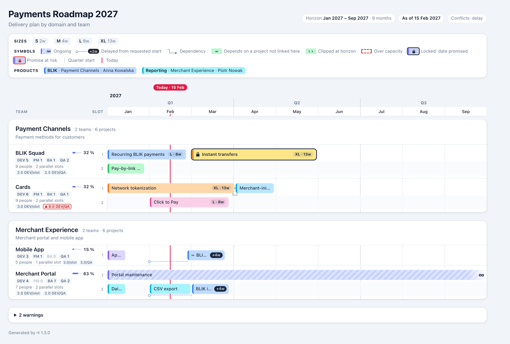
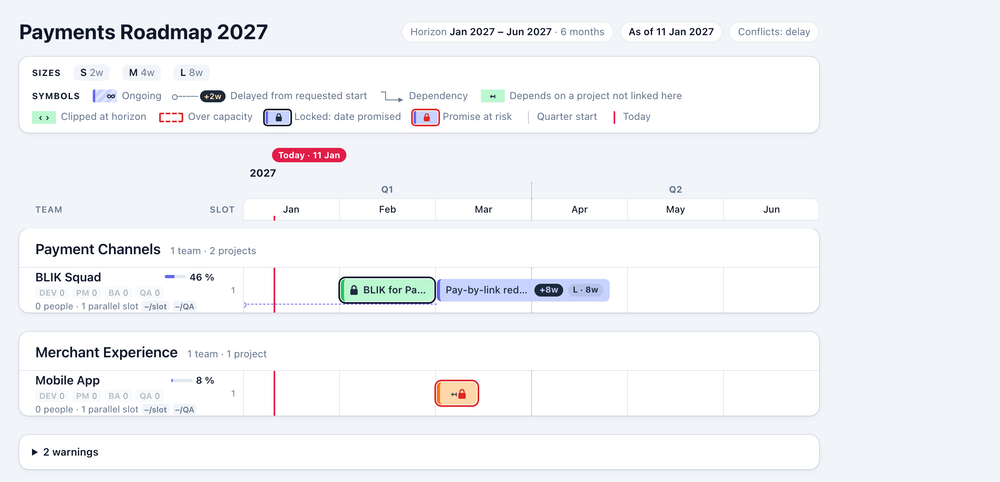
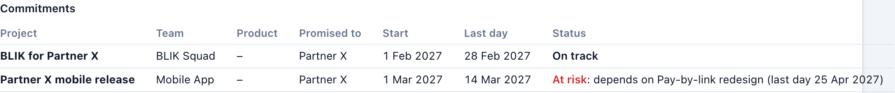
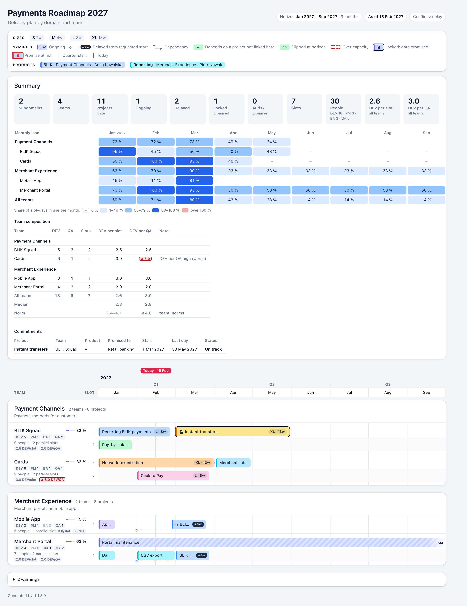

# rt — User Manual

**rt** turns one hand-written YAML file into a delivery roadmap: a single HTML page that shows each team as a
swimlane, each project as a bar on a month-scaled timeline, grouped by domain, with quarters, a Today line,
dependencies, products and delays. This manual starts with a three-line project and adds one idea at a time, so
each chapter builds on the previous one. The last chapters are reference material.

Covers **rt 1.3**. For a one-page summary, see the [cheat sheet](cheat-sheet.md).



---

## Contents

**Part I — Getting started**

1. [Install and first run](#1-install-and-first-run)
2. [Your first roadmap](#2-your-first-roadmap)

**Part II — Building a roadmap step by step**

3. [More projects: slots and priority](#3-more-projects-slots-and-priority)
4. [When a project starts: fixed, automatic, ongoing](#4-when-a-project-starts-fixed-automatic-ongoing)
5. [The timeline: horizon, today and page settings](#5-the-timeline-horizon-today-and-page-settings)
6. [Several teams and domains](#6-several-teams-and-domains)
7. [Dependencies](#7-dependencies)
8. [Products](#8-products)
9. [Colours](#9-colours)
10. [Team capacity and team indicators](#10-team-capacity-and-team-indicators)
11. [When there is more work than slots](#11-when-there-is-more-work-than-slots)
12. [Locking promised projects](#12-locking-promised-projects)
13. [Putting it all together](#13-putting-it-all-together)

**Part III — Working with rt**

14. [Reading the roadmap page](#14-reading-the-roadmap-page)
15. [Checking a file and fixing errors](#15-checking-a-file-and-fixing-errors)
16. [Importing projects from a spreadsheet](#16-importing-projects-from-a-spreadsheet)
17. [Pipelines, automation and the plan JSON](#17-pipelines-automation-and-the-plan-json)
18. [Editor support](#18-editor-support)
19. [Tips, YAML pitfalls and FAQ](#19-tips-yaml-pitfalls-and-faq)

**Part IV — Reference**

20. [Input fields](#20-input-fields)
21. [Commands and options](#21-commands-and-options)
22. [Diagnostics](#22-diagnostics)
23. [Colour palette](#23-colour-palette)

---

# Part I — Getting started

## 1. Install and first run

rt is a command-line program. Install it once:

```bash
uv tool install rt-roadmap
```

(or `pipx install rt-roadmap`). Check it works:

```bash
rt --version
```

The fastest way to see what rt does is to let it write a fully commented example and render it:

```bash
rt init
rt render roadmap.yaml
```

`rt init` writes `roadmap.yaml` (a Polish payments roadmap with every feature in use). `rt render` writes
`roadmap.html` next to it. Open the HTML file in any browser — it needs no internet connection, no server and no
JavaScript, and it prints on A3 landscape.

> **Tip.** `rt init --minimal` writes the smallest valid file instead. `rt init` never overwrites an existing
> file unless you add `--force`.

## 2. Your first roadmap

A roadmap file always has five parts: the format **version**, a **roadmap** title, the **sizes** you estimate
with, the **subdomains** (domains) with their **teams**, and the **projects**. Here is the smallest useful file:

```yaml
version: 1                       # always 1

roadmap:
  title: Payments Roadmap 2027   # shown at the top of the page

sizes:                           # t-shirt sizes, in WEEKS
  S: 2
  M: 4
  L: 8

subdomains:                      # business areas; each is a section on the page
  - id: channels
    name: Payment Channels
    teams:                       # the teams inside this area
      - id: blik
        name: BLIK Squad
        parallel_projects: 1     # how many projects the team runs at once

projects:
  - name: Recurring BLIK payments
    team: blik                   # the team id from above
    size: L                      # 8 weeks
    start: 2027-01               # requested start month
```

Save it as `roadmap.yaml` and render it:

```bash
rt render roadmap.yaml
```

```
rt: wrote roadmap.html — 1 subdomain, 1 team, 1 project, 0 warnings
```

The page shows one section, *Payment Channels*, with one swimlane, *BLIK Squad*, and one bar from 1 January
2027, eight weeks long (it ends on 25 February; 26 February is the first free day).

### The building blocks

| Concept | What it is | In the file |
| --- | --- | --- |
| **Subdomain** (domain) | A business area. Drawn as a card on the page holding its teams. | `subdomains[]` |
| **Team** | A delivery unit inside one subdomain. | `subdomains[].teams[]` |
| **Slot** | One of a team's parallel lanes. A slot runs one project at a time. | `parallel_projects` |
| **Size** | A label you estimate with, mapped to an exact number of weeks. | `sizes` |
| **Project** | A unit of work done by **one** team. | `projects[]` |

### Ids and names

Subdomains and teams have an **`id`** and a **`name`**:

- The **id** is a short technical handle used to refer to the thing from elsewhere in the file (`team: blik`).
  It must start with a lowercase letter or digit and may contain lowercase letters, digits, `-` and `_` (up to
  40 characters). Team ids must be unique across the whole file.
- The **name** is what people read on the page. It may contain spaces, capitals and Polish letters
  (`Płatności cykliczne`).

Projects only need a `name`; an `id` is optional and becomes useful in [chapter 7](#7-dependencies).

### Indentation in one minute

YAML uses indentation (spaces, never tabs) to nest things. A `-` starts a list item. These two forms are the
same; use whichever reads better:

```yaml
sizes:
  S: 2
  M: 4
```

```yaml
sizes: { S: 2, M: 4 }
```

Everything after ` #` on a line is a comment.

---

# Part II — Building a roadmap step by step

## 3. More projects: slots and priority

Add a second project for the same team, also requested for January:

```yaml
projects:
  - name: Recurring BLIK payments
    team: blik
    size: L
    start: 2027-01
  - name: Pay-by-link redesign
    team: blik
    size: M
    start: 2027-01
```

BLIK Squad has `parallel_projects: 1`, so it can run only one project at a time. rt reports:

```
roadmap.yaml:21:5: warning W001: project "Pay-by-link redesign" delayed 56 days (requested 2027-01-01,
starts 2027-02-26): no free slot in team "blik"
```

The redesign waits until the first project ends. On the page it gets a `+8w` pill and a dashed line back to the
month you asked for, so the delay is visible at a glance.

Give the team a second slot:

```yaml
      - id: blik
        name: BLIK Squad
        parallel_projects: 2
```

Now both projects start on 1 January, one in each lane, and the warning disappears.

### How rt places projects

rt walks the project list **from top to bottom** and puts each project into the **lowest-numbered slot** that is
free at the **earliest possible date**. Three consequences matter in practice:

1. **File order is priority.** A project higher in the list gets the first pick of free slots. If something
   matters more, move it up.
2. **Durations are exact.** A size of `M: 4` is 28 calendar days. Weekends and holidays are not modelled.
3. **Later projects may backfill.** If a later project fits into a gap before an earlier one, it takes the gap.
   Position on the timeline is not the same as position in the file.

A project never takes more than one slot, and a team never runs more projects at once than it has slots
(unless you ask for that — see [chapter 11](#11-when-there-is-more-work-than-slots)). The one exception to "file
order is priority" is a **locked** project, whose date has been promised: rt places it before everything else
([chapter 12](#12-locking-promised-projects)).

## 4. When a project starts: fixed, automatic, ongoing

A project starts in one of three ways.

### Fixed start — `start: YYYY-MM`

The project is requested for the first day of that month. If no slot is free then, rt starts it later and
reports a **delay** (W001). Use this for work with a real date: a regulatory deadline, a committed launch. When
the date has been **promised** to someone and must not move, lock it as well
([chapter 12](#12-locking-promised-projects)).

### Automatic start — no `start`

Leave `start` out and the project starts **as soon as a slot is free** (and its dependencies are done). An
automatic project is never "delayed" — it has no requested date to be late against. Use this for a backlog:
"do this next, whenever the team is free".

### Ongoing — `ongoing: true` instead of `size`

Some work never ends: maintenance, support, an operations rota. Mark it `ongoing: true` and give it **no size**.
It holds one slot permanently from its start; the bar fades out to the right and shows `∞`.

```yaml
projects:
  - name: Recurring BLIK payments
    team: blik
    size: L
    start: 2027-01           # fixed start
  - name: Pay-by-link redesign
    team: blik
    size: M
    start: 2027-01
  - name: Refund API clean-up
    team: blik
    size: S                  # no start: first free slot
  - name: Channel maintenance
    team: blik
    ongoing: true            # never ends; no size
    start: 2027-04
  - name: Instant transfers
    team: blik
    size: L
    start: 2027-03
```

With two slots this schedules as follows: the redesign ends on 28 January, so the clean-up starts automatically
on 29 January in lane 2; maintenance takes lane 1 from April for good; instant transfers run in lane 2 from
March.

Every project needs **exactly one** of `size` or `ongoing: true` (error E032 otherwise).

> **Careful with ongoing work.** A team with one slot and one ongoing project can never do anything else after
> the ongoing project starts; rt stops with error E060. Give the team another slot, or model maintenance as a
> sized project.

### Where automatic projects begin

Automatic projects need a date to start looking from — the **anchor**. It is the first month of the horizon if
you set one ([chapter 5](#5-the-timeline-horizon-today-and-page-settings)), otherwise the first day of the
current month. If your file has automatic projects, set `roadmap.horizon.start` so the result does not change
from month to month.

## 5. The timeline: horizon, today and page settings

The `roadmap` block controls what the page shows:

```yaml
roadmap:
  title: Payments Roadmap 2027
  subtitle: Delivery plan by domain and team    # optional second line
  horizon:
    start: 2027-01           # first month shown; also the anchor for automatic projects
    end: 2027-12             # last month shown (inclusive)
  today: 2027-01-11          # where the red Today line is drawn
  month_width: 120           # pixels per month column, 60–400
  content_language: pl       # language of your names and descriptions
```

All fields except `title` are optional.

| Field | Without it | Why set it |
| --- | --- | --- |
| `horizon.start` / `horizon.end` | rt picks the range from the projects: from the earliest start to the latest end, at least 6 months, at most 120 | To show a fixed year or quarter; to make automatic projects reproducible |
| `today` | The computer's date when you run rt | The Today line and the anchor stay fixed, so the same file always gives the same page |
| `month_width` | 120 px | Wider months make short bars readable; narrower months fit long plans on screen |
| `content_language` | none | Correct hyphenation and screen-reader pronunciation of Polish (or other) names |

You can write the horizon on one line: `horizon: { start: 2027-01, end: 2027-12 }`.

### Projects outside the horizon

Scheduling always uses **all** projects; the horizon only decides what is drawn.

- A bar that starts before the horizon is cut at the left edge and shows `‹` (warning W002).
- A bar that ends after the horizon is cut at the right edge and shows `›` (W003). Ongoing bars simply
  continue.
- A project entirely outside is not drawn at all (W004), but it still occupies its slot.

### Trying another view without editing the file

Command-line options override the file:

```bash
rt render roadmap.yaml --from 2027-04 --to 2027-06       # just Q2
rt render roadmap.yaml --today 2027-03-01                 # move the Today line
```

## 6. Several teams and domains

Real roadmaps have several business areas, each with several teams. Add them to `subdomains`:

```yaml
subdomains:
  - id: channels
    name: Payment Channels
    description: Payment methods for customers     # shown under the section title
    teams:
      - id: blik
        name: BLIK Squad
        parallel_projects: 2
      - id: cards
        name: Cards
        parallel_projects: 2

  - id: merchant
    name: Merchant Experience
    teams:
      - id: app
        name: Mobile App
        parallel_projects: 1
      - id: portal
        name: Merchant Portal
        parallel_projects: 2
```

Points to remember:

- **Order is kept.** Sections and teams appear on the page in the order you write them; rt never sorts.
- **Team ids are unique across the whole file**, not just within a subdomain, because projects refer to teams
  by id alone (`team: portal`).
- **A subdomain groups teams; it does not schedule anything.** Only a team's slots limit how much work runs at
  once.
- A project always belongs to exactly one team and is drawn in that team's swimlane. Work shared by two teams
  is two projects — see [chapter 8](#8-products) for how to keep them together visually.

It helps to group the `projects` list by team with comments; rt does not require it, but humans do:

```yaml
projects:
  # --- Payment Channels / BLIK Squad ---
  - name: Recurring BLIK payments
    team: blik
    size: L
    start: 2027-01

  # --- Merchant Experience / Mobile App ---
  - name: App widgets
    team: app
    size: S
```

## 7. Dependencies

A dependency says "this project cannot start before that one has **finished**" (finish-to-start). Write it with
`depends_on`:

```yaml
projects:
  - id: blik-recurring                 # an id makes the project easy to refer to
    name: Recurring BLIK payments
    team: blik
    size: L
    start: 2027-01

  - name: BLIK in the mobile app
    team: app                          # another team, even another domain, is fine
    size: M
    start: 2027-02
    depends_on: [blik-recurring]       # starts only after it ends

  - name: App widgets
    team: app
    size: S
    depends_on: BLIK in the mobile app # a single item may be written without [ ]
```

The recurring payments end on 25 February, so *BLIK in the mobile app* starts on 26 February — 25 days after
the February start it asked for:

```
warning W001: project "BLIK in the mobile app" delayed 25 days (requested 2027-02-01, starts 2027-02-26):
waiting for dependencies
```

*App widgets* has no `start`, so it simply follows on 26 March without a warning.

### Rules

| Rule | Error if broken |
| --- | --- |
| Refer to a project by its `id`, or by its `name` if that name is unique in the whole file | E034 unknown, E035 ambiguous |
| The project you depend on must be written **above** in the file | E037 |
| You cannot depend on an ongoing project (it never finishes) | E036 |
| A project cannot depend on itself | E037 |

Because dependencies always point upwards, cycles are impossible. Give projects that others depend on an `id`:
ids survive renaming, names do not.

There is no lag or lead time: the dependent project may start on the very day the other one finishes. A
project may depend on several others (`depends_on: [a, b]`); it waits for the last of them.

### How dependencies appear

- When both bars are in the same domain card, an arrow connects them.
- When they are in different domains (as above), no line is drawn; the dependent bar shows `↤` at its left edge.
- The tooltip always lists them: *After: Recurring BLIK payments (Payment Channels › BLIK Squad)*.
- The W001 message tells you the reason for a delay: *waiting for dependencies*, *no free slot*, or both.

## 8. Products

A **product** groups projects that belong together — often across several teams — and is **owned by one
domain**. All bars of a product share one colour, so you can follow, say, "BLIK" across the whole page, and the
legend lists each product with its owner.

Define products in a top-level `products` list, then tag projects with `product`:

```yaml
products:
  - id: blik
    name: BLIK
    domain: channels                   # the owning domain: a subdomain id
    owner: Anna Kowalska               # optional, shown in the legend
    description: BLIK payments in every channel   # optional, legend tooltip
  - id: reports
    name: Reporting
    domain: merchant

projects:
  - id: blik-recurring
    name: Recurring BLIK payments
    team: blik
    product: blik                      # BLIK colour
    size: L
    start: 2027-01
  - name: BLIK in the mobile app
    team: app                          # a team in another domain — still the BLIK product
    product: blik
    size: M
    depends_on: [blik-recurring]
  - name: BLIK in the portal
    team: portal
    product: blik
    size: M
    start: 2027-02
  - name: Daily report
    team: portal
    product: reports
    size: S
    start: 2027-01
```

What changes on the page:

- The legend gets a **Products** row: `BLIK · Payment Channels · Anna Kowalska`.
- Every BLIK bar has the same colour, wherever its team sits.
- Each bar's tooltip adds *Product: BLIK · owned by Payment Channels (Anna Kowalska)*.
- Bars stay in the swimlane of the team **doing** the work; the product only adds the colour and the label.

Products are optional. Projects without `product` are *standalone* and coloured automatically, as before. A
product without any project gives warning W013.

**Product vs subdomain.** A subdomain is *who does the work* (where the teams sit). A product is *what the work
is for* (whose budget, whose roadmap). One product can span teams of several domains; its `domain` names the
one that owns it.

## 9. Colours

You normally do not choose colours. rt colours bars so that bars next to each other (in the same lane or in the
lane directly above or below, closer than two weeks) **never share a colour**, and spreads colours evenly. The
same file always produces the same colours.

When you want a fixed colour, pin it with `color`, using a palette name or a hex code:

```yaml
products:
  - id: reports
    name: Reporting
    domain: merchant
    color: amber-deep           # pins the product's colour

projects:
  - name: CSV export
    team: portal
    product: reports
    size: M
    start: 2027-03
    color: sky                  # a project pin wins over its product's colour
  - name: Security audit
    team: portal
    size: S
    color: "#FFD6A5"            # hex codes need quotes ("#" starts a comment)
```

How colours are chosen:

1. A project's own `color` always wins.
2. Product bars take the product colour: the product's `color`, else an automatic one from the "product" part
   of the palette (entries 10–31), so products rarely look like standalone bars.
3. Standalone bars get the first ten palette colours (entries 0–9), avoiding their neighbours.

Red is deliberately not in the palette: it is reserved for over-capacity outlines, the Today line and warning
chips. The full palette is in [chapter 23](#23-colour-palette).

Pins can clash. If two pinned (or product) bars sit next to each other with the same colour, rt warns W009;
remove a pin. To make "next to each other" stricter or looser, set the gap in days:

```yaml
scheduling:
  adjacency_gap_days: 14        # 0–90; bars closer than this get different colours
```

## 10. Team capacity and team indicators

### Capacity

Each team can record its head count per role:

```yaml
      - id: blik
        name: BLIK Squad
        parallel_projects: 2
        capacity: { developers: 5, product_managers: 1, analysts: 1, testers: 2 }
```

All four roles are optional (default 0). Capacity is **for display and comparison only — it never changes the
schedule.** Only `parallel_projects` limits how much a team runs at once. The team label shows the roles as
badges (`DEV 5  PM 1  BA 1  QA 2`), the total of people, the number of slots, and the team's utilisation.

### Team indicators

From capacity rt derives two ratios that make team composition comparable across the roadmap:

| Indicator | Formula | Reads as |
| --- | --- | --- |
| **DEV per slot** | developers ÷ `parallel_projects` | How many developers stand behind each project the team runs at once |
| **DEV per QA** | developers ÷ testers | How many developers one tester has to keep up with |

They appear as two chips under each team name (`2.5 DEV/slot  2.5 DEV/QA`). For **both, higher is worse**:

- a value clearly **above** normal gets a red chip with `▲` (e.g. testing is a bottleneck);
- a value clearly **below** normal gets a green chip with `▼` (the healthier side);
- a team with developers but **no testers** gets a red `! no QA` chip;
- a team without `capacity` is left out of the comparison.

**What "normal" means.** By default, rt compares each team with the **median** of all teams: a value more than
50 % above or below the median is marked. This needs at least three teams with a value; with fewer, nothing is
marked.

**Your own targets.** If your organisation has norms, write them once for the whole roadmap; they replace the
median rule for that indicator:

```yaml
team_norms:
  devs_per_slot: { min: 2, max: 3 }    # either bound may be left out
  devs_per_qa: { max: 4 }
```

With this, a team with 6 developers and 1 tester (6.0 DEV/QA) is marked red `▲`; a team exactly on a bound is
not marked. Indicators never produce warnings and never affect `--strict`.

`rt render --summary` adds a **Team composition** table with every team's values, the totals, the median and
the norm (see [chapter 14](#14-reading-the-roadmap-page)).

## 11. When there is more work than slots

By default rt **delays** projects that do not fit (W001). Two other modes are available, set in the file or on
the command line:

```yaml
scheduling:
  on_conflict: delay      # delay (default) | overflow | error
```

```bash
rt render roadmap.yaml --on-conflict overflow
```

| Mode | What happens to a project with a `start` that finds no free slot | Use it to |
| --- | --- | --- |
| `delay` | Starts later, when a slot frees up (W001) | See realistic dates |
| `overflow` | Starts on time in an extra **overflow lane** (`+1`, `+2`…) drawn red-hatched, bar outlined in dashed red (W011) | See how much extra capacity the wish-list needs |
| `error` | rt stops with E061 for every conflict, writes nothing, exit code 3 | Enforce in CI that the plan fits the teams |

Automatic projects (no `start`) always wait for a free slot, in every mode. Dependencies are honoured in every
mode. Locked projects never cause E061 and are never delayed: they keep their date in every mode (next chapter).

Example with one slot and two January projects, in `overflow` mode:

```
warning W011: project "Pay-by-link redesign" exceeds team "blik" capacity; placed in overflow lane +1
```

and in `error` mode:

```
error E061: project "Pay-by-link redesign" needs a slot on 2027-01-01 but team "blik" has 1 of 1 busy
```

## 12. Locking promised projects

Some dates are not a plan but a **promise**: a launch agreed with a partner, a date given to a customer or to the
business. Mark such a project `locked: true`. rt then treats its start month as fixed: the bar never moves, and
everything else is scheduled around it. Optionally record who the date was promised to:

```yaml
version: 1
roadmap:
  title: Payments Roadmap 2027
  horizon: { start: 2027-01, end: 2027-06 }
  today: 2027-01-11
sizes: { S: 2, M: 4, L: 8 }
subdomains:
  - id: channels
    name: Payment Channels
    teams:
      - id: blik
        name: BLIK Squad
        parallel_projects: 1
  - id: merchant
    name: Merchant Experience
    teams:
      - id: app
        name: Mobile App
        parallel_projects: 1
projects:
  - name: Pay-by-link redesign
    team: blik
    size: L
    start: 2027-01
  - name: BLIK for Partner X
    team: blik
    size: M
    start: 2027-02
    locked: true                 # promised: never moved
    promised_to: Partner X       # optional
  - name: Partner X mobile release
    team: app
    size: S
    start: 2027-03
    locked: true
    promised_to: Partner X
    depends_on: [Pay-by-link redesign]
```



### What a lock does

1. **Locked projects go first.** Before anything else, rt places every locked project exactly on the first day of
   its `start` month. *BLIK for Partner X* keeps 1 February even though it is written **below** the redesign.
2. **Everything else goes around them.** Unlocked projects are then scheduled as usual (file order, first free
   slot). Here the redesign no longer fits in January–February and moves to 1 March:

   ```
   warning W001: project "Pay-by-link redesign" delayed 59 days (requested 2027-01-01, starts 2027-03-01):
   no free slot in team "blik"
   ```

3. **A locked project is never delayed.** If its promise cannot be kept, the bar still stays at its date. It is
   marked **at risk** and rt warns:

   ```
   warning W015: locked project "Partner X mobile release" cannot keep its promised start 2027-03-01:
   depends on "Pay-by-link redesign", which ends 2027-04-26
   ```

A promise is at risk in two situations:

| Situation | Example | What you see |
| --- | --- | --- |
| A project it depends on ends after its start | The redesign ends in April, the release was promised for March | Red frame and padlock; W015 names the late dependency |
| Other locked projects already take every slot of the team | Three promises for the same month in a two-slot team | The last one sits in a red-hatched `+1` lane; W015 says the team is full |

To resolve a risk, move the dependency earlier (put it higher in the file, or lock it too), give the team another
slot, or go back to whoever the date was promised to. rt will not move the promise for you.

### On the page

- **Locked:** a dark solid frame around the bar and a padlock before its name.
- **Promise at risk:** the frame and padlock turn red; wide bars also show a red `! at risk` label.
- Very short locked bars show only the padlock; hover for the details.
- The tooltip adds `Locked: promised to Partner X · start fixed 1 Feb 2027`, and for a bar at risk the reason,
  for example `Promise at risk: depends on Pay-by-link redesign (last day 25 Apr 2027)`.
- The legend explains both symbols (only when the file has locked projects).

`rt render --summary` adds two counters, **Locked** and **At risk**, and a **Commitments** table: every promise
with its team, product, who it was promised to, its dates and its status. It is the list to show to stakeholders.



### Rules

| Rule | Error if broken |
| --- | --- |
| A locked project needs a `start` month (a promise needs a date) | E050 |
| `promised_to` is allowed only together with `locked: true` | E051 |
| `locked` is `true` or `false` (not `1`, `yes`) | E011 |
| `promised_to` is 1–100 characters | E012 |

Ongoing work can be locked too (for example support promised from a given month). Locking never changes a bar's
colour. Lock only real promises: every lock takes a slot away from the rest of the plan.

## 13. Putting it all together

The complete example below uses everything from Part II. It produces the page shown at the top of this manual.

```yaml
# yaml-language-server: $schema=./roadmap.schema.json
version: 1

roadmap:
  title: Payments Roadmap 2027
  subtitle: Delivery plan by domain and team
  horizon: { start: 2027-01, end: 2027-09 }
  today: 2027-02-15

sizes:              # weeks
  S: 2
  M: 4
  L: 8
  XL: 13

scheduling:
  on_conflict: delay

team_norms:
  devs_per_qa: { max: 4 }

subdomains:
  - id: channels
    name: Payment Channels
    description: Payment methods for customers
    teams:
      - id: blik
        name: BLIK Squad
        parallel_projects: 2
        capacity: { developers: 5, product_managers: 1, analysts: 1, testers: 2 }
      - id: cards
        name: Cards
        parallel_projects: 2
        capacity: { developers: 6, product_managers: 1, analysts: 1, testers: 1 }

  - id: merchant
    name: Merchant Experience
    description: Merchant portal and mobile app
    teams:
      - id: app
        name: Mobile App
        parallel_projects: 1
        capacity: { developers: 3, product_managers: 1, testers: 1 }
      - id: portal
        name: Merchant Portal
        parallel_projects: 2
        capacity: { developers: 4, analysts: 1, testers: 2 }

products:
  - id: blik
    name: BLIK
    domain: channels
    owner: Anna Kowalska
    description: BLIK payments in every channel
  - id: reports
    name: Reporting
    domain: merchant
    owner: Piotr Nowak

projects:
  # --- BLIK Squad ---
  - id: blik-recurring
    name: Recurring BLIK payments
    team: blik
    product: blik
    size: L
    start: 2027-01
    description: Subscriptions and other recurring BLIK payments
  - name: Pay-by-link redesign
    team: blik
    size: M
    start: 2027-01
  - name: Instant transfers
    team: blik
    size: XL
    start: 2027-03
    locked: true                       # date promised to the business
    promised_to: Retail banking

  # --- Cards ---
  - id: tokens
    name: Network tokenization
    team: cards
    size: XL
    start: 2027-01
  - name: Click to Pay
    team: cards
    size: L
    start: 2027-02
  - name: Merchant-initiated card payments
    team: cards
    size: M
    depends_on: [tokens]

  # --- Mobile App ---
  - name: BLIK in the mobile app
    team: app
    product: blik
    size: M
    start: 2027-02
    depends_on: [blik-recurring]
  - name: App widgets
    team: app
    size: S

  # --- Merchant Portal ---
  - name: Portal maintenance
    team: portal
    ongoing: true
    start: 2027-01
  - name: Daily report
    team: portal
    product: reports
    size: S
    start: 2027-01
  - name: CSV export
    team: portal
    product: reports
    size: M
    start: 2027-02
  - name: BLIK in the portal
    team: portal
    product: blik
    size: M
    start: 2027-02
```

```
roadmap.yaml:96:5: warning W001: project "BLIK in the mobile app" delayed 25 days (requested 2027-02-01,
starts 2027-02-26): waiting for dependencies
roadmap.yaml:121:5: warning W001: project "BLIK in the portal" delayed 28 days (requested 2027-02-01,
starts 2027-03-01): no free slot in team "portal"
rt: wrote roadmap.html — 2 subdomains, 4 teams, 12 projects, 2 warnings
```

What to notice in the result:

- *Merchant-initiated card payments* follows *Network tokenization* with an arrow (same domain).
- *BLIK in the mobile app* waits for a project in another domain, so it shows `↤` and a `+4w` delay pill.
- *App widgets* has no start and no dependency, so it fills the free January gap in the Mobile App lane before
  the BLIK work — backfill.
- *Portal maintenance* holds one Merchant Portal slot for good, so the portal's other three projects share the
  second slot and *BLIK in the portal* is pushed to March.
- All BLIK bars are blue, across three teams in two domains.
- Cards has 6 developers per tester, above the norm of 4, so its DEV/QA chip is red `▲ 6.0`.
- *Instant transfers* is locked: promised to retail banking for March, it has a dark frame and a padlock, and
  `--summary` lists it under Commitments as on track.

---

# Part III — Working with rt

## 14. Reading the roadmap page

From top to bottom, the page contains:

1. **Header** — title, subtitle, horizon, "As of" date (`today`) and the conflict mode.
2. **Legend** — your sizes with their weeks, the meaning of every symbol, and (when you have products) one chip
   per product: name · owning domain · owner.
3. **Summary** — only with `--summary`, described below.
4. **Timeline header** — years, quarters (Q1–Q4) and months. It stays on screen while you scroll down.
5. **One card per subdomain**, with a swimlane per team.
6. **Warnings** — a collapsed "N warnings" panel listing every warning.
7. **Footer** — the rt version.

### The team label

`BLIK Squad 32 %` — team name and **utilisation** (share of the team's slot-days within the horizon that are
busy). Below: role badges (`DEV 5 PM 1 BA 1 QA 2`, a zero badge is dimmed), number of people, number of slots,
and the two indicator chips of [chapter 10](#10-team-capacity-and-team-indicators). Each slot is a numbered row;
empty slots are drawn too, so free capacity is visible.

### Bars and symbols

| You see | Meaning |
| --- | --- |
| Name and a `M · 4w` chip | A sized project. Short bars show only the name, very short ones no text — hover for details |
| Stripes, fade and `∞` at the right | Ongoing project |
| `+4w` pill and a dashed line with a hollow circle | Delayed; the line starts at the requested start |
| Arrow between bars | Dependency within the same domain |
| `↤` at the left edge | Depends on a project not linked by an arrow (another domain or not drawn) |
| `‹` or `›` with a square edge | Cut at the edge of the horizon |
| Dashed red outline, red-hatched `+1` lane | Over capacity (overflow mode) |
| Dark solid frame and a padlock | Locked: the start was promised |
| Red solid frame and a red padlock, `! at risk` | A promise that cannot be kept (see the tooltip) |
| Dotted vertical line | Quarter start; a solid darker line marks a new year |
| Red vertical line | Today |

**Hover over a bar** (or tab to it with the keyboard) to see its full details: team, product, size, requested
and actual start, last day, delay, dependencies and description.

### The summary (`--summary`)

```bash
rt render roadmap.yaml --summary
```



- **KPI tiles** — number of subdomains, teams, finite and ongoing projects, delayed projects, locked projects and
  promises at risk (when there are locks), slots, people
  (with the role breakdown), and DEV per slot / DEV per QA for all teams together.
- **Monthly load** — for every team, every subdomain and all teams together, the share of slot-days in use per
  month. Columns line up with the timeline. Shading: `–` for 0 %, light blue below 50 %, mid blue 50–79 %, dark
  blue 80–100 %, red above 100 % (only in overflow mode, or when a locked promise is at risk in a full team).
  Hover a cell for the slot-day count.
- **Team composition** — DEV, QA, slots and both indicators per team, plus All teams, Median and the norm or
  normal range; a Notes column spells out each mark ("DEV per QA high (worse)", "no QA").
- **Commitments** — only when the file has locked projects: every promise with its team, product, who it was
  promised to, start, last day and status (*On track* or *At risk* with the reason). Two KPI tiles, Locked and
  At risk, count them.

### Printing and dark mode

Print from the browser: the page is set up for **A3 landscape**, keeps colours and never splits a team across
pages. When your system uses dark mode, the page follows it automatically.

## 15. Checking a file and fixing errors

`rt validate` checks and schedules a file without writing anything:

```bash
rt validate roadmap.yaml
```

Every problem is reported with file, line and column, in one sorted list — rt does not stop at the first error:

```
roadmap.yaml:9:9: error E010: team #1 of subdomain "channels" is missing required field "parallel_projects"
roadmap.yaml:11:9: error E002: unknown key "paralel_projects" in team "blik" (did you mean "parallel_projects"?)
roadmap.yaml:16:18: error E037: project "Mobile release" depends on "Web checkout", which appears later (line 17); move "Web checkout" above it
roadmap.yaml:18:11: error E030: project "Web checkout" references unknown team "blikk" (did you mean "blik"?)
roadmap.yaml:19:11: error E031: project "Web checkout" uses size "XL", not defined in sizes (S, M)
roadmap.yaml:20:12: error E013: invalid month "2027-13"; expected YYYY-MM
```

- **Errors** (`E…`) stop rt: nothing is written, exit code 1 (or 3 for scheduling errors E060/E061).
- **Warnings** (`W…`) are reported, and the page is still written. They also appear in the page's warnings
  panel.
- `--strict` turns warnings into errors — useful in CI, or before you publish a plan.
- `-q` hides warnings and the summary line.
- `--format json` prints the diagnostics as JSON on standard output, for tools.

The most common mistakes and their fixes:

| You see | Usually means | Fix |
| --- | --- | --- |
| E002 unknown key … did you mean | A typo in a field name | Use the suggested name |
| E030 unknown team | `team:` holds a name or a typo instead of the team **id** | Use the id |
| E031 unknown size | Size label not in `sizes` (labels are case-sensitive: `M` ≠ `m`) | Add the size or fix the label |
| E032 | Both `size` and `ongoing: true`, or neither | Keep exactly one |
| E034 / E035 | Dependency name misspelt, or the name is used by two projects | Give the project an `id` and use it |
| E037 | Dependency written below the project that needs it | Move it above |
| E050 / E051 | A locked project without `start`; `promised_to` without `locked: true` | Add the start month; add the lock |
| E060 | Every slot of the team is taken by ongoing work | Add a slot or end the ongoing project |
| E001 invalid YAML | Indentation, a tab, or a `: ` inside an unquoted name | See [chapter 19](#19-tips-yaml-pitfalls-and-faq) |
| W001 delayed | Not enough slots, or waiting for a dependency — the message says which | Reorder, add a slot, move the project to another team, or change the start |
| W015 promise at risk | A locked project's dependency ends too late, or locked work fills the team | Move the dependency earlier, add a slot, or renegotiate the promise |

The complete list is in [chapter 22](#22-diagnostics).

## 16. Importing projects from a spreadsheet

Project lists often live in a spreadsheet. `rt convert` turns a CSV export into an rt YAML file.

### The simplest case

A CSV with just two columns, `name` and `size`:

```csv
name,size
Merchant onboarding wizard,L
Reports and exports v2,M
Self-service refunds,S
```

```bash
rt convert projects.csv -o roadmap.yaml
```

Without anything else, rt generates a **skeleton** around the projects: title "Roadmap", sizes XS 1, S 2, M 4,
L 8, XL 13, XXL 26, one subdomain "Roadmap" and one team "Team" with one slot. Change these with `--title`,
`--sizes "S=2,M=4,L=8"`, `--slots 2`; if the CSV has `team` and `subdomain` columns, one team per distinct value
is created.

### The usual case: a base file

Keep teams, sizes, products and settings in a hand-maintained **base file** (an rt YAML file, its `projects`
may be empty), and let the spreadsheet supply only the projects:

```yaml
# teams.base.yaml
version: 1
roadmap:
  title: Payments Roadmap 2027
  horizon: { start: 2027-01, end: 2027-12 }
sizes: { S: 2, M: 4, L: 8 }
subdomains:
  - id: channels
    name: Payment Channels
    teams:
      - { id: blik, name: BLIK Squad, parallel_projects: 2 }
  - id: merchant
    name: Merchant Experience
    teams:
      - { id: app, name: Mobile App, parallel_projects: 1 }
      - { id: portal, name: Merchant Portal, parallel_projects: 2 }
products:
  - { id: blik, name: BLIK, domain: channels }
projects: []
```

```csv
Project,Size,Team,Product,Start,Depends on,Ongoing,Owner
Recurring BLIK payments,L,blik,BLIK,2027-01,,,Anna
Pay-by-link redesign,M,BLIK Squad,,01.01.2027,,,Piotr
BLIK in the mobile app,M,app,blik,,Recurring BLIK payments,,Ewa
Portal maintenance,,portal,,2027-04,,yes,Ewa
```

```bash
rt convert projects.csv --base teams.base.yaml --map "Project=name,Depends on=depends_on" -o roadmap.yaml
```

```
projects.csv:1:8: warning W020: column "Owner" is not used and was ignored
rt: wrote roadmap.yaml — 4 projects from projects.csv, 1 warning
```

The result is the base file (comments and order kept) with its `projects` replaced by:

```yaml
projects:
  - name: Recurring BLIK payments
    team: blik
    product: blik
    start: 2027-01
    size: L
  - name: Pay-by-link redesign
    team: blik
    start: 2027-01
    size: M
  - name: BLIK in the mobile app
    team: app
    product: blik
    size: M
    depends_on: [Recurring BLIK payments]
  - name: Portal maintenance
    team: portal
    start: 2027-04
    ongoing: true
```

Notice that rt resolved the team name `BLIK Squad` and the product name `BLIK` to their ids, and turned
`01.01.2027` into `2027-01`. Use `--append` to keep the base file's own projects and add the CSV rows after them.

### Columns

| Column | Required | Accepts |
| --- | --- | --- |
| `name` | yes | Project name |
| `size` | yes (the column) | A size label; may be empty for an ongoing row |
| `team` | no | Team id or team name |
| `product` | no | Product id or name (only with `--base`) |
| `subdomain` | no | Subdomain name (only without `--base`, for the skeleton) |
| `start` | no | `2027-03`, `2027-03-01` or `01.03.2027` — only the month is kept (W021 if the day is not 1) |
| `ongoing` | no | `true/yes/y/1/x/tak/t` or `false/no/n/0/nie`/empty |
| `locked` | no | The same values as `ongoing`, so `1`/`0` work |
| `promised_to` | no | Who the date was promised to (only for locked rows) |
| `depends_on` | no | Ids or names separated by `\|` |
| `id`, `description`, `color` | no | As in YAML |

Headers match case-insensitively. Rename other headers with `--map "Projekt=name,Rozmiar=size,Zespół=team"`.
Columns rt does not know (like *Owner*) are ignored with W020, so you can export the sheet as it is.

### Spreadsheet export tips

- In Excel choose **CSV UTF-8**. Plain "CSV" on Polish Windows uses another encoding: add `--encoding cp1250`.
- Comma, semicolon and tab delimiters are detected automatically; force one with `--delimiter semicolon`.
- Rows with no team use `--team <id>`, or the base file's only team.
- Re-running convert on the same input produces byte-identical YAML, so it diffs cleanly in version control.

## 17. Pipelines, automation and the plan JSON

Every rt command reads standard input when no file is given and writes its content to standard output when
asked, while all messages go to standard error. Commands therefore chain:

```bash
# spreadsheet → YAML → HTML in one go
rt convert projects.csv --base teams.base.yaml | rt render -o roadmap.html

# check a converted file without saving it
rt convert projects.csv --base teams.base.yaml | rt validate

# read from stdin, write HTML to stdout
cat roadmap.yaml | rt render --summary > roadmap.html
```

If a command fails, it writes nothing to standard output, so the next command sees empty input and stops with
E001 *input is empty (did the previous command fail?)* rather than processing half a file.

### The plan JSON

`--plan <file>` writes the computed schedule as JSON: every project with its lane, dates, delay and reason,
flags and colour; every team with utilisation and indicators; the monthly load; and the warnings. `-` sends it
to standard output:

```bash
# list delayed projects
rt render roadmap.yaml -o roadmap.html --plan - | jq -r '.projects[] | select(.delay_days > 0) | .name'

# list promises at risk and why
rt validate roadmap.yaml --plan - | jq -r '.projects[] | select(.lock_risk) | "\(.name): \(.lock_risk)"'

# list teams with an indicator mark
rt validate roadmap.yaml --plan - | jq -r '.teams[] | select(.indicator_flags != []) | "\(.id): \(.indicator_flags)"'
```

### In CI

```bash
rt validate roadmap.yaml --strict --on-conflict error --today 2027-01-15
```

fails the build on any error, any warning (a promise at risk included), or any unlocked project that does not fit
the teams. Exit codes:

| Code | Meaning |
| --- | --- |
| 0 | Success (warnings allowed unless `--strict`) |
| 1 | Validation or conversion errors, empty input, or warnings under `--strict` |
| 2 | Usage error (unknown option, missing input…) |
| 3 | Scheduling error (E060, E061) |
| 4 | File cannot be read or written; `rt init` target exists |

**Reproducible output.** The same file, options and `today` always give a byte-identical page and plan. Set
`today` in the file (or pass `--today`) when you commit generated pages.

## 18. Editor support

rt ships a JSON Schema of the input format. Save it next to your file and reference it in the first line:

```bash
rt schema -o roadmap.schema.json
```

```yaml
# yaml-language-server: $schema=./roadmap.schema.json
version: 1
```

Editors with YAML language support (for example VS Code with the Red Hat YAML extension) then offer completion,
hover help and live validation of field names and value formats while you type. rt's own validation still
checks the rules a schema cannot, such as references between teams and projects.

## 19. Tips, YAML pitfalls and FAQ

### YAML pitfalls

| Pitfall | Example | Fix |
| --- | --- | --- |
| ` #` starts a comment — **silently** | `name: Fix #12 issues` becomes "Fix" | Quote: `name: "Fix #12 issues"` |
| `: ` inside a value | `name: Phase 2: rollout` → E001 invalid YAML | Quote: `name: "Phase 2: rollout"` |
| Hex colour | `color: #FDE68A` is an empty value plus a comment | `color: "#FDE68A"` |
| Tabs | Indenting with a tab → E001 | Use spaces only (2 per level) |
| Wrong indentation | A project field less indented than `- name:` | Align fields under the first one after `-` |

Things that are **not** a problem: Polish letters anywhere; `no`, `yes`, `on`, `off` (they stay text, so a team
called `NO` is fine); months and dates with or without quotes.

### Planning tips

- **Put what matters most first.** File order is priority for free slots.
- **Use `start` for real commitments, leave it out for the backlog.** Delays then mean something.
- **Lock only what was promised.** `locked: true` makes everything else yield to that project.
- **Give projects referenced in `depends_on` an `id`.**
- **Model shared work as one project per team**, tied together with the same `product` and, if one must
  finish first, a `depends_on`.
- **Set `today` and `horizon.start`** to keep the page stable between runs.
- **Read the W001 reason.** *no free slot* → capacity problem (reorder, add a slot, move to another team);
  *waiting for dependencies* → sequencing problem.
- **Try "what if" quickly:** change `parallel_projects`, or run with `--on-conflict overflow` to see how many
  extra lanes the wish-list would need.

### FAQ

**Does capacity (developers, testers) change the schedule?** No. Only `parallel_projects` does. Capacity is
shown on the page and feeds the team indicators.

**Can a project start in the middle of a month?** Not as a requested start: `start` is a month. A project that
depends on another, or has no start, may begin on any day when the slot or dependency frees up.

**Are holidays or working days considered?** No. A week is 7 calendar days. Choose size values that already
include your typical slack.

**How do I make sure a promised date never moves?** Add `locked: true` (and `promised_to`). rt keeps it at its
start month and tells you with W015 when the rest of the plan puts the promise at risk.

**Can one project be done by two teams?** No — split it into one project per team.

**Can I write the file in JSON?** Yes, JSON is valid YAML. YAML is easier to write by hand and allows comments.

**Can I write names in Polish?** Yes, everywhere. Set `content_language: pl`. The page's own labels stay
English.

**Why does a later project appear before an earlier one?** Backfill: it fit into a gap the earlier project
could not use.

**Why are two bars the same colour?** They belong to the same product, or one or both are pinned with `color`,
or the palette ran out for that cluster (W007). Otherwise neighbours always differ.

**Can rt read Excel files?** Not directly; export to CSV and use `rt convert`.

---

# Part IV — Reference

## 20. Input fields

**Top level**

| Field | Required | Content |
| --- | --- | --- |
| `version` | yes | Always `1` |
| `roadmap` | yes | Title and display settings |
| `sizes` | yes | Size label → weeks; at least one |
| `scheduling` | no | Conflict mode and colour gap |
| `team_norms` | no | Targets for team indicators |
| `subdomains` | yes | At least one; each with `teams` |
| `products` | no | Product groups |
| `projects` | yes | May be `[]` (warning W010) |

**`roadmap`**

| Field | Req. | Default | Rules |
| --- | --- | --- | --- |
| `title` | yes | — | 1–120 characters |
| `subtitle` | no | — | ≤ 200 characters |
| `horizon.start` | no | automatic | `YYYY-MM`; also the anchor for automatic projects |
| `horizon.end` | no | automatic | `YYYY-MM`, not before start, span ≤ 120 months |
| `today` | no | system date | `YYYY-MM-DD` |
| `month_width` | no | 120 | 60–400 px |
| `content_language` | no | — | Language tag such as `pl` |

**`sizes`** — keys: 1–8 letters, digits or `+`, case-sensitive; values: whole weeks 1–520. Written order = legend
order.

**`scheduling`**

| Field | Default | Values |
| --- | --- | --- |
| `on_conflict` | `delay` | `delay`, `overflow`, `error` |
| `adjacency_gap_days` | 14 | 0–90 |

**`team_norms`** — `devs_per_slot` and `devs_per_qa`, each `{ min, max }`; both bounds optional, numbers 0–999,
`min` ≤ `max`.

**`subdomains[]`**

| Field | Req. | Rules |
| --- | --- | --- |
| `id` | yes | Lowercase letters, digits, `-`, `_`; starts with letter/digit; ≤ 40; unique among subdomains |
| `name` | yes | 1–80 characters |
| `description` | no | ≤ 300 characters |
| `teams` | yes | List of teams |

**`subdomains[].teams[]`**

| Field | Req. | Rules |
| --- | --- | --- |
| `id` | yes | As above; unique across **all** teams |
| `name` | yes | 1–60 characters |
| `parallel_projects` | yes | 1–12 |
| `capacity.developers`, `.product_managers`, `.analysts`, `.testers` | no | 0–999, default 0 |

**`products[]`**

| Field | Req. | Rules |
| --- | --- | --- |
| `id` | yes | As above; unique among products |
| `name` | yes | 1–100 characters; unique among products |
| `domain` | yes | A subdomain id: the owning domain |
| `owner` | no | ≤ 100 characters |
| `description` | no | ≤ 500 characters |
| `color` | no | Palette name or `"#RRGGBB"` |

**`projects[]`**

| Field | Req. | Rules |
| --- | --- | --- |
| `id` | no | As above; unique among projects |
| `name` | yes | 1–100 characters; unique within its team |
| `team` | yes | A team id |
| `product` | no | A product id |
| `start` | no | `YYYY-MM`; omitted = automatic start |
| `size` | one of | A key of `sizes` |
| `ongoing` | one of | `true` |
| `locked` | no | `true` or `false`; `true` needs `start`: placed first, never moved |
| `promised_to` | no | 1–100 characters; only with `locked: true` |
| `depends_on` | no | Id or unique name, or a list of them; projects above, not ongoing |
| `description` | no | ≤ 500 characters; shown in the tooltip |
| `color` | no | Palette name or `"#RRGGBB"`; wins over the product colour |

Unknown fields are errors (E002), so typos never pass silently.

## 21. Commands and options

| Command | Purpose |
| --- | --- |
| `rt render [file] [options]` | Validate, schedule and write the HTML (default: `<file>.html`) |
| `rt validate [file] [options]` | Validate and schedule only; diagnostics on stderr |
| `rt convert [file.csv] [options]` | CSV project list → rt YAML (stdout by default) |
| `rt init [path \| -] [--minimal] [--force]` | Write a commented starter file (default `roadmap.yaml`) |
| `rt schema [-o path]` | Print the JSON Schema |
| `rt --version`, `rt <command> --help` | Version, help |

A missing file argument or `-` means standard input.

| Option | Commands | Meaning |
| --- | --- | --- |
| `-o, --output PATH` | render, convert, schema | Output file; `-` = stdout |
| `--summary` | render | Add KPIs, monthly load and team composition |
| `--from YYYY-MM`, `--to YYYY-MM` | render, validate | Override the horizon |
| `--today YYYY-MM-DD` | render, validate | Override `today` |
| `--on-conflict delay\|overflow\|error` | render, validate | Override the conflict mode |
| `--plan PATH` | render, validate | Also write the plan JSON; `-` = stdout |
| `--strict` | render, validate, convert | Warnings count as errors |
| `--format text\|json` | validate | Diagnostics as text (stderr) or JSON (stdout) |
| `-q, --quiet` | all | Hide warnings and the summary line |
| `--base PATH` | convert | Base YAML with settings, teams, products |
| `--append` | convert | Keep the base file's projects, add CSV rows after |
| `--map "Src=col,…"` | convert | Rename CSV headers |
| `--team ID\|NAME` | convert | Team for rows without one |
| `--title`, `--sizes "S=2,M=4"`, `--slots N` | convert | Skeleton settings (without `--base` only) |
| `--encoding NAME` | convert | CSV encoding, e.g. `cp1250` |
| `--delimiter comma\|semicolon\|tab` | convert | Skip delimiter detection |
| `--force` | init | Overwrite an existing file |

Command-line options win over values in the file, which win over defaults.

## 22. Diagnostics

Format: `file:line:column: error|warning CODE: message`.

**Errors**

| Code | Meaning |
| --- | --- |
| E001 | Invalid YAML, empty input, or input over 5 MB |
| E002 | Unknown key (with "did you mean") |
| E003 | Duplicate key in one mapping |
| E004 | `version` missing or not 1 |
| E010 | Required field missing |
| E011 | Wrong type (e.g. text where a number is needed) |
| E012 | Value out of range or id pattern mismatch |
| E013 | Invalid month or date |
| E020 / E021 | Duplicate subdomain id / team id |
| E022 / E023 | Duplicate project name in a team / duplicate project id |
| E024 / E025 | Duplicate product id / product name |
| E030 | Unknown team |
| E031 | Unknown size |
| E032 | Not exactly one of `size` and `ongoing: true` |
| E033 | Invalid colour |
| E034 / E035 | Unknown dependency / ambiguous dependency name |
| E036 | Dependency on an ongoing project |
| E037 | Dependency on itself or on a project further down |
| E038 / E039 | Unknown product / product domain is not a subdomain id |
| E040 / E041 | Horizon end before start / horizon longer than 120 months |
| E042 / E043 | `sizes` empty / `subdomains` empty |
| E050 | Locked project without `start` |
| E051 | `promised_to` without `locked: true` |
| E060 | Cannot schedule: every slot held by ongoing projects (exit 3) |
| E061 | Conflict in `error` mode (exit 3) |
| E101–E107 | CSV problems: unterminated quote, encoding, missing column, duplicate column, no team for a row, too many cells, team in two subdomains |

**Warnings**

| Code | Meaning |
| --- | --- |
| W001 | Project starts later than requested (reason given) |
| W002 / W003 / W004 | Cut at the left / cut at the right / entirely outside the horizon |
| W005 | Team has no projects |
| W006 | Subdomain has no teams |
| W007 | Palette exhausted: a bar shares a colour with a neighbour |
| W008 | Team capacity adds up to 0 people |
| W009 | Two adjacent pinned or product bars share a colour |
| W010 | No projects |
| W011 | Overflow lane used (overflow mode) |
| W012 | Automatic horizon capped at 120 months |
| W013 | Product has no projects |
| W014 | More than 32 products; some share a colour |
| W015 | Locked project cannot keep its promised start (late dependency or full team) |
| W020 | CSV column ignored |
| W021 | Day of a CSV start date dropped |

## 23. Colour palette

Use any of these names in `color:` of a project or product. Entries 0–9 are used for standalone bars, 10–31
first for products.

| # | Name | Fill | # | Name | Fill |
| --- | --- | --- | --- | --- | --- |
| 0 | `indigo` | `#C7D2FE` | 16 | `stone` | `#E7E5E4` |
| 1 | `green` | `#BBF7D0` | 17 | `sand-deep` | `#D6C3A5` |
| 2 | `orange` | `#FED7AA` | 18 | `indigo-deep` | `#A5B4FC` |
| 3 | `pink` | `#FBCFE8` | 19 | `green-deep` | `#86EFAC` |
| 4 | `sky` | `#BAE6FD` | 20 | `orange-deep` | `#FDBA74` |
| 5 | `amber` | `#FDE68A` | 21 | `pink-deep` | `#F9A8D4` |
| 6 | `violet` | `#DDD6FE` | 22 | `sky-deep` | `#7DD3FC` |
| 7 | `teal` | `#99F6E4` | 23 | `amber-deep` | `#FCD34D` |
| 8 | `lime` | `#D9F99D` | 24 | `violet-deep` | `#C4B5FD` |
| 9 | `sand` | `#EADBC8` | 25 | `teal-deep` | `#5EEAD4` |
| 10 | `blue` | `#BFDBFE` | 26 | `lime-deep` | `#BEF264` |
| 11 | `cyan` | `#A5F3FC` | 27 | `blue-deep` | `#93C5FD` |
| 12 | `emerald` | `#A7F3D0` | 28 | `cyan-deep` | `#67E8F9` |
| 13 | `yellow` | `#FEF08A` | 29 | `emerald-deep` | `#6EE7B7` |
| 14 | `fuchsia` | `#F5D0FE` | 30 | `fuchsia-deep` | `#F0ABFC` |
| 15 | `purple` | `#E9D5FF` | 31 | `purple-deep` | `#D8B4FE` |

A custom `"#RRGGBB"` gets a darker border of the same hue and dark or white text, whichever reads better.
