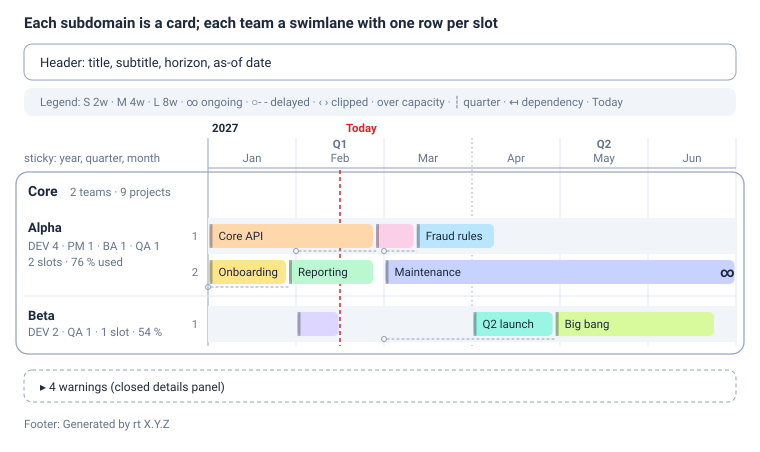

# rt — Roadmap Renderer CLI — Requirements Specification

Oct 23, 2026 · @Artur

Revised Oct 29, 2026: CR-1 products (sections 2, 3.2, 3.4, 5, 6.6, 7.2, 7.10, 8, 9, 11.7, 12.1, 13.2).
Revised Oct 31, 2026: CR-2 team composition indicators (sections 2, 3.1, 3.2, 7.5, 7.8, 7.10, 7.12, 7.13, 8, 11.8, 12.1).
Revised Nov 7, 2026: CR-3 locked projects (sections 1.3, 2, 3.1, 3.2, 3.4, 4.2, 4.6, 6.6, 7.2, 7.6, 7.8, 7.10, 7.12, 8, 9, 11.9, 12.1, 13.2).

## 1. Introduction

**rt (roadmap tool)** is a command-line tool that reads one human-written YAML file (from a path or standard input) describing teams, t-shirt sizes and projects, schedules the projects into each team's parallel slots, and writes one self-contained HTML file showing the roadmap as month-scaled swimlanes grouped by subdomain.

### 1.1 Audience

| Reader | Uses this document to |
| --- | --- |
| Architect agent | Choose stack and module boundaries within the constraints of sections 6, 7 and 10 |
| Developer agent | Implement parsing, validation, scheduling, colouring and rendering exactly as specified |
| Tester agent | Derive test cases from the acceptance scenarios (section 11), the error catalogue (section 9) and the fixture files |

### 1.2 Conventions

- **MUST / SHOULD / MAY** follow RFC 2119. MUST = required for acceptance; SHOULD = expected unless there is a documented reason; MAY = optional.
- Requirement IDs: `IN-` input, `SC-` scheduling, `CO-` colour, `CLI-` command line, `OUT-` HTML output, `PL-` plan JSON, `NF-` non-functional. Error codes `E###`, warning codes `W###`.
- Dates are ISO 8601. A **month** is written `YYYY-MM`; a **date** is `YYYY-MM-DD`. All time is calendar time with no time zones.
- Intervals are half-open: `[start, end)` — the end date is the first day the project no longer runs.

### 1.3 Scope

**In scope (version 1):**

- Input: one YAML file (JSON also accepted, being valid YAML 1.2), read from a path or from standard input. Project names and other text may be in Polish.
- Definitions: subdomains, teams (role capacity, parallel project slots), t-shirt sizes in weeks, projects (name, size or ongoing, team, optional start month, optional dependencies, optional lock on a promised start), optional products (named groups of projects owned by one domain, drawn in one colour).
- Scheduling: deterministic slot assignment, locked projects first at their promised start, then all others in file order, honouring finish-to-start dependencies, with conflict handling (`delay`, `overflow` or `error`).
- Output: one HTML file with embedded CSS, no external resources, no JavaScript required; quarters labelled Q1–Q4; optional summary section with monthly load (`--summary`). Written to a file or to standard output.
- Command chaining: every command reads standard input and writes standard output, so commands combine with each other and with other tools in shell pipelines (section 6.5).
- Spreadsheet import: `rt convert` turns a CSV project list with named columns (at least project name and size) into a valid rt YAML file, optionally merged into a base file that holds teams and settings (sections 3.4, 6.6).
- Commands: `render`, `validate`, `convert`, `init`, `schema`. Optional plan JSON for testing.

**Out of scope (this iteration):** editing the roadmap in the browser; project status or percent complete; milestones; scheduling by role capacity (roles are displayed only); multiple input files; PDF/PNG export (browser printing covers it); a translated (Polish) page interface — page labels stay English while user text may be Polish; fiscal years different from calendar years; reading .xlsx or .ods files directly (export them to CSV first); converting YAML back to CSV; reading from project-management tools.

## 2. Glossary

| Term | Meaning |
| --- | --- |
| Subdomain | A business area (e.g. Payment Channels). Rendered as its own section; contains one or more teams. |
| Team | A delivery unit belonging to exactly one subdomain. Has role capacity and a number of parallel slots. |
| Role capacity | Head count per role: developers, product managers, analysts, testers. Displayed, not used for scheduling. |
| Slot | One of a team's `parallel_projects` lanes. A slot runs at most one project at any instant. |
| Overflow lane | An extra lane created only in `overflow` mode when no slot is free. Visibly marked as over capacity. |
| T-shirt size | A label (XS, S, M…) mapped to an exact whole number of weeks in the file. |
| Project | A unit of work with a name, a team, either a size or `ongoing: true`, and optionally a start month and dependencies. |
| Ongoing project | A project with no end (e.g. maintenance). Occupies its slot permanently from its start. |
| Product | A named group of projects owned by exactly one domain (a subdomain id). Its projects may run in teams of any subdomain; all its bars share the product's colour. |
| Owning domain | The subdomain that owns a project: its product's `domain`, or for a standalone project its team's subdomain. Shown in the tooltip and the legend; bars stay in the section of the team that does the work. |
| Standalone project | A project without `product`. Coloured from palette entries 0–9 as in version 1. |
| Team indicators | DEV per slot (developers ÷ `parallel_projects`) and DEV per QA (developers ÷ testers): ratios that compare team composition across the roadmap (section 7.13). |
| Locked project | A project with `locked: true`: its start month has been promised to the business, a customer or a partner. It is placed before all other projects, exactly at its start, and never moved (SC-14). |
| Promise at risk | A locked project that cannot keep its date: a dependency ends after its start, or other locked work fills every slot of its team (SC-15). It stays at its date and is flagged. |
| Dependency | Finish-to-start link: a project cannot start before each project it depends on has ended. |
| Anchor | The earliest date for projects without a `start`: the horizon start if given, else the 1st of the current month (SC-12). |
| Auto-start project | A project without `start`; it starts as soon as its dependencies have ended and a slot is free. |
| Requested start | First day of the project's `start` month, as written in the file. Absent for auto-start projects. |
| Earliest start | The later of the requested start (or anchor) and the end of the last dependency. |
| Actual start | The date the scheduler places the project. |
| Delay | Actual start minus requested start, in days, caused by dependencies, by lack of a free slot, or both. |
| Horizon | The month range shown on the timeline (first day of start month to last day of end month). |
| Quarter | Calendar quarter: Q1 = Jan–Mar, Q2 = Apr–Jun, Q3 = Jul–Sep, Q4 = Oct–Dec. |
| Load | Share of a team's slot-days occupied in a month; shown in the summary section. |
| Clipping | Drawing only the part of a bar that falls inside the horizon. |
| Plan | The computed schedule: every project's slot, dates, colour and flags. |
| Standard streams | stdin (input piped into rt), stdout (content rt produces), stderr (messages). Written as - on the command line. |
| Command chaining | Connecting commands with a shell pipe (\|) so the stdout of one becomes the stdin of the next. |
| CSV project list | A spreadsheet export, one project per row, with a header row of column names; input of rt convert. |
| Base file | A hand-maintained rt YAML file with settings, sizes, subdomains and teams, into which rt convert puts the CSV projects. |
| Skeleton | The settings, sizes, subdomains and teams rt convert generates when no base file is given. |

## 3. Input file format

The input is **YAML 1.2**, file extension `.yaml` or `.yml`, encoded UTF-8. YAML wins because it is the only common format that is easy to write by hand, supports comments, keeps list order (which defines project sequence) and nests naturally.

| Format | Hand-writable | Comments | Nested lists | Verdict |
| --- | --- | --- | --- | --- |
| YAML 1.2 | Yes, minimal punctuation | Yes | Natural | **Chosen** |
| TOML | Yes | Yes | Awkward (`[[subdomains.teams]]`) | Rejected |
| JSON | Noisy (quotes, commas) | No | Yes | Accepted as input (valid YAML 1.2), not promoted |
| CSV / spreadsheet | Yes for flat rows | No | No | Not an input of render; project lists convert to YAML with rt convert (3.4, 6.6) |

A JSON Schema (`roadmap.schema.json`) is shipped with the tool so editors such as VS Code can auto-complete and validate while typing (via the `# yaml-language-server: $schema=...` header comment).

### 3.1 Top-level structure

```yaml
version: 1                 # required, integer, must be 1
roadmap:                   # required: title and display settings
  title: Payments Roadmap 2027
  horizon: { start: 2027-01, end: 2027-12 }
  today: 2026-10-23
  content_language: pl     # language of names and descriptions
sizes:                     # required: t-shirt size -> weeks
  S: 2
  M: 4
  L: 8
scheduling:                # optional
  on_conflict: delay
team_norms:                # optional: bands for the team indicators (7.13)
  devs_per_qa: { max: 4 }
subdomains:                # required: render order = file order
  - id: channels
    name: Payment Channels
    teams:
      - id: blik
        name: BLIK Squad
        parallel_projects: 2
        capacity: { developers: 5, product_managers: 1, analysts: 1, testers: 2 }
products:                  # optional: legend order = file order
  - id: blik-online
    name: BLIK online
    domain: channels       # the owning domain: a subdomain id
    owner: Anna Kowalska
projects:                  # required: sequence = file order
  - id: blik-recurring
    name: Płatności cykliczne BLIK
    team: blik
    product: blik-online   # optional: the bar takes the product's colour
    size: L
    start: 2027-01
    locked: true           # optional: the start is promised; never moved
    promised_to: Allegro   # optional, only with locked: true
  - name: Pay-by-link redesign
    team: blik
    size: M                # no start: as soon as a slot is free
  - name: BLIK in mobile app
    team: blik
    size: M
    depends_on: [blik-recurring]   # starts after it ends
  - name: Channel maintenance
    team: blik
    ongoing: true
    start: 2027-01
```

### 3.2 Field reference

**`roadmap`** (required object)

| Field | Type | Req. | Default | Rules |
| --- | --- | --- | --- | --- |
| `title` | string | Yes | — | 1–120 characters |
| `subtitle` | string | No | none | ≤ 200 characters |
| `horizon.start` | month | No | auto (SC-9) | `YYYY-MM`; also the anchor for auto-start projects (SC-12) |
| `horizon.end` | month | No | auto (SC-9) | `YYYY-MM`, ≥ `horizon.start`, ≤ 120 months span |
| `today` | date | No | system date at run time | `YYYY-MM-DD`; drives the Today line and the anchor, and makes output reproducible |
| `month_width` | integer px | No | 120 | 60–400 |
| `content_language` | string | No | none | BCP 47 tag such as `pl`; written as `lang` on every element that holds user text (OUT-27) |

**`sizes`** (required map, at least one entry)

| Part | Type | Rules |
| --- | --- | --- |
| key | string | Matches `^[A-Za-z0-9+]{1,8}$`, case-sensitive (`M` ≠ `m`). Declaration order = legend order. |
| value | integer | Weeks, 1–520. No fractions. |

**`scheduling`** (optional object)

| Field | Type | Default | Rules |
| --- | --- | --- | --- |
| `on_conflict` | enum | `delay` | `delay` \| `overflow` \| `error` (SC-5 to SC-7) |
| `adjacency_gap_days` | integer | 14 | 0–90; used by colouring (CO-2) |

**`team_norms`** (optional object; roadmap-wide bands for the team indicators of section 7.13)

| Field | Type | Rules |
| --- | --- | --- |
| `devs_per_slot.min`, `devs_per_slot.max` | number | Optional, 0–999, integer or decimal; `min` ≤ `max` (else E012 at `max`) |
| `devs_per_qa.min`, `devs_per_qa.max` | number | Same |

An indicator with a band is marked against its written bounds only (a missing bound is not checked); an indicator without one is compared with the median (TI-5).

**`subdomains[]`** (required list, ≥ 1 item)

| Field | Type | Req. | Rules |
| --- | --- | --- | --- |
| `id` | string | Yes | `^[a-z0-9][a-z0-9_-]{0,39}$`, unique among subdomains |
| `name` | string | Yes | 1–80 characters |
| `description` | string | No | ≤ 300 characters, shown under the section title |
| `teams` | list | Yes | ≥ 1 team (an empty list is warning W006 and the section shows "No teams") |

**`subdomains[].teams[]`**

| Field | Type | Req. | Rules |
| --- | --- | --- | --- |
| `id` | string | Yes | Same pattern as subdomain id, unique across **all** teams in the file |
| `name` | string | Yes | 1–60 characters |
| `parallel_projects` | integer | Yes | 1–12; number of slots |
| `capacity.developers` | integer | No (0) | 0–999 |
| `capacity.product_managers` | integer | No (0) | 0–999 |
| `capacity.analysts` | integer | No (0) | 0–999 |
| `capacity.testers` | integer | No (0) | 0–999 |

**`products[]`** (optional list; absent = empty; file order = legend order)

| Field | Type | Req. | Rules |
| --- | --- | --- | --- |
| `id` | string | Yes | `^[a-z0-9][a-z0-9_-]{0,39}$`, unique among products (a namespace of its own: a product may share an id with a team) |
| `name` | string | Yes | 1–100 characters, unique among products |
| `domain` | string | Yes | Must equal an existing subdomain id: the owning domain. The product's projects are owned by that domain, whichever team does the work |
| `owner` | string | No | ≤ 100 characters, e.g. the product owner's name; shown in the legend and tooltip |
| `description` | string | No | ≤ 500 characters, shown in the legend chip's tooltip |
| `color` | string | No | Palette name (section 5.3) or `#RRGGBB`; pins the product colour |

**`projects[]`** (required list; may be empty, which is W010)

| Field | Type | Req. | Rules |
| --- | --- | --- | --- |
| `id` | string | No | `^[a-z0-9][a-z0-9_-]{0,39}$`, unique among projects; a stable handle for `depends_on` |
| `name` | string | Yes | 1–100 characters, unique within its team; any Unicode, including Polish |
| `team` | string | Yes | Must equal an existing team `id` |
| `product` | string | No | Must equal a product `id`. A project without it is standalone; its owning domain is its team's subdomain. Bars are always drawn in the section of their team |
| `start` | month | No | `YYYY-MM`; requested start = 1st of that month. Omitted → auto-start (SC-12) |
| `size` | string | One of | Must be a key of `sizes` |
| `ongoing` | boolean | One of | `true` marks a never-ending project. Exactly one of `size` or `ongoing: true` MUST be present. |
| `locked` | boolean | No (`false`) | `true` or `false` (other values are E011). `true` marks the start month as promised: the project is placed first and never moved (SC-14). A locked project MUST have a `start` (E050). Ongoing projects may be locked |
| `promised_to` | string | No | 1–100 characters: who the date was promised to. Allowed only with `locked: true` (E051). Shown in the tooltip and the Commitments table |
| `depends_on` | list of strings | No | Each item is a project `id`, or a project `name` that is unique in the whole file. Every referenced project MUST appear earlier in the file, MUST NOT be ongoing, and MUST NOT be the project itself. Cross-team and cross-subdomain references are allowed. |
| `description` | string | No | ≤ 500 characters, shown in the tooltip |
| `color` | string | No | Palette name (section 5.3) or `#RRGGBB`; pins the colour, also over the product's colour |

### 3.3 Parsing rules

- **IN-1** The parser MUST be YAML 1.2 compliant, so `yes`, `no`, `on`, `off` stay strings and `NO` is never `false`.
- **IN-2** Months and dates MAY be written quoted or unquoted. If the YAML library turns `2026-10-23` into a date object, the tool MUST accept it as the same value.
- **IN-3** Unknown keys at any level are error E002, with a "did you mean" suggestion when an allowed key is within edit distance 2 (e.g. `paralel_projects`).
- **IN-4** Duplicate keys in one mapping are error E003.
- **IN-5** Every error MUST report file, line and column of the offending node.
- **IN-6** Validation collects all errors before exiting; it does not stop at the first.
- **IN-7** Project sequence is the physical order of `projects[]`. Teams and subdomains render in physical order. No sort is ever applied.
- **IN-8** Strings are Unicode. Polish letters (ąćęłńóśźż ĄĆĘŁŃÓŚŹŻ) MUST round-trip unchanged into the HTML, the plan JSON and CLI messages, including on Windows consoles. Name matching (`depends_on`, uniqueness, "did you mean") is exact and case-sensitive after Unicode NFC normalisation, so `Płatności` typed with a combining accent matches the precomposed form.
- **IN-9** `depends_on` MAY be a single string instead of a list; it is treated as a one-item list. An empty list equals no dependencies.

### 3.4 CSV project list (input of `rt convert`)

A CSV project list holds one project per row under a header row of column names. Only the `name` and `size` columns are required, so a two-column spreadsheet export converts without any other file.

**File rules**

- **CV-1 Encoding.** UTF-8, with or without a byte-order mark (Excel's "CSV UTF-8" adds one), unless `--encoding` names another encoding such as `cp1250` (Excel's plain "CSV" on Polish Windows). Bytes that do not decode are error E102, with line, byte column and the hint `try --encoding cp1250`.
- **CV-2 Quoting (RFC 4180).** Fields may be enclosed in double quotes; `""` inside quotes is one quote character; a quoted field may contain the delimiter and line breaks. Lines end in LF or CRLF. An unterminated quote is error E101.
- **CV-3 Delimiter.** Comma, semicolon or tab, detected from the header line: count each candidate outside double quotes; the most frequent wins; ties go to comma, then semicolon, then tab; if none occurs the file has one column and comma is used. `--delimiter comma|semicolon|tab` overrides detection.
- **CV-4 Records.** The first record is the header. Records whose cells are all empty are skipped. A record with fewer cells than the header has the missing cells treated as empty. A record with more non-empty cells than there are header columns is error E106.
- **CV-5 Positions.** In diagnostics, the line is the physical line on which the record starts (header = line 1) and the column is the 1-based field number. Messages end with the header name, e.g. `[column "Zespół"]`.

**Columns** (order in the file is free)

| Column | Required | Content | Becomes YAML field |
| --- | --- | --- | --- |
| `name` | Yes | Project name | `name` |
| `size` | Yes (the column) | T-shirt label; a cell may be empty only when `ongoing` is true | `size` |
| `team` | No | Team id or team name | `team` (always written as the id) |
| `product` | No | Product id or product name; used only with a base file (CV-21) | `product` (always written as the id) |
| `subdomain` | No | Subdomain name; used only when no base file is given | — (skeleton, CV-14) |
| `start` | No | `YYYY-MM`, `YYYY-MM-DD` or `DD.MM.YYYY`; empty = auto-start | `start` (`YYYY-MM`) |
| `ongoing` | No | `true`, `yes`, `y`, `1`, `x`, `tak`, `t` or `false`, `no`, `n`, `0`, `nie`, empty; case-insensitive | `ongoing: true` when true, else omitted |
| `locked` | No | The same values as `ongoing` (so `1`/`0` work) | `locked: true` when true, else omitted |
| `promised_to` | No | Free text | `promised_to` |
| `depends_on` | No | Project ids or names separated by `\|` or line breaks | `depends_on` (flow list) |
| `id` | No | Project id | `id` |
| `description` | No | Free text | `description` |
| `color` | No | Palette name or `#RRGGBB` | `color` |

**Header and value rules**

- **CV-6 Header matching.** Header cells are trimmed, NFC-normalised and matched to the column names above case-insensitively. `--map "Projekt=name,Rozmiar=size"` renames source headers first (source matched case-insensitively); a target that is not a column name above is a usage error (exit 2).
- **CV-7 Header problems.** A missing `name` or `size` column is error E103, listing the headers found and suggesting `--map`. Two headers resolving to the same column is error E104. Any other header is warning W020 and its column is ignored, so owner or notes columns can stay in the export.
- **CV-8 Cells** are trimmed and NFC-normalised; an empty optional cell omits the field.
- **CV-9 Size.** Exact label match, else a unique case-insensitive match (`m` → `M`), else error E031. An empty size when `ongoing` is not true is error E032.
- **CV-10 Start.** `YYYY-MM-DD` and `DD.MM.YYYY` are reduced to their month; a day other than 01 gives warning W021. Any other value is error E013.
- **CV-11 Ongoing and locked.** A value outside the two lists is error E011.
- **CV-12 Dependencies** follow section 3.2: each item is a project id or a name unique in the result, and must refer to an earlier row (E034–E037).

Example `projects.pl.csv` (semicolon-delimited, UTF-8 with BOM, Polish headers, an ignored owner column):

```csv
Projekt;Rozmiar;Zespół;Start;Zależności;Ciągły;Opis;Właściciel
Płatności cykliczne BLIK;L;BLIK i przelewy;01.01.2027;;nie;"Subskrypcje; płatności cykliczne";Anna
BLIK w aplikacji;M;Aplikacja mobilna;;Płatności cykliczne BLIK;;;Piotr
Utrzymanie aplikacji;;Aplikacja mobilna;2027-02;;tak;;Ewa
Widżety Android;S;app;2027-03-15;;;;
"Portfele cyfrowe (Apple Pay; Google Pay)";M;BLIK i przelewy;;Płatności cykliczne BLIK|BLIK w aplikacji;;;Anna
```

## 4. Time model and scheduling

Every project gets a slot and an exact `[start, end)` date interval, computed deterministically: locked projects first, at their promised start (SC-14), then walking the other projects in file order and putting each one into the lowest-numbered slot that is free at the earliest possible date.

### 4.1 Time model

- **SC-1** Requested start = day 1 of the `start` month (`2027-03` → `2027-03-01`).
- **SC-2** Duration in days = `sizes[size] × 7`. End = actual start + duration days (exclusive). The last working day is `end − 1 day`. Ongoing projects have end = +∞.
- **SC-3** Two intervals `[a, b)` and `[c, d)` overlap if and only if `a < d` and `c < b`. Touching intervals (`b = c`) do **not** overlap, so a project may start the same day the previous one ends.
- **SC-4** Scheduling runs on **all** projects regardless of the horizon. A project outside the horizon still occupies its slot; only rendering is clipped (SC-10).

### 4.2 Slot assignment

- **SC-5 `delay` mode (default).** For each project in file order:
  1. Earliest start `E` = the later of the base date and the end of every project in `depends_on`. Base = requested start, or the anchor (SC-12) for auto-start projects.
  2. Build candidate dates: `E`, plus the end date of every finite interval already placed in this team's slots that is later than `E`. Sort ascending, remove duplicates.
  3. For each candidate `t` in order, for each slot `s = 1…N` in order: if `[t, t + duration)` overlaps nothing in slot `s`, place the project there and stop. (For ongoing projects the interval is `[t, ∞)`.)
  4. No candidate fits → error E060 (unschedulable — every slot is blocked by ongoing projects).
  5. If the project has a requested start and actual start > requested start: set flag `delayed`, record `delay_days`, emit W001, and set `delay_reason` = `dependency` (only `E` moved it), `capacity` (only a busy slot moved it) or `dependency+capacity` (both).
  6. Auto-start projects get flag `auto_start` and are never `delayed`.
- Because step 3 checks overlap against every interval, a later project MAY **backfill** a gap before an earlier-placed one in the same slot. File order sets priority, not left-to-right position.
- **SC-6 `overflow` mode.** Projects with a requested start try slots `1…N` at `E` only. If none is free, try existing overflow lanes in order, else create overflow lane `N+1`, `N+2`… Set flag `over_capacity`, emit W011. Dependencies are still honoured; a dependency that moves `E` still gives `delayed` with reason `dependency`.
- **SC-7 `error` mode.** As overflow, but each project that would need an overflow lane is error E061. All conflicts are collected and reported; no HTML is written; exit code 3.
- **SC-8** Slots are numbered from 1. Ties always go to the lowest slot number, then to the earliest date.
- **SC-12 Auto-start.** A project without `start` starts as soon as its dependencies have ended and a slot is free. Its base date (the anchor) is the 1st day of the horizon start month when the horizon start is given in the file or by `--from`, otherwise the 1st day of the month of `today`. In every mode, auto-start projects are placed with the SC-5 search, so they never use overflow lanes and never cause E061.
- **SC-13 Dependencies.** Links are finish-to-start: a project may start on the end date (exclusive) of its last dependency. Dependencies MUST point to projects earlier in the file, so they are always placed first and cycles cannot occur. A dependency that lies outside the horizon still counts.
- **SC-14 Locked projects first (CR-3).** Scheduling runs in two passes. **Pass 1** places every locked project, in file order, at `R` = day 1 of its `start` month, whatever its dependencies: into the lowest regular slot free for `[R, R + duration)` (`[R, ∞)` when ongoing); only locked projects are on the board then. When no regular slot is free, it goes into the first overflow lane free at `R`, or a new one, in every `on_conflict` mode. **Pass 2** places every unlocked project in file order exactly as SC-5 to SC-8 and SC-12 describe, with the locked intervals already in the slots: unlocked work goes around them (a requested start on a locked interval gives a `capacity` delay). A locked project is never `delayed`: `delay_days` 0, `delay_reason` `null`.
- **SC-15 Promise at risk.** After both passes, a locked project's earliest start is `E = max(R, end of every dependency)`. Its `lock_risk` is `dependency` when `E > R`, `capacity` when it lies in an overflow lane, `dependency+capacity` for both, else `null`. A locked project with a lock risk has flag `at_risk` and gives W015 (instead of W011); it keeps its date. Locked projects never cause E061.

### 4.3 Horizon and visibility

- **SC-9 Automatic horizon.** Applied to each of `horizon.start` / `horizon.end` that is not given in the file or on the command line:
  - start = earliest start month of all projects, using the requested start where given and the actual start for auto-start projects (no projects → month of `today`);
  - end = latest month containing `end − 1 day` of any finite project, or the actual-start month of any ongoing project, whichever is later;
  - if the span is shorter than 6 months, end is extended to give 6 months; if longer than 120 months, end is cut to 120 months and W012 is emitted.
- **SC-10 Visibility.** With `H0` = first day of the horizon start month and `H1` = first day of the month after the horizon end, a project's visible interval is `[max(start, H0), min(end, H1))`.
  - Empty visible interval → project not drawn, W004 (it is still listed in the plan JSON).
  - `start < H0` → flag `clipped_left`, W002.
  - Finite `end > H1` → flag `clipped_right`, W003. Ongoing projects reaching `H1` get flag `continues` instead (no warning).

### 4.4 Worked example

Fixture `scheduling-worked-example.yaml`. Sizes S = 2 w, M = 4 w, L = 8 w. Team **Alpha** has 2 slots, team **Beta** has 1 slot, both in subdomain *Core*, mode `delay`. The table is the expected plan; the tester MUST assert it exactly.

| # | Project | Team | Size | Requested | Slot | Actual start | End (excl.) | Delay | Flags |
| --- | --- | --- | --- | --- | --- | --- | --- | --- | --- |
| 1 | Core API | Alpha | L | 2027-01-01 | 1 | 2027-01-01 | 2027-02-26 | 0 | — |
| 2 | Onboarding | Alpha | M | 2027-01-01 | 2 | 2027-01-01 | 2027-01-29 | 0 | — |
| 3 | Reporting | Alpha | M | 2027-01-01 | 2 | 2027-01-29 | 2027-02-26 | 28 d | delayed |
| 4 | Hotfix pack | Alpha | S | 2027-02-01 | 1 | 2027-02-26 | 2027-03-12 | 25 d | delayed |
| 5 | Maintenance | Alpha | ongoing | 2027-03-01 | 2 | 2027-03-01 | ∞ | 0 | continues |
| 6 | Fraud rules | Alpha | M | 2027-03-01 | 1 | 2027-03-12 | 2027-04-09 | 11 d | delayed |
| 7 | Q2 launch | Beta | M | 2027-04-01 | 1 | 2027-04-01 | 2027-04-29 | 0 | — |
| 8 | Quick win | Beta | S | 2027-02-01 | 1 | 2027-02-01 | 2027-02-15 | 0 | — (backfill) |
| 9 | Big bang | Beta | L | 2027-03-01 | 1 | 2027-04-29 | 2027-06-24 | 59 d | delayed |

Auto horizon is **2027-01 to 2027-06**: earliest request January; latest finite last day 2027-06-23. Project 4 shows the tie rule: both Alpha slots free on 2027-02-26, slot 1 wins. Project 8 shows backfill: it runs before project 7 although it comes after it in the file.

### 4.5 Worked example: dependencies and auto-start

Fixture `dependencies-example.yaml`. Sizes S = 2 w, M = 4 w, L = 8 w. Subdomain *Product*: team **API** (1 slot), team **Web** (2 slots). Subdomain *Platform*: team **Ops** (2 slots). Horizon start 2027-01 is given, so the anchor is 2027-01-01. The tester MUST assert this table and `dependencies-example.expected.json` exactly.

| # | Project | Team | Size | Requested | Depends on | Earliest | Slot | Actual start | End (excl.) | Delay | Reason | Flags |
| --- | --- | --- | --- | --- | --- | --- | --- | --- | --- | --- | --- | --- |
| 1 | API v2 | API | L | 2027-01-01 | — | 2027-01-01 | 1 | 2027-01-01 | 2027-02-26 | 0 | — | — |
| 2 | Web checkout | Web | M | 2027-01-01 | 1 | 2027-02-26 | 1 | 2027-02-26 | 2027-03-26 | 56 d | dependency | delayed |
| 3 | Design system | Web | M | — | — | 2027-01-01 | 1 | 2027-01-01 | 2027-01-29 | — | — | auto\_start (backfill) |
| 4 | Mobile release | Web | S | — | 2 | 2027-03-26 | 1 | 2027-03-26 | 2027-04-09 | — | — | auto\_start |
| 5 | Ops maintenance | Ops | ongoing | — | — | 2027-01-01 | 1 | 2027-01-01 | ∞ | — | — | auto\_start, continues |
| 6 | Load testing | Ops | S | 2027-02-01 | 1, 2 | 2027-03-26 | 2 | 2027-03-26 | 2027-04-09 | 53 d | dependency | delayed |
| 7 | Partner onboarding | Web | S | 2027-03-01 | 1 | 2027-03-01 | 2 | 2027-03-01 | 2027-03-15 | 0 | — | — |
| 8 | Release audit | Ops | S | 2027-02-01 | 2 | 2027-03-26 | 2 | 2027-04-09 | 2027-04-23 | 67 d | dependency+capacity | delayed |

Project 6 depends on a project in another subdomain (OUT-28 shows such links without a connector line). Project 7's dependency ended before its requested start, so it is not delayed. Project 8 waits 53 days for its dependency, then 14 more for a free Ops slot. Auto horizon end: latest last day 2027-04-22, extended to the 6-month minimum, so 2027-01 to 2027-06.

### 4.6 Worked example: locked projects

Fixture `lock-example.yaml` ("LE"). Sizes S = 2 w, M = 4 w, L = 8 w. Subdomain *Core*: team **Alpha** (1 slot), team **Beta** (2 slots). Horizon 2027-01 to 2027-06, today 2027-01-15, mode `delay`. The tester MUST assert this table and `lock-example.expected.json` exactly.

| # | Project | Team | Size | Requested | Locked (promised to) | Depends on | Pass | Lane | Actual start | End (excl.) | Delay | Lock risk | Flags |
| --- | --- | --- | --- | --- | --- | --- | --- | --- | --- | --- | --- | --- | --- |
| 1 | Core API | Alpha | L | 2027-01-01 | — | — | 2 | 1 | 2027-03-01 | 2027-04-26 | 59 d capacity | — | delayed |
| 2 | Partner launch | Alpha | M | 2027-02-01 | Partner X | — | 1 | 1 | 2027-02-01 | 2027-03-01 | 0 | — | locked |
| 3 | Mobile release | Beta | M | 2027-03-01 | Retail bank | 1 | 1 | 1 | 2027-03-01 | 2027-03-29 | 0 | dependency (earliest 2027-04-26) | at\_risk, locked |
| 4 | Data migration | Beta | S | 2027-03-01 | yes | — | 1 | 2 | 2027-03-01 | 2027-03-15 | 0 | — | locked |
| 5 | Audit | Beta | S | 2027-03-01 | Regulator | — | 1 | 3 (+1) | 2027-03-01 | 2027-03-15 | 0 | capacity | at\_risk, locked, over\_capacity |
| 6 | Reporting | Beta | M | 2027-03-01 | — | — | 2 | 2 | 2027-03-15 | 2027-04-12 | 14 d capacity | — | delayed |
| 7 | Polish | Beta | S | — | — | 2 | 2 | 1 | 2027-03-29 | 2027-04-12 | — | — | auto\_start |

Partner launch is written after Core API but keeps February; Core API yields. Mobile release keeps its promised 1 March although Core API now ends on 26 April (W015). Three locked projects ask for Beta's two slots on 1 March; Audit, written last, keeps its date in an overflow lane (W015, no W011). With `--on-conflict overflow`, Core API runs from 1 January in Alpha lane 2 (W011), so Mobile release is on track; Reporting takes Beta lane 4. With `--on-conflict error`, E061 is reported for Core API and Reporting only.

## 5. Colour assignment

Bars that touch or sit close to each other on screen never share a colour, solved as a graph-colouring problem over a fixed palette with a deterministic DSATUR algorithm that also spreads colours evenly. All bars of a product share one colour, so a product is recognisable across the whole roadmap; standalone bars are coloured from the first 10 palette entries exactly as in version 1.

### 5.1 Adjacency graph

- **CO-1** Nodes = every drawn bar (projects with a non-empty visible interval). For ongoing bars the visible end is `H1`.
- **CO-2** Lanes are numbered in render order **within each subdomain section**: team order from the file, slots `1…N`, then overflow lanes. Lanes in different subdomains are never adjacent (a section header separates them).
- **CO-3** Gap between bars A and B = `max(A.vis_start, B.vis_start) − min(A.vis_end, B.vis_end)` in days (negative = overlapping in time). A and B are adjacent when `gap ≤ adjacency_gap_days` (default 14) **and** either:
  - they are in the same lane (neighbours along a row), or
  - their lane numbers differ by exactly 1 (neighbours across rows, including the last slot of one team and the first slot of the next team).

### 5.2 Algorithm

- **CO-4** Bars are coloured in this order, and a colour once given is never changed:
  1. **Project pin.** A project with its own `color` uses it, also when it belongs to a product.
  2. **Product colour.** Every other project of a product uses the product colour: the product's `color` when given; otherwise products without a pin, in file order, take the lowest-index palette entry not yet taken by any product (pinned products included), scanning entries **10–31 first, then 0–9**, so for up to 22 automatic products a product colour never equals a colour that standalone bars use. When all 32 entries are taken, the next product takes the entry used by the fewest products, ties to the lowest index, and W014 names the products that share.
  3. **Standalone projects** are coloured by CO-5 **over entries 0–9 only**, treating the bars coloured in steps 1–2 as pre-coloured neighbours, so a standalone bar never takes the colour of an adjacent product bar (unless W007 applies).

  A palette name or a hex equal to a palette fill maps to that palette entry; any other hex is a custom colour that conflicts only with the same hex and takes no palette entry. Two adjacent pre-coloured bars (steps 1–2) with the same colour give W009, except when both belong to the same product: bars of one product share a colour by design and never cause W007 or W009.
- **CO-5** Then repeat until all bars are coloured (DSATUR over entries 0–9):
  1. Pick the uncoloured bar with the most distinct colours among its neighbours; ties → most neighbours in total; ties → earliest in file order.
  2. Allowed colours = entries 0–9 not used by any neighbour. Pick the one used **least so far across the whole roadmap** (pre-coloured bars count); ties → lowest palette index.
  3. No allowed colour → pick the entry of 0–9 minimising (neighbours already using it, global use count, palette index) and emit W007.
- **CO-6** The same input MUST always yield the same colours.
- **CO-7** Compatibility: a file without `products` and without palette names beyond the first 10 gets exactly the colours of version 1.

### 5.3 Palette

Soft fills with a strong left accent and one dark text colour `#1E293B`, giving at least 9:1 text contrast on entries 0–9 and at least 7:1 on entries 10–31 (WCAG AAA). Red is deliberately absent; it is reserved for over-capacity and Today markers and for worse team indicators (7.13). Any palette name may be used in `color:` of a project or a product.

| Index | Name | Fill | Accent (border) |
| --- | --- | --- | --- |
| 0 | indigo | `#C7D2FE` | `#6366F1` |
| 1 | green | `#BBF7D0` | `#22C55E` |
| 2 | orange | `#FED7AA` | `#F97316` |
| 3 | pink | `#FBCFE8` | `#EC4899` |
| 4 | sky | `#BAE6FD` | `#0EA5E9` |
| 5 | amber | `#FDE68A` | `#D97706` |
| 6 | violet | `#DDD6FE` | `#8B5CF6` |
| 7 | teal | `#99F6E4` | `#14B8A6` |
| 8 | lime | `#D9F99D` | `#65A30D` |
| 9 | sand | `#EADBC8` | `#A16207` |
| 10 | blue | `#BFDBFE` | `#3B82F6` |
| 11 | cyan | `#A5F3FC` | `#06B6D4` |
| 12 | emerald | `#A7F3D0` | `#10B981` |
| 13 | yellow | `#FEF08A` | `#CA8A04` |
| 14 | fuchsia | `#F5D0FE` | `#D946EF` |
| 15 | purple | `#E9D5FF` | `#A855F7` |
| 16 | stone | `#E7E5E4` | `#78716C` |
| 17 | sand-deep | `#D6C3A5` | `#854D0E` |
| 18 | indigo-deep | `#A5B4FC` | `#4F46E5` |
| 19 | green-deep | `#86EFAC` | `#16A34A` |
| 20 | orange-deep | `#FDBA74` | `#EA580C` |
| 21 | pink-deep | `#F9A8D4` | `#DB2777` |
| 22 | sky-deep | `#7DD3FC` | `#0284C7` |
| 23 | amber-deep | `#FCD34D` | `#B45309` |
| 24 | violet-deep | `#C4B5FD` | `#7C3AED` |
| 25 | teal-deep | `#5EEAD4` | `#0D9488` |
| 26 | lime-deep | `#BEF264` | `#4D7C0F` |
| 27 | blue-deep | `#93C5FD` | `#2563EB` |
| 28 | cyan-deep | `#67E8F9` | `#0891B2` |
| 29 | emerald-deep | `#6EE7B7` | `#059669` |
| 30 | fuchsia-deep | `#F0ABFC` | `#C026D3` |
| 31 | purple-deep | `#D8B4FE` | `#9333EA` |

For a custom hex colour, the accent is the same hue darkened by 35 % in HSL lightness, and text is `#1E293B` if its contrast is ≥ 4.5:1, else `#FFFFFF`.

### 5.4 Expected colours for the worked example

With the default 14-day gap, the fixture's adjacency and colours are given in the expected plan file `scheduling-worked-example.expected.json` (fields `color_index`, `color_name`). Testers MUST also assert the property: no two adjacent bars share a colour whenever W007 is absent.

## 6. Command-line interface

The executable is `rt`, with five subcommands; the everyday call is `rt render roadmap.yaml`, which writes `roadmap.html` next to the input.

### 6.1 Commands

| Command | Purpose |
| --- | --- |
| `rt render [<input>] [options]` | Validate, schedule, colour and write the HTML |
| `rt validate [<input>] [options]` | Validate and schedule only; print diagnostics; write nothing except `--plan` or `--format json` output |
| `rt convert [<input.csv>] [options]` | Convert a CSV project list into rt YAML (sections 3.4, 6.6) |
| `rt init [<path> \| -] [--minimal] [--force]` | Write a commented starter file (default `roadmap.yaml`); `-` writes it to stdout; `--minimal` writes the minimal example |
| `rt schema [-o <path>]` | Print the JSON Schema of the input format |
| `rt --version`, `rt --help`, `rt <command> --help` | Version string `rt X.Y.Z`; usage text |

`<input>` is a path or `-` for standard input; when omitted, rt reads standard input if it is piped (CLI-2).

### 6.2 Options

| Option | Commands | Meaning |
| --- | --- | --- |
| `-o, --output <path \| ->` | render, convert, schema | Output path; `-` = stdout. Defaults: render → input path with `.html` (stdout when input is stdin); convert and schema → stdout |
| `--summary` | render | Add the summary section with KPIs and monthly load (section 7.12) above the swimlanes |
| `--from <YYYY-MM>` | render, validate | Overrides `roadmap.horizon.start` (and therefore the auto-start anchor) |
| `--to <YYYY-MM>` | render, validate | Overrides `roadmap.horizon.end` |
| `--today <YYYY-MM-DD>` | render, validate | Overrides `roadmap.today` |
| `--on-conflict <mode>` | render, validate | Overrides `scheduling.on_conflict` |
| `--plan <path \| ->` | render, validate | Also write the computed plan as JSON (section 8); `-` = stdout |
| `--strict` | render, validate, convert | Treat any warning as an error (exit 1, nothing written) |
| `--format <text\|json>` | validate | Diagnostic output format; default `text` (stderr); `json` goes to stdout |
| `--base <path>` | convert | Base rt YAML file holding settings, sizes and teams (CV-13) |
| `--append` | convert | Keep the base file's projects and add the CSV rows after them (default: replace them) |
| `--map <src=col,…>` | convert | Rename CSV headers to column names, e.g. `"Projekt=name,Rozmiar=size"` (CV-6) |
| `--team <id \| name>` | convert | Team for rows whose `team` cell is empty or missing (CV-14, CV-16) |
| `--title <text>` | convert | Skeleton only: `roadmap.title`; default `Roadmap` |
| `--sizes <label=weeks,…>` | convert | Skeleton only: sizes, e.g. `"S=2,M=4,L=8"`; default XS 1, S 2, M 4, L 8, XL 13, XXL 26 |
| `--slots <n>` | convert | Skeleton only: `parallel_projects` of generated teams, 1–12; default 1 |
| `--encoding <name>` | convert | Encoding of the CSV; default `utf-8` (BOM accepted) |
| `--delimiter <comma\|semicolon\|tab>` | convert | Skip delimiter detection (CV-3) |
| `-q, --quiet` | all | Suppress warnings and the summary line; errors still print |
| `--force` | init | Overwrite an existing file |

### 6.3 Behaviour rules

- **CLI-1** Precedence: command-line option > value in file > built-in default.
- **CLI-2** Input: `<input>` is a path, or `-` for standard input. When `<input>` is omitted, rt reads standard input if it is not a terminal; if it is a terminal, rt exits with code 2 and `rt: error: no input; give a file or pipe data into rt`. With an explicit `-` and a terminal, rt reads until end-of-file (Ctrl-D, or Ctrl-Z then Enter on Windows).
- **CLI-3** File outputs are overwritten. rt writes to a temporary file in the same directory and renames it, so a failed run never leaves a partial or corrupted file.
- **CLI-4** init MUST NOT overwrite an existing file without `--force` (exit 4, message names the file); `rt init -` writes to stdout.
- **CLI-5** stdout carries only content (HTML, plan JSON, YAML, schema, JSON diagnostics); all human messages go to stderr (section 6.5).
- **CLI-6** Diagnostics format (text): `<file>:<line>:<col>: <error|warning> <code>: <message>`, one per line, sorted by file, line, then column; `<file>` is `<stdin>` for standard input. Example: `roadmap.yaml:41:11: error E030: project "Card tokens" references unknown team "blik2" (did you mean "blik"?)`
- **CLI-7** On success, one summary line on stderr: `rt: wrote roadmap.html — 3 subdomains, 7 teams, 42 projects, 2 warnings` (`<stdout>` instead of a file name when writing to stdout; for convert: `rt: wrote <stdout> — 5 projects from projects.pl.csv, 2 warnings`).
- **CLI-8** Coloured terminal output only when stderr is a TTY and the `NO_COLOR` environment variable is unset.
- **CLI-9** No network access, no telemetry, no config files outside the inputs.

### 6.4 Exit codes

| Code | Meaning |
| --- | --- |
| 0 | Success (warnings allowed unless `--strict`) |
| 1 | Validation or conversion errors, empty input, or warnings under `--strict` |
| 2 | Usage error: unknown command or option, bad option value, no input, two outputs on stdout |
| 3 | Scheduling error: E060 or E061 |
| 4 | I/O error: input unreadable, output not writable, init target exists |
| 141 | Output pipe closed by the reader before rt finished writing (ST-6) |

### 6.5 Streams and chaining

Every rt command can stand anywhere in a shell pipeline: it reads standard input, writes its content to standard output, and keeps every message on standard error, so a pipe never carries a warning or a half-written file.

**Default streams per command**

| Command | Reads | Writes |
| --- | --- | --- |
| `render` | `<input>`, else stdin | File next to the input; stdout when the input is stdin; `-o -` forces stdout |
| `validate` | `<input>`, else stdin | Nothing (diagnostics on stderr); `--format json` and `--plan -` write to stdout |
| `convert` | `<input.csv>`, else stdin; `--base` only from a file | stdout; `-o <path>` writes a file |
| `init` | — | `roadmap.yaml`; `-` writes to stdout |
| `schema` | — | stdout; `-o <path>` writes a file |

**Rules**

- **ST-1 One artifact per stream.** stdout carries at most one artifact: HTML, plan JSON, YAML, schema or JSON diagnostics. A command line that sends two artifacts to stdout (e.g. `-o - --plan -`, or stdin input with `--plan -` and no `-o`) is a usage error (exit 2), detected before any input is read.
- **ST-2 All or nothing.** Output is built completely in memory and written once, after the run has succeeded. When the exit code is not 0, stdout receives no bytes; the only exception is `validate --format json`, whose diagnostics are its content. The next command in a pipe therefore sees empty input and stops with E001 instead of processing a fragment.
- **ST-3 Empty input.** Zero bytes or only whitespace, from stdin or a file, is error E001 `input is empty (did the previous command fail?)`, exit 1.
- **ST-4 Bytes, not text.** stdin is read as bytes and decoded as UTF-8, BOM accepted (`convert` honours `--encoding`). stdout receives UTF-8 bytes with LF line endings, whatever the terminal code page, locale or operating system, so output redirected from stdout is byte-identical to output written with `-o`.
- **ST-5 Size limit.** The 5 MB input limit applies to stdin as to files (E001 `input too large`).
- **ST-6 Closed pipe.** If the reader closes the pipe early (e.g. `| head`), rt stops writing, prints nothing — no traceback — and exits with code 141.
- **ST-7 Names in messages.** Diagnostics for standard input use `<stdin>` as the file name; the summary line names `<stdout>` as the output.
- **ST-8 One input stream.** At most one input comes from stdin; `--base` and other file options always name files.

**Examples**

```bash
# spreadsheet → YAML → HTML in one go
rt convert projects.csv --base teams.yaml | rt render -o roadmap.html

# check a converted file without saving it
rt convert projects.csv --base teams.yaml | rt validate

# HTML to a file, plan JSON down the pipe: list delayed projects
rt render roadmap.yaml -o roadmap.html --plan - | jq -r '.projects[] | select(.delay_days > 0) | .name'

# stdin to stdout
cat roadmap.yaml | rt render --summary > roadmap.html

# starter file, edited on the fly, rendered without touching the disk
rt init --minimal - | sed 's/My Roadmap/Q1 plan/' | rt render > q1.html
```

Shell note for Windows: cmd.exe and PowerShell 7.4+ pass bytes through pipes unchanged. Windows PowerShell 5.1 re-encodes text between programs and writes UTF-16 with `>`; there, use `-o` for files and set `$OutputEncoding = [Text.UTF8Encoding]::new()` before piping. This is shell behaviour that rt cannot change.

### 6.6 `rt convert`

`rt convert` turns a CSV project list (section 3.4) into a complete, valid rt YAML file. With `--base`, the projects go into an existing file that holds the settings and teams; without it, rt generates a minimal skeleton around them.

- **CV-13 Modes.** With `--base <file>`, the base must be an rt YAML file (it may lack `projects`). Its content is kept, including comments and key order, and its `projects` list is replaced by the CSV rows; with `--append` the CSV rows follow the base's own projects. Without `--base`, a skeleton is generated (CV-14). `--title`, `--sizes` and `--slots` apply only to the skeleton; combined with `--base` they are usage errors (exit 2).
- **CV-14 Skeleton.** `version: 1`; `roadmap.title` from `--title`, default `Roadmap`; `sizes` from `--sizes`, default XS 1, S 2, M 4, L 8, XL 13, XXL 26. One subdomain per distinct `subdomain` value in order of first appearance; rows without one, or files without the column, go to subdomain `Roadmap`. One team per distinct `team` value in order of first appearance, placed in the subdomain of its first row, with `parallel_projects` from `--slots` (default 1) and no capacity; rows without a team go to the team named by `--team`, default `Team`. A team that appears with two different subdomains is error E107.
- **CV-15 Generated ids.** Subdomain and team ids derive from their names: replace `ł`/`Ł` with `l`/`L`, remove accents (NFKD, drop combining marks), lower-case, turn every run of characters other than `a–z`, `0–9` into `-`, trim `-`, cut to 40 characters. An empty result becomes `team` or `subdomain`. Duplicates get `-2`, `-3`… in order of appearance. Example: `Płatności Łódź` → `platnosci-lodz`. Names keep their original Polish spelling.
- **CV-16 Team resolution with a base.** A `team` cell matches a team id exactly, else a team name exactly (after NFC); otherwise error E030 with a suggestion. A row with no team value uses `--team` (id or name); without it, the base's only team if the base has exactly one; otherwise error E105.
- **CV-17 Validation.** convert checks the result like `rt validate` (sections 3 and 9) but does not schedule. Diagnostics about CSV rows point into the CSV (CV-5); diagnostics about the base point into the base file. Any error means exit 1 and nothing written. Warnings W020 and W021 are added to the usual ones.
- **CV-18 Output format.** The expected files `projects.minimal.expected.yaml` and `projects.pl.expected.yaml` are the byte-level contract. In words:
  - first line `# Generated by rt convert from <CSV file name>. Edit freely.` — the name without directories, or `<stdin>`; no date, so output is reproducible;
  - with a base, the base text follows, comments and key order kept, indentation normalised as below; its `projects` list replaced;
  - mappings indented 2 spaces, list items written ` -  ` indented 2 spaces under their key (as in all examples); no line wrapping; UTF-8, LF; Polish letters written as-is;
  - project keys in the order `id, name, team, product, start, size, ongoing, locked, promised_to, depends_on, description, color`, absent ones omitted; `team` and `product` are always ids; `depends_on` is a flow list `[a, b]`;
  - scalars are written plain unless a YAML reader would take them for another type or for YAML syntax, in which case they are quoted.
- **CV-19 Determinism.** The same CSV bytes, base file and options give byte-identical YAML, so re-running convert on unchanged input shows no diff in version control.
- **CV-20 Equivalence.** `rt convert x.csv | rt render -o a.html` produces the same HTML as converting to a file and rendering that file.
- **CV-21 Product resolution.** With `--base`, a `product` cell matches a product id of the base's `products` exactly, else a product name exactly (after NFC); otherwise error E038 with a case-insensitive suggestion over ids and names. An empty cell leaves the project standalone. Without `--base` the column is ignored with warning W020, since the skeleton creates no products.

**Worked example.** With the CSV from section 3.4 and the fixture `teams.base.yaml` (two teams: `blik` "BLIK i przelewy", `app` "Aplikacja mobilna"):

```bash
rt convert projects.pl.csv --base teams.base.yaml \
  --map "Projekt=name,Rozmiar=size,Zespół=team,Start=start,Zależności=depends_on,Ciągły=ongoing,Opis=description" \
  -o roadmap.yaml
```

stderr:

```
projects.pl.csv:1:8: warning W020: column "Właściciel" is not used and was ignored
projects.pl.csv:5:4: warning W021: day of "2027-03-15" ignored; using 2027-03 [column "Start"]
rt: wrote roadmap.yaml — 5 projects from projects.pl.csv, 2 warnings
```

The projects part of `roadmap.yaml` (the base's settings and teams, with their comments, come before it):

```yaml
projects:
  - name: Płatności cykliczne BLIK
    team: blik
    start: 2027-01
    size: L
    description: Subskrypcje; płatności cykliczne
  - name: BLIK w aplikacji
    team: app
    size: M
    depends_on: [Płatności cykliczne BLIK]
  - name: Utrzymanie aplikacji
    team: app
    start: 2027-02
    ongoing: true
  - name: Widżety Android
    team: app
    start: 2027-03
    size: S
  - name: Portfele cyfrowe (Apple Pay; Google Pay)
    team: blik
    size: M
    depends_on: [Płatności cykliczne BLIK, BLIK w aplikacji]
```

Rendering that file schedules Widżety Android 25 days late (both `app` slots are busy until 2027-03-26), and the two dependent projects start as soon as their predecessors end.

## 7. HTML output

The output is one static HTML5 file that opens offline in any current browser and shows, per subdomain, each team as a swimlane with one row per parallel slot and projects as coloured bars on a month-scaled axis.

### 7.1 File rules

- **OUT-1** One file, UTF-8, `<!doctype html>`, `<html lang="en">`, `<title>` = roadmap title.
- **OUT-2** All CSS in one `<style>` element. No `<script>` is required for any feature in this spec; if the architect adds JavaScript later it MUST be inline and the page MUST still render fully without it.
- **OUT-3** No external resources: no `http:`, `https:` or `//` URL in any `src`, `href` or CSS `url()`. Fonts use the system stack `system-ui, -apple-system, "Segoe UI", Roboto, "Helvetica Neue", Arial, sans-serif`.
- **OUT-4** Every user string is HTML-escaped (`& < > " '`). A project named `<script>alert(1)</script>` MUST appear as literal text.
- **OUT-5** Output is byte-identical for identical input, options and `today`.

### 7.2 Page structure (top to bottom)

1. **Header** — title (h1), subtitle, horizon ("Jan 2027 – Dec 2027"), "As of 23 Oct 2026".
2. **Legend** — size chips in declaration order (`S 2w`, `M 4w`…), then the symbols for ongoing, delayed, dependency, clipped, over capacity, locked and promise at risk (these two only when the file has locked projects), quarter line and Today, then — only when the file has products — a "Products" row: one chip per product in file order with its colour, name, owning domain and owner (`BLIK · Kanały płatności · Anna Kowalska`).
3. **Summary** — only with `--summary` (section 7.12).
4. **Timeline header** — sticky to the top while scrolling: a year row, a quarter row (`Q1`…`Q4`) and a month row (`Jan`…`Dec`).
5. **Subdomain sections** — one per subdomain in file order (h2), each holding its team swimlanes (h3) in file order.
6. **Warnings panel** — a closed `<details>` element "N warnings" listing code and message; omitted when there are none.
7. **Footer** — "Generated by rt X.Y.Z".



The wireframe uses the worked example: delayed bars show a dashed lead line from their requested start; bars under 48 px carry no label; colours here only approximate the palette in section 5.3.

### 7.3 Geometry

- **OUT-6** Fixed scale: each month column is `month_width` px wide (default 120), whatever its number of days. Timeline width = months × `month_width`. The page scrolls horizontally; the team label column (280 px) stays sticky on the left.
- **OUT-7** x position of a date = `(month_index + (day − 1) / days_in_month) × month_width`, where `month_index` counts from 0 at the horizon start. x of `H1` = timeline width.
- **OUT-8** A bar spans `x(vis_start)` to `x(vis_end)`, inset 2 px on each side (so touching bars show a 4 px gap), minimum drawn width 6 px. `left` and `width` are written in px rounded to 2 decimals, half away from zero.
- **OUT-9** Slot row height 40 px; bar height 28 px, vertically centred; 8 px padding above and below each team block; 1 px line between teams.

### 7.4 Subdomain section

- **OUT-10** A white rounded card (radius 12 px, 24 px apart) with a header band: subdomain name (18 px, weight 600), description in muted text, and counts "3 teams · 14 projects".
- **OUT-11** A subdomain with no teams shows the band and a muted line "No teams defined".

### 7.5 Team swimlane

- **OUT-12** Left cell: team name (15 px, weight 600); four role badges `DEV 5` `PM 1` `BA 1` `QA 2` (a zero badge is shown dimmed); total people; "2 parallel slots"; slot utilisation as a whole percentage with a thin progress bar; the two team indicator chips of section 7.13 (`2.5 DEV/slot` `2.5 DEV/QA`) on a row of their own. A team with one regular slot (56 px label) shows them on the people line in short form (`2.0/slot` `2.0/QA`), so its height does not change; in an extreme case the people text is cut with an ellipsis, never the chips.
- **OUT-13** Utilisation = sum of visible days of bars in regular slots ÷ (slots × horizon days), rounded half up. Overflow lanes are excluded. Worked example: Alpha 276 ÷ 362 = **76 %**, Beta 98 ÷ 181 = **54 %**.
- **OUT-14** Right side: one row per slot, numbered `1…N` in a narrow muted gutter, alternate rows tinted very lightly. Empty slots are still drawn so free capacity is visible.
- **OUT-15** Overflow lanes (overflow mode only) follow the regular slots, labelled `+1`, `+2`, with a red diagonal-hatched background and the caption "Over capacity".

### 7.6 Project bar

- **OUT-16** Rounded rectangle (radius 6 px), palette fill, 4 px left border in the accent colour, text `#1E293B` 12.5 px weight 500.
- **OUT-17** Content by drawn width: ≥ 120 px → name (ellipsis) plus a right-aligned chip `M · 4w`; 48–119 px → name only; < 48 px → no text.
- **OUT-18** Every bar has a `title` tooltip and `aria-label` with: name; team; for product projects a line `Product: BLIK · owned by Kanały płatności (Anna Kowalska)` (the owner in brackets only when given); for locked projects `Locked: promised to Partner X · start fixed 1 Feb 2027` (without `promised to …` when not given) and, when at risk, `Promise at risk: depends on Core API (last day 25 Apr 2027)` or `… no free slot in team Beta (overflow lane +1)`; size and weeks or "Ongoing"; requested start; actual start; last day (`end − 1`); delay; description. Dates display as `29 Jan 2027`. A styled CSS tooltip on hover and keyboard focus SHOULD be added; bars have `tabindex="0"`.
- **OUT-19** **Ongoing**: square right end, a light diagonal stripe overlay, a fade over the last 48 px, and an `∞` glyph inside the right edge.
- **OUT-20** **Delayed**: a pill `+4w` after the name, and a dashed 1 px accent line running 3 px below the bar's bottom edge (in the gap between bar and lane edge, so it never crosses another bar) from `x(requested start)` to the bar, starting with a 5 px hollow circle. Delay label: `+Nd` when under 14 days, else `+Nw` with N = days ÷ 7 rounded half up.
- **OUT-21** **Clipped**: the clipped edge is square and shows a chevron (`‹` left, `›` right).
- **OUT-22** **Over capacity**: 2 px dashed `#DC2626` outline.
- **OUT-35** **Locked** (CR-3): a 2 px solid frame in `--lock` (light `#0F172A`, dark `#F8FAFC`), 1 px outside the bar; a padlock icon (inline SVG, 11 × 13 px, the bar's text colour) before the name, shown at every width: a locked bar under 72 px (the 48 px text threshold plus 24 px for the padlock) shows only the padlock, centred; name weight 600. Fill colours are unchanged.
- **OUT-36** **Promise at risk**: the frame and padlock are red (`--over`); on bars ≥ 120 px a red pill `! at risk` replaces the size chip. A locked bar in an overflow lane shows the at-risk frame instead of the dashed over-capacity outline.

* **OUT-28** **Dependencies.** When a dependency and its successor are both drawn in the same subdomain card, an orthogonal connector is drawn: 1 px `#64748B`, a 5 px arrowhead, route = from the predecessor's right end at mid-height, 8 px right, along the nearest lane gap to 8 px left of the successor, then into the successor's left edge at mid-height. Connectors sit beneath the bars, so they never cover a label. When the two bars are in different subdomains, or one is hidden, no line is drawn; the successor shows a `↤` glyph at its left edge instead. The tooltip always lists dependencies as "After: API v2 (Product › API)".

### 7.7 Timeline marks

- **OUT-23** **Quarters and gridlines.** The header quarter row labels each calendar quarter `Q1`…`Q4`, centred over its visible months; a partly visible quarter is labelled over the months that are shown. Vertical lines run through the header and all lanes, one per boundary, with the strongest style winning where boundaries coincide:
  - year start (1 Jan): 1 px solid `#94A3B8`;
  - quarter start (1 Apr, 1 Jul, 1 Oct): 1 px **dotted** `#94A3B8`;
  - month start: 1 px solid `#E2E8F0`. No line is drawn at the horizon's left edge.
- **OUT-24** Today line: 2 px `#E11D48` across all sections, labelled "Today · 23 Oct" in the timeline header. Drawn beneath the bars (bar fills are opaque), and only when today is inside the horizon.

### 7.8 Visual tokens

| Token | Light | Dark (SHOULD) |
| --- | --- | --- |
| Page background | `#F1F5F9` | `#0B1120` |
| Card surface | `#FFFFFF` | `#111827` |
| Text | `#0F172A` | `#E5E7EB` |
| Muted text | `#64748B` | `#94A3B8` |
| Month grid | `#E2E8F0` | `#1F2937` |
| Year line | `#94A3B8` | `#475569` |
| Today | `#E11D48` | `#FB7185` |
| Over capacity, promise at risk | `#DC2626` | `#F87171` |
| Locked frame (`--lock`) | `#0F172A` | `#F8FAFC` |
| Bar text | `#1E293B` | `#1E293B` (bars keep light fills) |
| Indicator worse: high, no QA (fill / text and outline) | `#FEE2E2` / `#B91C1C` | `#450A0A` / `#FCA5A5` |
| Indicator better: low (fill / text and outline) | `#DCFCE7` / `#166534` | `#052E16` / `#86EFAC` |

Dark mode SHOULD follow `prefers-color-scheme: dark`.

### 7.9 Print

- **OUT-25** `@page { size: A3 landscape; margin: 10mm }`, `print-color-adjust: exact`, sticky positioning off, team blocks never split across pages (`break-inside: avoid`).

### 7.10 Stable hooks for testing

These class names and attributes are a contract; tests and future tooling rely on them.

| Element | Class | Attributes |
| --- | --- | --- |
| Subdomain card | `rt-subdomain` | `data-subdomain` (id) |
| Team block | `rt-team` | `data-team`, `data-slots`, `data-utilization` (4 decimals) |
| Lane | `rt-lane` | `data-team`, `data-lane` (1-based), `data-overflow` (`true`/`false`) |
| Bar | `rt-bar` | `data-seq` (1-based file order), `data-team`, `data-product` (product id, empty for standalone), `data-lane`, `data-requested` (or `auto`), `data-start`, `data-end` (exclusive, or `ongoing`), `data-delay-days`, `data-delay-reason`, `data-depends-on` (space-separated seq numbers), `data-color-index`, `data-flags` (space-separated, alphabetical) |
| Dependency connector | `rt-dep` | `data-from`, `data-to` (seq numbers) |
| Quarter label | `rt-quarter` | `data-quarter` (`2027-Q2`) |
| Quarter line | `rt-quarter-line` | `data-date` (`2027-04-01`) |
| Today line | `rt-today` | `data-date` |
| Summary section | `rt-summary` | — |
| Load cell | `rt-load-cell` | `data-row` (team id, subdomain id, or `all`), `data-kind` (`team`, `subdomain`, `all`), `data-month` (`2027-02`), `data-load` (4 decimals) |
| Warning item | `rt-warning` | `data-code` |
| Product chip (legend) | `rt-product` | `data-product` (id), `data-color-index` (empty for a custom hex colour) |
| Team block (indicators) | `rt-team` | also `data-devs-per-slot`, `data-devs-per-qa` (4 decimals, empty when not defined), `data-indicator-flags` (space-separated, alphabetical) |
| Indicator chip | `rt-indicator` | `data-indicator` (`devs_per_slot`, `devs_per_qa`), `data-mark` (`low`, `high`, `no_qa` or empty), `data-tone` (`bad` for high and no QA, `good` for low, or empty); classes `rt-indicator--bad` / `--good` |
| Team composition table | `rt-composition` | rows `rt-composition-row`; team rows carry `data-team` |
| Locked bar (CR-3) | `rt-bar--locked`, `rt-bar--risk` | `data-lock-risk` (`dependency`, `capacity`, `dependency+capacity` or empty) on every bar; `data-flags` may contain `locked`, `at_risk`; padlock `rt-bar__lock` |
| Commitments table | `rt-commitments` | rows `rt-commitment` with `data-seq` and `data-status` (`on_track`, `at_risk`) |

### 7.11 Accessibility

- **OUT-26** Headings h1 → h2 (subdomain, Summary) → h3 (team). Every state shown by colour is also shown by a glyph or pattern. Bar text contrast ≥ 4.5:1.
- **OUT-27** Page labels are English (`<html lang="en">`). When `content_language` is set, every element holding user text (title, subtitle, subdomain, team and project names, descriptions, tooltips) carries that `lang` attribute, so Polish names are hyphenated and read aloud correctly. User text is never case-transformed with CSS (`text-transform`).

### 7.12 Summary section (`--summary`)

The summary shows, at a glance, how loaded each team is per month: a KPI row plus a heatmap table whose month columns line up with the timeline below.

- **OUT-29** Heading h2 "Summary", placed after the legend and before the timeline header; it scrolls horizontally with the timeline so months stay aligned.
- **OUT-30** **KPI row** of tiles: Subdomains, Teams, Projects (finite), Ongoing, Delayed, Over capacity (overflow mode only), Slots (sum of `parallel_projects`), People (sum of all roles, with a `DEV · PM · BA · QA` breakdown), DEV per slot and DEV per QA (the All teams values of TI-4, `–` when not defined); when the file has locked projects, Locked and At risk after Delayed (or Over capacity).
- **OUT-31** **Monthly load table.** First column (280 px, sticky) holds row names; then one cell per horizon month, `month_width` px wide. Rows: for each subdomain in file order, a bold subdomain row followed by its team rows (indented 16 px); a final bold "All teams" row.
- **OUT-32** Load of a team in a month = occupied slot-days of its projects inside that month (regular and overflow lanes, ongoing included) ÷ (`parallel_projects` × days in the month). Subdomain and "All teams" rows divide the summed numerators by the summed denominators. Over 100 % happens only in overflow mode, or when a locked project at risk sits in an overflow lane (SC-14). Note this differs from OUT-13 utilisation, which excludes overflow.
- **OUT-33** Each cell shows the load as a whole percentage rounded half up (`0 %` shown as `–`), coloured by bin, with a tooltip "Alpha · Feb 2027 · 53 of 56 slot-days (95 %)".

| Load | Fill | Text |
| --- | --- | --- |
| 0 % | none | `#94A3B8` (`–`) |
| 1–49 % | `#DBEAFE` | `#1E293B` |
| 50–79 % | `#93C5FD` | `#1E293B` |
| 80–100 % | `#2563EB` | `#FFFFFF` |
| > 100 % | `#FCA5A5` | `#7F1D1D` |

Expected load for the worked example (section 4.4), also in the expected plan's `monthly_load`:

| Row | Jan | Feb | Mar | Apr | May | Jun |
| --- | --- | --- | --- | --- | --- | --- |
| Core (subdomain) | 67 % | 80 % | 67 % | 76 % | 67 % | 59 % |
| Alpha | 100 % | 95 % | 100 % | 63 % | 50 % | 50 % |
| Beta | – | 50 % | – | 100 % | 100 % | 77 % |
| All teams | 67 % | 80 % | 67 % | 76 % | 67 % | 59 % |

- **OUT-34** **Team composition table**, after the load table and its key: caption "Team composition"; columns Team · DEV · QA · Slots · DEV per slot · DEV per QA · Notes; rows grouped under a bold subdomain row as in OUT-31; then "All teams", "Median" and, when a band exists, "Normal range" (median ± 50 %) or "Norm" (`team_norms`). Values have one decimal; a marked value is a chip as in OUT-12; Notes name the marks ("DEV per slot high (worse)", "DEV per QA low (better)", "no QA", "no capacity given").
- **OUT-37** **Commitments table** (CR-3), after the team composition table and only when the file has locked projects: caption "Commitments"; columns Project · Team · Product · Promised to · Start · Last day · Status; one row per locked project in file order; status `On track`, or a red `At risk` followed by the reason as in the tooltip.

### 7.13 Team indicators

Two ratios let teams be compared with each other and make unusual composition visible: how many developers stand behind each project a team runs at once, and how many developers one tester has to keep up with. They never change scheduling and never produce warnings.

- **TI-1 Inputs.** Developers = `capacity.developers`, testers = `capacity.testers`; product managers and analysts do not count. Slots = `parallel_projects` as written: slots held by ongoing projects count, overflow lanes never do.
- **TI-2 DEV per slot** = developers ÷ slots. Not defined (`null`) when the team has no `capacity` mapping.
- **TI-3 DEV per QA** = developers ÷ testers. Not defined without `capacity` or when testers = 0; developers > 0 with no testers is flagged `no_qa`.
- **TI-4 Roadmap values.** "All teams" = summed numerators ÷ summed denominators over the teams where the indicator is defined; the median over the same teams is the baseline.
- **TI-5 Discrepancy.** A value is marked `low` below the band and `high` above it; a value on a bound is not marked. The band is the `team_norms` entry of the indicator when written, else median × 0.5 to median × 1.5 (a value more than 50 % away from the median is marked) when at least 3 teams have the indicator; otherwise nothing is marked. Exact fractions are compared.
- **TI-6 Rounding.** Plan values 4 decimals half up (PL-5); display 1 decimal half up.
- **TI-7 Flags** per team, sorted: `devs_per_qa_high`, `devs_per_qa_low`, `devs_per_slot_high`, `devs_per_slot_low`, `no_capacity`, `no_qa`.
- **TI-8 Display.** Chips (OUT-12) read `2.5 DEV/slot` and `2.5 DEV/QA`, `–` when not defined, `no QA` for flag `no_qa`. For both indicators higher is worse: a `high` value is a red chip with `▲`, `no QA` a red chip with `!`, and a `low` value a green chip with `▼` (better). The glyph carries the state without colour (OUT-26). The tooltip explains the mark: `DEV per slot 3.5 — high (worse): above 3.0 (median 2.0 + 50 %)` or `DEV per slot 1.5 — low (better): below the norm 2.0`.

Expected values for `roadmap.example.yaml` (DEV per slot median 2.0, band 1.0–3.0; DEV per QA median 2.75, band 1.375–4.125). Only Cyberbezpieczeństwo is marked; Karty's 3.0 lies exactly on the upper edge, so it is not marked:

| Team | DEV | QA | Slots | DEV per slot | DEV per QA | Flags |
| --- | --- | --- | --- | --- | --- | --- |
| BLIK i przelewy | 5 | 2 | 2 | 2.5 | 2.5 | — |
| Karty | 6 | 2 | 2 | 3.0 | 3.0 | — |
| Integracje acquirerów | 7 | 3 | 3 | 2.3 | 2.3 | — |
| Panel merchanta | 4 | 1 | 2 | 2.0 | 4.0 | — |
| Aplikacja mobilna | 4 | 2 | 2 | 2.0 | 2.0 | — |
| Utrzymanie i wsparcie | 3 | 1 | 2 | 1.5 | 3.0 | — |
| Cyberbezpieczeństwo | 2 | 0 | 1 | 2.0 | — | `no_qa` |
| All teams | 31 | 11 | 14 | 2.2 (2.2143) | 2.6 (29 ÷ 11 = 2.6364) | |

## 8. Plan JSON (test oracle)

`--plan plan.json` writes the computed schedule as JSON, so testers can assert scheduling and colouring without parsing HTML; the HTML MUST be generated from exactly this plan.

- **PL-1** UTF-8 without escaping non-ASCII (Polish letters appear as-is), 2-space indent, LF line endings, trailing newline, keys in the order shown below.
- **PL-2** Dates as `YYYY-MM-DD` strings; `end` is exclusive; ongoing projects have `end`, `last_day`, `size` and `weeks` set to `null`; auto-start projects have `requested_start` and `delay_reason` = `null` and `delay_days` = 0.
- **PL-3** `projects` lists **every** project in file order, including ones outside the horizon (`visible`, `color_*` = `null`). `id` is `null` when not given. `depends_on` holds resolved `seq` numbers, ascending.
- **PL-4** `flags` values: `at_risk`, `auto_start`, `clipped_left`, `clipped_right`, `continues`, `delayed`, `hidden`, `locked`, `over_capacity`; sorted alphabetically. `delay_reason`: `dependency`, `capacity`, `dependency+capacity` or `null`. `neighbors` = `seq` numbers of adjacent bars (CO-3), ascending.
- **PL-5** `utilization` and every `monthly_load` value are numbers rounded to 4 decimals.
- **PL-6** `monthly_load` is always present (independent of `--summary`): `months`, then per-team, per-subdomain and `total` arrays aligned with `months` (OUT-32).
- **PL-8** Each team has, after `utilization`: `developers`, `testers` (integers, `null` without `capacity`), `devs_per_slot`, `devs_per_qa` (4 decimals or `null`) and `indicator_flags` (TI-7). A top-level `team_indicators` object follows `teams`: `{ "devs_per_slot": { "all", "median", "low", "high", "source" }, "devs_per_qa": { … } }`; `low` / `high` are the band limits (`null` when not checked) and `source` is `"norm"`, `"median"` or `null`.
- **PL-7** Each project has `product` (product id or `null`) right after `team`. A top-level `products` list follows `team_indicators`, in file order (empty when the file has none): `{ "id", "name", "domain", "owner", "color_index", "color_name", "color_fill", "projects" }`, with `owner` `null` when not given, `color_index` and `color_name` `null` for a custom hex colour, and `projects` the `seq` numbers of its projects (hidden ones included), ascending.
- **PL-9** Each project has `locked` (boolean) and `promised_to` (string or `null`) right after `ongoing`, and `lock_risk` (`dependency`, `capacity`, `dependency+capacity` or `null`) right after `delay_reason`. For a locked project `earliest_start` is the SC-15 value; it is later than `start` exactly when `lock_risk` includes `dependency`.

```json
{
  "rt_version": "1.0.0",
  "format": 1,
  "title": "Scheduling worked example",
  "today": "2027-02-15",
  "horizon": { "start": "2027-01", "end": "2027-06", "start_date": "2027-01-01", "end_exclusive": "2027-07-01", "days": 181 },
  "on_conflict": "delay",
  "teams": [
    { "id": "alpha", "subdomain": "core", "slots": 2, "overflow_lanes": 0, "utilization": 0.7624,
      "developers": 4, "testers": 1, "devs_per_slot": 2.0, "devs_per_qa": 4.0, "indicator_flags": [] }
  ],
  "team_indicators": {
    "devs_per_slot": { "all": 2.0, "median": 2.0, "low": null, "high": null, "source": null },
    "devs_per_qa": { "all": 3.0, "median": 3.0, "low": null, "high": null, "source": null }
  },
  "products": [],
  "projects": [
    {
      "seq": 3, "id": null, "name": "Reporting", "team": "alpha", "product": null, "size": "M", "weeks": 4, "ongoing": false,
      "locked": false, "promised_to": null, "requested_start": "2027-01-01", "depends_on": [], "earliest_start": "2027-01-01",
      "start": "2027-01-29", "end": "2027-02-26", "last_day": "2027-02-25",
      "lane": 2, "overflow": false, "delay_days": 28, "delay_reason": "capacity", "lock_risk": null,
      "visible": { "start": "2027-01-29", "end": "2027-02-26" },
      "color_index": 1, "color_name": "green", "color_fill": "#BBF7D0",
      "flags": ["delayed"], "neighbors": [1, 2, 4, 5, 6, 8]
    }
  ],
  "monthly_load": {
    "months": ["2027-01", "2027-02", "2027-03", "2027-04", "2027-05", "2027-06"],
    "teams": [ { "team": "alpha", "load": [1.0, 0.9464, 1.0, 0.6333, 0.5, 0.5] } ],
    "subdomains": [ { "subdomain": "core", "load": [0.6667, 0.7976, 0.6667, 0.7556, 0.6667, 0.5889] } ],
    "total": [0.6667, 0.7976, 0.6667, 0.7556, 0.6667, 0.5889]
  },
  "warnings": [
    { "code": "W001", "line": 38, "column": 5, "message": "project \"Reporting\" delayed 28 days (requested 2027-01-01, starts 2027-01-29): no free slot in team \"alpha\"" }
  ]
}
```

The complete expected plans are the companion files `scheduling-worked-example.expected.json` (excerpt above), `dependencies-example.expected.json`, `lock-example.expected.json` and `products-example.expected.json`, whose products entry reads `{ "id": "blik", "name": "BLIK", "domain": "channels", "owner": "Anna Kowalska", "color_index": 10, "color_name": "blue", "color_fill": "#BFDBFE", "projects": [1, 3, 5] }`. W001 messages end with the reason: "no free slot in team …", "waiting for dependencies", or "waiting for dependencies, then no free slot in team …".

## 9. Errors and warnings

Errors stop output (exit 1 or 3); warnings are reported and output is still written unless `--strict` is set. Codes are stable across versions; message wording may improve.

Location rule: a diagnostic points to the offending node; project-level diagnostics (W001–W004, W011, W015, E060, E061) point to the first key of that project's mapping, product-level warnings (W013, W014) to the first key of that product's mapping. E002, E010–E012 and E033 apply to product fields as to other entities.

### 9.1 Errors

| Code | Condition | Example message |
| --- | --- | --- |
| E001 | YAML syntax error, empty input (ST-3) or input over 5 MB (ST-5) | `invalid YAML: mapping values are not allowed here` |
| E002 | Unknown key | `unknown key "paralel_projects" in team "blik" (did you mean "parallel_projects"?)` |
| E003 | Duplicate key in one mapping | `duplicate key "size"` |
| E004 | `version` missing or not 1 | `unsupported version 2; this rt supports version 1` |
| E010 | Required field missing | `project #4 is missing required field "team"` |
| E011 | Wrong type | `"parallel_projects" must be an integer, got "two"` |
| E012 | Out of range or pattern mismatch | `size "XL" must be 1–520 weeks, got 0` |
| E013 | Invalid or impossible month/date | `invalid month "2027-13"; expected YYYY-MM` |
| E020 | Duplicate subdomain id | `subdomain id "channels" already defined at line 12` |
| E021 | Duplicate team id (file-wide) | `team id "blik" already defined at line 18` |
| E022 | Duplicate project name within a team | `project "Maintenance" already exists in team "blik" (line 40)` |
| E023 | Duplicate project id | `project id "api-v2" already defined at line 31` |
| E024 | Duplicate product id | `product id "blik" already defined at line 31` |
| E025 | Duplicate product name | `product name "BLIK" already used at line 31` |
| E030 | Unknown team reference | `project "Card tokens" references unknown team "blik2" (did you mean "blik"?)` |
| E031 | Unknown size | `project "Card tokens" uses size "XXL", not defined in sizes (S, M, L, XL)` |
| E032 | Both or neither of `size` / `ongoing: true` | `project "Card tokens" needs exactly one of size or ongoing: true` |
| E033 | Invalid colour | `color "blu" is not a palette name or #RRGGBB` |
| E034 | Unknown dependency | `project "Mobile release" depends on unknown project "Web chekout" (did you mean "Web checkout"?)` |
| E035 | Ambiguous dependency name | `"Maintenance" matches 2 projects (lines 40, 77); give one an id and use it` |
| E036 | Dependency on an ongoing project | `project "Audit" cannot depend on ongoing project "Ops maintenance"` |
| E037 | Dependency on itself or on a later project | `project "Web checkout" depends on "API v2", which appears later (line 52); move "API v2" above it` |
| E038 | Unknown product reference (YAML, or a CSV `product` cell with `--base`) | `project "BLIK w aplikacji" references unknown product "blk" (did you mean "blik"?)` |
| E039 | Product domain is not a subdomain id | `product "BLIK" references unknown domain "chanels" (did you mean "channels"?)` |
| E040 | Horizon end before start | `horizon end 2027-01 is before start 2027-06` |
| E041 | Explicit horizon longer than 120 months | `horizon spans 144 months; maximum is 120` |
| E042 | `sizes` empty | `sizes must define at least one size` |
| E043 | `subdomains` empty | `subdomains must contain at least one subdomain` |
| E050 | `locked: true` without `start` | `project "Partner launch" is locked but has no start; a locked project needs a start month` |
| E051 | `promised_to` without `locked: true` | `project "Audit" has promised_to but is not locked; add locked: true or remove promised_to` |
| E060 | Unschedulable (any mode, or an auto-start project) | `project "Audit" cannot be scheduled: every slot of team "ops" is held by an ongoing project` |
| E061 | Conflict (error mode) | `project "Reporting" needs a slot on 2027-01-01 but team "alpha" has 2 of 2 busy` |
| E101 | CSV syntax error (unterminated quote) | `unterminated quoted field starting at line 7` |
| E102 | CSV bytes do not decode with the encoding | `cannot decode byte 0xB3 as utf-8 at line 1, byte 21; try --encoding cp1250` |
| E103 | Required CSV column missing | `missing column "size"; found: Projekt, Rozmiar, Zespół; use --map "Rozmiar=size"` |
| E104 | Two CSV headers resolve to the same column | `columns "Name" (3) and "Projekt" (1) both map to "name"` |
| E105 | No team for a CSV row (base has several teams, no team cell, no --team) | `row has no team and teams.base.yaml has 2 teams; add a team column or --team` |
| E106 | CSV row has more non-empty cells than the header | `row has 9 fields but the header has 8` |
| E107 | Skeleton: one team listed under two subdomains | `team "Karty" is in subdomain "Kanały" (line 2) and "Merchant" (line 9)` |

### 9.2 Warnings

| Code | Condition | Example message |
| --- | --- | --- |
| W001 | Project delayed | `project "Reporting" delayed 28 days (requested 2027-01-01, starts 2027-01-29): no free slot in team "alpha"` |
| W002 | Starts before horizon | `project "Core API" starts before the horizon; left part not shown` |
| W003 | Ends after horizon | `project "Big bang" ends after the horizon; right part not shown` |
| W004 | Entirely outside horizon | `project "Archive" is outside the horizon and not shown` |
| W005 | Team has no projects | `team "qa-lab" has no projects` |
| W006 | Subdomain has no teams | `subdomain "risk" has no teams` |
| W007 | Palette exhausted | `project "X" shares colour "teal" with an adjacent bar` |
| W008 | Team has 0 people | `team "ghost" has no members in capacity` |
| W009 | Pre-coloured bars collide: two adjacent bars, each pinned or coloured by a product, not both of the same product, share a colour | `projects "A" and "B" are adjacent and both pinned to "sky"` (`… both coloured "teal"` when a product colour is involved) |
| W010 | No projects | `no projects defined; rendering empty roadmap` |
| W011 | Over capacity (overflow mode) | `project "X" exceeds team "alpha" capacity; placed in overflow lane +1` |
| W012 | Auto horizon capped | `automatic horizon capped at 120 months (2027-01 to 2036-12)` |
| W013 | Product has no projects | `product "Karty" has no projects` |
| W014 | More products than palette colours; some share | `products "A" and "B" share colour "teal" (more than 32 products)` |
| W015 | Locked project at risk (SC-15); replaces W011 for a locked project | `locked project "Mobile release" cannot keep its promised start 2027-03-01: depends on "Core API", which ends 2027-04-26` (or `all 2 slots of team "beta" are taken by locked projects; shown in overflow lane +1`, or both joined by `; `) |
| W020 | CSV column not used and ignored, subdomain column with --base, or product column without --base | `column "Właściciel" is not used and was ignored` |
| W021 | Day of a CSV start date dropped (only the month is kept) | `day of "2027-03-15" ignored; using 2027-03 [column "Start"]` |

## 10. Non-functional requirements

| ID | Requirement | How to verify |
| --- | --- | --- |
| NF-1 | Runs on Windows 10+, macOS 13+, Linux x86-64 and arm64 | CI matrix runs the acceptance suite on all three |
| NF-2 | Installed as one command `rt`; no runtime services, no database | Fresh machine: install, run `rt --version` |
| NF-3 | 50 teams, 500 projects, 60 months render in under 2 s and produce HTML under 2 MB | Generated stress fixture, timed |
| NF-4 | Deterministic: same input, options and `today` → byte-identical HTML and plan | Run twice, compare SHA-256 |
| NF-5 | Offline: no network access at any time | Run with network disabled |
| NF-6 | HTML renders correctly in the latest two versions of Chrome, Edge, Firefox and Safari | Visual check plus screenshot comparison |
| NF-7 | Polish and other non-ASCII text preserved in input, messages and output | Fixture with `Płatności – łańcuch źródeł` |
| NF-8 | Unit test coverage ≥ 90 % for parser, validator, scheduler and colouring | Coverage report |
| NF-9 | `rt --help` and each command's help fit in 80 columns | Snapshot test |
| NF-10 | The tool never modifies the input file | Checksum before and after |
| NF-11 | rt convert handles a 10,000-row CSV in under 2 s | Generated CSV, timed |
| NF-12 | Stream behaviour (section 6.5) is identical on Windows, macOS and Linux | AT-37 to AT-46 in the CI matrix on all three |

## 11. Acceptance tests

The tool is accepted when all 86 scenarios below pass. "DE" = dependencies-example.yaml; CSV fixtures are in section 13.2. "WE" = `scheduling-worked-example.yaml`, "EX" = `roadmap.example.yaml`, "PE" = `products-example.yaml`, "LE" = `lock-example.yaml`; all runs use `--today` or the file's `today` so results are reproducible.

### 11.1 Scheduling and colour

| ID | Given / When | Then |
| --- | --- | --- |
| AT-01 | `rt render WE --plan p.json` | Exit 0; `p.json` equals `scheduling-worked-example.expected.json` byte for byte (ignoring `rt_version`) |
| AT-02 | Same run | Each `rt-bar` has `data-start`, `data-end`, `data-lane`, `data-color-index` equal to the plan |
| AT-03 | Same run | Reporting bar: `left: 110.39px; width: 114.76px`. Quick win: `left: 122.00px; width: 56.00px`. Big bang: `left: 474.00px; width: 216.00px` |
| AT-04 | Same run | Maintenance bar `left: 242.00px; width: 476.00px`, flag `continues`, shows `∞` |
| AT-05 | Same run | `rt-today` with `data-date="2027-02-15"` at x = 180.00 px |
| AT-06 | Same run | Beta lane 1 holds Quick win, Q2 launch, Big bang in that left-to-right order (backfill) |
| AT-07 | `rt render WE --on-conflict overflow --plan p.json` | Exit 0; Reporting in Alpha lane 3 from 2027-01-01, Big bang in Beta lane 2 from 2027-03-01, both `over_capacity`; Hotfix pack Alpha lane 2 2027-02-01–2027-02-15; Maintenance Alpha lane 1; Fraud rules Alpha lane 2 2027-03-01–2027-03-29; two W011 |
| AT-08 | `rt render WE --on-conflict error` | Exit 3; E061 for Reporting and Big bang; no HTML written |
| AT-09 | Team with 1 slot, ongoing project from 2027-01, then an M project from 2027-02 | Exit 3, E060 naming the M project |
| AT-10 | `rt render EX --plan p.json` | For every pair in each `neighbors` list, colours differ; no W007 |
| AT-11 | A project with `color: sky` | Its `color_index` is 4 whatever its neighbours; neighbours avoid sky |
| AT-12 | WE with `--from 2027-02 --to 2027-04` | Core API and Reporting `clipped_left` (W002 each); Big bang `clipped_right` (W003); Onboarding `hidden` (W004), not drawn but present in plan |
| AT-13 | Same as AT-01 | Team utilisation: Alpha `data-utilization="0.7624"` shown as 76 %, Beta `0.5414` shown as 54 % |

### 11.2 Validation and CLI

| ID | Given / When | Then |
| --- | --- | --- |
| AT-14 | File with unknown team, undefined size and month `2027-13` | Exit 1; E030, E031, E013 all reported, sorted by line, with line and column |
| AT-15 | Team key `paralel_projects` | E002 with "did you mean "parallel\_projects"?" |
| AT-16 | Project with both `size` and `ongoing: true` | E032 |
| AT-17 | `rt render EX --strict` when EX produces a warning | Exit 1; output file not created; a pre-existing output file unchanged |
| AT-18 | `rt init` twice in an empty folder | First exit 0 and the file renders with exit 0; second exit 4; with `--force` exit 0 |
| AT-19 | `cat EX \| rt render - -o -` | HTML on stdout only; summary on stderr |
| AT-20 | `rt validate EX --format json` | JSON array of diagnostics on stdout; no file written |
| AT-21 | Unknown option `--frm` | Exit 2 with usage hint |

### 11.3 Output quality

| ID | Given / When | Then |
| --- | --- | --- |
| AT-22 | Project name `<script>alert(1)</script>` | Appears as literal text; no `<script` element in the output |
| AT-23 | Names with `ąćęłńóśźż` and a team named `NO` | Text preserved exactly; `NO` is a string, not false |
| AT-24 | Render EX twice | SHA-256 of both HTML files equal; no `http:`, `https:` or `//` URL in `src`, `href` or `url()` |
| AT-25 | Open EX output in Chrome, Firefox, Safari, Edge | Visual review against section 7: sticky headers, colours, glyphs, legend, warnings panel, print preview on A3 landscape |

### 11.4 Dependencies, auto-start, quarters, summary, Polish

| ID | Given / When | Then |
| --- | --- | --- |
| AT-26 | `rt render DE --plan p.json` | Exit 0; `p.json` equals `dependencies-example.expected.json` byte for byte (ignoring `rt_version`) |
| AT-27 | Same run | `data-delay-reason`: Web checkout `dependency`, Load testing `dependency`, Release audit `dependency+capacity`; three W001, each message ending with its reason (section 8) |
| AT-28 | Same run | Design system and Mobile release: `data-requested="auto"`, flag `auto_start`, no W001; Design system backfills Web lane 1 from 2027-01-01 |
| AT-29 | Same run | Inside the Product card, `rt-dep` 1→2 and 2→4 exist and 1→7 exists; no `rt-dep` for 1→6, 2→6 or 2→8 (cross-subdomain); Load testing and Release audit show `↤`; tooltips list "After: …" |
| AT-30 | `rt render DE --from 2027-02 --plan p.json` | Anchor 2027-02-01: Design system Web lane 2, 2027-02-01–2027-03-01; Ops maintenance from 2027-02-01; API v2 `clipped_left` (W002); other projects as in AT-26 |
| AT-31 | `rt render DE --on-conflict overflow --plan p.json` | Release audit in Ops lane 3 from 2027-03-26, flags `delayed` (reason `dependency`, 53 days) and `over_capacity`, W011; auto-start projects unchanged from AT-26 |
| AT-32 | File with a `depends_on` typo, an ambiguous name, a dependency on an ongoing project, a dependency on a later project and a duplicate project id | Exit 1; E034 (with "did you mean"), E035, E036, E037, E023 all reported |
| AT-33 | `rt render WE` and `rt render EX` | WE: `rt-quarter` labels `2027-Q1`, `2027-Q2`; one dotted `rt-quarter-line` at 2027-04-01 (x = 360.00 px). EX: labels `2026-Q4`, `2027-Q1`, `2027-Q2`; dotted line at 2027-04-01; 2027-01-01 drawn as a solid year line; no line at the horizon's left edge |
| AT-34 | `rt render WE --summary` | One `rt-summary`; `rt-load-cell` values equal the table in 7.12 (e.g. Alpha Feb `data-load="0.9464"` shown 95 %, Beta Jan shown `–`); without `--summary` there is no `rt-summary` |
| AT-35 | `rt render WE --on-conflict overflow --summary` | Alpha Jan 140 % and Beta Apr 177 % in the over-100 % colour `#FCA5A5`; Core Jan 94 % |
| AT-36 | Render EX (`content_language: pl`) and DE with a `depends_on` name typed in decomposed Unicode | "Płatności odroczone (BNPL) pilot" appears exactly, its elements carry `lang="pl"`; plan JSON contains `Płatności` unescaped; the decomposed reference resolves (NFC) |

### 11.5 Streams and chaining

| ID | Given / When | Then |
| --- | --- | --- |
| AT-37 | `cat EX \| rt render > a.html`, then `rt render EX -o b.html` | Both exit 0; `a.html` and `b.html` byte-identical; the first run's summary names `<stdout>` |
| AT-38 | `cat WE \| rt render --plan - -o x.html` | stdout equals `scheduling-worked-example.expected.json` (ignoring `rt_version`); `x.html` written |
| AT-39 | `rt render EX -o - --plan -`, and `cat EX \| rt render --plan -` | Both exit 2 without reading input; stdout empty |
| AT-40 | `rt render` with no argument and stdin a terminal (pseudo-terminal in the test) | Exit 2, message `no input; give a file or pipe data into rt`; stdout empty |
| AT-41 | `printf '' \| rt render`, and `printf '  \n' \| rt validate` | Exit 1; E001 `input is empty …` reported for `<stdin>`; stdout empty |
| AT-42 | `rt validate < e030_unknown_team.yaml`, and `rt validate - --format json < e030_unknown_team.yaml` | Text: stderr lines start with `<stdin>:`; exit 1. JSON: array on stdout with `"file": "<stdin>"`; exit 1 |
| AT-43 | `cat e030_unknown_team.yaml \| rt render -o -`, and `rt render EX --strict -o -` (EX has one warning) | Exit 1; stdout 0 bytes |
| AT-44 | `rt render stress.yaml -o - \| head -c 1` (stress file from `tools/gen_stress.py`, HTML over 64 KB) | rt exits 141 (`PIPESTATUS[0]`); stderr empty |
| AT-45 | EX rendered to stdout with `PYTHONIOENCODING=cp1252 LANG=C` on POSIX, and in cmd.exe with code page 852 on Windows | stdout bytes equal the `-o` file bytes; `Płatności` present as UTF-8; no CR (0x0D) byte |
| AT-46 | `rt init --minimal - \| rt render -o - > m.html`, and `rt schema \| python -m json.tool` | Both exit 0; `m.html` is complete HTML; the schema parses as JSON |

### 11.6 `rt convert`

| ID | Given / When | Then |
| --- | --- | --- |
| AT-47 | `rt convert projects.minimal.csv` | Exit 0; stdout byte-equal to `projects.minimal.expected.yaml`; `rt validate` on it exits 0 |
| AT-48 | `rt convert projects.pl.csv --base teams.base.yaml --map "<as in 6.6>" -o out.yaml` | Exit 0; `out.yaml` byte-equal to `projects.pl.expected.yaml`; stderr has W020 at 1:8 and W021 at 5:4; both base comments present |
| AT-49 | Same conversion piped: `… \| rt render --plan - -o pl.html` | Exit 0; plan: Widżety Android in `app` lane 1 from 2027-03-26, 25 days late, reason `capacity`; BLIK w aplikacji `auto_start` from 2027-02-26; Portfele cyfrowe `auto_start` from 2027-03-26 in `blik` lane 1; Utrzymanie aplikacji in `app` lane 2 with `continues`; `pl.html` equals rendering `out.yaml` from AT-48 |
| AT-50 | `projects.pl.csv` re-saved comma-delimited, tab-delimited with BOM, and in cp1250 | Comma and tab: output equals AT-48 apart from the file name in the first line. cp1250 without `--encoding`: exit 1, E102 at 1:21 with the cp1250 hint. With `--encoding cp1250`: equals AT-48 apart from the first line |
| AT-51 | Nine invalid CSVs: (a) no size column, (b) unknown team `Apka`, (c) size `XXXL`, (d) ongoing `może`, (e) start `2027-13`, (f) empty size, not ongoing, (g) unterminated quote, (h) 9 cells under 8 headers, (i) `Name` and mapped `Projekt` both resolve to `name` | Exit 1; stdout empty; codes (a) E103, (b) E030 with a suggestion, (c) E031, (d) E011, (e) E013, (f) E032, (g) E101, (h) E106, (i) E104; positions are CSV line and field number; cell messages end with `[column "…"]` |
| AT-52 | Skeleton: CSV `name,size,team,subdomain` with rows `Tokenizacja,XL,Karty,Kanały płatności` / `Click to Pay,L,Karty,Kanały płatności` / `Raporty v2,m,Płatności Łódź,Merchant` / `Audyt,S,,`; options `--slots 2 --team "Zespół wspólny" --title "Plan Q1"` | Subdomains `kanaly-platnosci`, `merchant`, `roadmap`; teams `karty`, `platnosci-lodz`, `zespol-wspolny`, each `parallel_projects: 2`; size `m` written as `M`; title `Plan Q1` |
| AT-53 | AT-52 plus row `Portal,S,Karty,Merchant`; `--sizes "S=2,M=5"` with a size-L row; `--base teams.base.yaml --slots 2` | E107; E031; exit 2 (usage) |
| AT-54 | CSV without a team column with `--base teams.base.yaml`; then with `--team app`; then with `--team "Aplikacja mobilna" --append` and a base holding one project | E105 for every row; every project `team: app`; the base project first, then the CSV rows |
| AT-55 | `cat projects.minimal.csv \| rt convert`, run twice | Exit 0; both outputs identical, and equal to `projects.minimal.expected.yaml` except that the first line names `<stdin>` |

### 11.7 Products

| ID | Given / When | Then |
| --- | --- | --- |
| AT-56 | `rt render PE --plan p.json`: two products, one with projects in teams of two subdomains | Every bar of a product has the product's `data-color-index`; plan `products[*].projects` lists their seqs; the plan equals `products-example.expected.json` (ignoring `rt_version`) |
| AT-57 | Same, one product project with its own `color: sky` | That bar is sky (index 4); the product's other bars keep the product colour |
| AT-58 | Same | Standalone bars use indices 0–9 only and none shares a colour with an adjacent bar of any product |
| AT-59 | WE and DE (no products) | Plans equal the updated expected files: every colour unchanged, `product: null`, `products: []` |
| AT-60 | Unknown product, duplicate product id and name, unknown domain | Exit 1; E038 and E039 with "did you mean", E024, E025, all positioned |
| AT-61 | A product with no projects | W013 |
| AT-62 | 34 products without pins, each with a project | 32 distinct product colours; W014 for the two products that share |
| AT-63 | Render PE | Legend has one `rt-product` chip per product in file order; tooltips show `Product: … · owned by …` |
| AT-64 | CSV with a `product` column, `--base` holding products | `product:` written as the id (a name resolves too); unknown value → E038; without `--base` → W020 |
| AT-65 | `rt schema` | The schema accepts `products` and `project.product`, and still validates every fixture |

### 11.8 Team indicators

| ID | Given / When | Then |
| --- | --- | --- |
| AT-66 | `rt render EX --plan p.json` | Every team's `developers`, `testers`, `devs_per_slot`, `devs_per_qa` equal the table in 7.13; only Cyberbezpieczeństwo is flagged (`no_qa`, `devs_per_qa` null) |
| AT-67 | Same run | `team_indicators.devs_per_slot`: all 2.2143, median 2.0, low 1.0, high 3.0, source `median`; `devs_per_qa`: all 2.6364, median 2.75, low 1.375, high 4.125, source `median` |
| AT-68 | Same run, HTML | Each `rt-team` carries the indicator hooks equal to the plan; Cyberbezpieczeństwo shows a red `! no QA` chip (`data-tone="bad"`); with the AT-70 norms Karty shows a red `▲ 3.0 DEV/slot` and Utrzymanie i wsparcie a green `▼ 1.5 DEV/slot` (`data-tone="good"`); one-slot teams show the chips on the people line (no extra row) |
| AT-69 | WE, DE, PE | WE: Alpha 2.0 / 4.0, Beta 2.0 / 2.0, no marks, source `null`. DE, PE: every team `no_capacity`, values null. Plans equal the expected files |
| AT-70 | EX with `team_norms: { devs_per_slot: { min: 2, max: 2.5 }, devs_per_qa: { max: 3 } }` | Karty `devs_per_slot_high`, Utrzymanie i wsparcie `devs_per_slot_low`, Panel merchanta `devs_per_qa_high`; values on a bound not marked; source `norm` for both |
| AT-71 | `team_norms` with `min: 5, max: 2`, `min: "two"` and the key `devs_per_slots` | Exit 1; E012 at the `max`, E011, E002 with "did you mean" |
| AT-72 | `rt render EX --summary` | KPI tiles `DEV per slot 2.2` and `DEV per QA 2.6`; one `rt-composition` table: 7 team rows in subdomain and team order, then All teams, Median, Normal range |
| AT-73 | `rt render EX --strict` and `rt validate EX` | Same diagnostics as before (no new warnings) |
| AT-74 | `rt schema` | Accepts `team_norms`; still validates every fixture |

### 11.9 Locked projects

| ID | Given / When | Then |
| --- | --- | --- |
| AT-75 | `rt render LE --plan p.json` | Exit 0; `p.json` equals `lock-example.expected.json` byte for byte (ignoring `rt_version`) |
| AT-76 | Same run | Partner launch keeps 2027-02-01 in Alpha lane 1 although written after Core API; Core API starts 2027-03-01, `delay_days` 59, reason `capacity` |
| AT-77 | Same run | Mobile release: start 2027-03-01, `earliest_start` 2027-04-26, `lock_risk` `dependency`, flags `at_risk locked`, `delay_days` 0; W015 names Core API and 2027-04-26 |
| AT-78 | Same run | Audit: Beta lane 3 (overflow) from 2027-03-01, `lock_risk` `capacity`, flags `at_risk locked over_capacity`; W015 and no W011 |
| AT-79 | `rt render LE --on-conflict error` | Exit 3; E061 for Core API and Reporting only; no HTML |
| AT-80 | `rt render LE --on-conflict overflow --plan p.json` | Core API in Alpha lane 2 from 2027-01-01 (W011); Reporting in Beta lane 4 from 2027-03-01; locked projects keep their dates; Mobile release on track, Audit at risk |
| AT-81 | `locked: true` without `start`; `promised_to` without `locked`; `locked: 1`; `promised_to` of 101 characters; key `lock` | Exit 1; E050, E051, E011, E012, E002 "did you mean "locked"" |
| AT-82 | LE HTML | Locked bars have `rt-bar--locked` and one `rt-bar__lock`; Mobile release and Audit also `rt-bar--risk`, Audit without `rt-bar--over`; `data-lock-risk` equals the plan; the legend shows both lock symbols; tooltips have the `Locked` and `Promise at risk` lines |
| AT-83 | `rt render LE --summary` | KPI tiles Locked 4 and At risk 2; one `rt-commitments` table with 4 rows in file order, statuses `on_track` / `at_risk` as in the plan |
| AT-84 | EX, WE, DE and PE | Plans equal their expected files (only the new keys differ from rt 1.2); the HTML has no lock symbol in the legend and no `rt-bar--locked` |
| AT-85 | `rt convert` of a CSV with `locked` cells `1`, `0`, `tak`, `x` and a `promised_to` column | `locked: true` for 1/tak/x and nothing for 0, plus `promised_to`, in CV-18 key order; a locked row without start gives E050 at that CSV row |
| AT-86 | `rt schema` | Accepts `locked` and `promised_to`; still validates every fixture, LE included |

## 12. Assumptions and open questions

All seven questions from the first review and the two requirements added on 24 Oct 2026 (command chaining, CSV import) are built into this version; the team-to-subdomain assumption (A1) still awaits confirmation.

### 12.1 Decisions

| Question | Decision | Where in the spec |
| --- | --- | --- |
| Optional start? | Yes: without `start`, a project begins as soon as a slot is free | SC-12, 3.2, 4.5 |
| Project status / percent complete? | Not in this iteration | 1.3 out of scope |
| Dependencies? | Yes, optional `depends_on`, finish-to-start | SC-13, OUT-28, 4.5 |
| Milestones? | No. Quarters marked instead: Q1–Q4 labels and dotted quarter lines | OUT-23 |
| Quarter labels and fiscal year? | Standard Q1–Q4; fiscal year = calendar year | OUT-23, glossary |
| Summary across subdomains? | Yes, behind the `--summary` CLI option | 6.2, 7.12 |
| Polish? | For project names (and other user text); page labels stay English | IN-8, OUT-27, AT-36 |
| Command chaining (24 Oct)? | Yes: every command reads stdin and writes stdout; one artifact per stream; nothing on stdout after a failure; exit 141 on a closed pipe | 6.5, CLI-2, AT-37 to AT-46 |
| CSV project list (24 Oct)? | Yes, through a conversion command rt convert (CSV → YAML) rather than CSV input to render; required columns name and size; optional base file for teams and settings | 3.4, 6.6, AT-47 to AT-55 |
| Team indicators (CR-2, 31 Oct)? | Yes: DEV per slot and DEV per QA per team, developers only, every slot counts (ongoing included); marked when more than 50 % from the median (3+ teams) or outside roadmap-wide `team_norms`; higher is worse (red), lower is better (green); shown in labels, summary and plan; never warnings | 3.2, 7.13, OUT-12, OUT-30, OUT-34, PL-8, AT-66 to AT-74 |
| Locked projects (CR-3, 7 Nov)? | Yes: `locked: true` (plus optional `promised_to`) marks a promised start; locked projects are placed first and never moved; a promise that cannot be kept stays at its date, is flagged at risk and gives W015; framed, padlocked bars and a Commitments table | 3.2, SC-14, SC-15, 4.6, OUT-35 to OUT-37, PL-9, AT-75 to AT-86 |
| Products (CR-1, 29 Oct)? | Yes: optional `products`, each owned by one domain; a product is delivered through ordinary projects (one team per project, any subdomain); its bars share one colour from a 32-colour palette; a project pin wins over the product colour | 3.2, 5.2, 5.3, 7.2, 8, AT-56 to AT-65 |

### 12.2 Assumptions

| ID | Assumption | Effect if wrong |
| --- | --- | --- |
| A1 | Each team belongs to exactly one subdomain (teams are nested under subdomains) | Teams would move to a top-level list with a `subdomains` reference |
| A2 | Only `parallel_projects` limits scheduling; role head counts are displayed and feed the team indicators (7.13) only | Scheduler needs per-project role demand |
| A3 | A delayed or dependent project may start mid-month | Add a snap-to-month option |
| A4 | A week is 7 calendar days; no holidays or working-day calendar | Add a calendar block |
| A5 | Default conflict handling is `delay`, not `overflow` | Change one default |
| A6 | Colour separates neighbours and identifies products; it carries no other meaning | Add `color_by` (theme, priority…) |
| A7 | A project keeps one slot for its whole duration and never spans teams | Needed for shared projects |
| A8 | Dependencies are finish-to-start with no lag and must point to earlier projects in the file | Add a lag (`+2w`) or topological ordering |
| A9 | The auto-start anchor is the horizon start if given, else the current month | Add an explicit `scheduling.anchor` |

### 12.3 Open questions

- [ ] Confirm A1: can one team work for more than one subdomain?
- [ ] Should a dependency allow a lag (e.g. start 2 weeks after) or a start-to-start link?

## 13. Architecture notes and companion files

These notes are non-binding for the architect, except that the plan (section 8) MUST be the seam between computation and rendering.

### 13.1 Suggested pipeline

1. **Load** — YAML 1.2 parser that keeps line and column for every node (e.g. `ruamel.yaml` for Python or `yaml` for Node.js; PyYAML is YAML 1.1 and does not qualify).
2. **Validate** — schema checks (types, ranges, unknown keys), then cross-reference checks (team ids, sizes, duplicates, dependency references after NFC normalisation). Collect all diagnostics.
3. **Schedule** — pure function: model → slot and dates per project, resolving dependencies and auto-start (section 4).
4. **Colour** — pure function: scheduled projects + horizon → colour per bar (section 5).
5. **Plan** — assemble the plan object; optionally write it as JSON.
6. **Layout** — pure function: plan → pixel geometry and display strings (section 7.3).
7. **Render** — HTML template with auto-escaping on; atomic file write.

Steps 3, 4 and 6 hold no I/O and no clock, so they can be unit-tested in isolation. Date arithmetic uses calendar dates only, never time zones or timestamps.

### 13.2 Companion files

Delivered alongside this document and stored in the project.

| File | Purpose | Used in |
| --- | --- | --- |
| `roadmap.example.yaml` | Realistic, fully commented example: 4 subdomains, 7 teams, every feature incl. dependencies, auto-start, products and Polish names | Users, `rt init`, AT-10, AT-17, AT-24, AT-33, AT-36 |
| `roadmap.minimal.yaml` | Smallest valid file | `rt init --minimal`, smoke tests |
| `scheduling-worked-example.yaml` | Input of the worked example (section 4.4) | AT-01 to AT-08, AT-12, AT-13, AT-33 to AT-35 |
| `scheduling-worked-example.expected.json` | Expected plan for the worked example | AT-01, AT-59 |
| `dependencies-example.yaml` | Input of the dependency example (section 4.5) | AT-26 to AT-31 |
| `dependencies-example.expected.json` | Expected plan for the dependency example | AT-26, AT-59 |
| `products-example.yaml` | Input of the products example: two products, one spanning two subdomains, one project pinned over its product's colour | AT-56 to AT-58, AT-63 |
| `products-example.expected.json` | Expected plan for the products example | AT-56 |
| `lock-example.yaml` | Input of the locked-projects example (section 4.6): reserve first, a dependency risk and a capacity risk | AT-75 to AT-83 |
| `lock-example.expected.json` | Expected plan for the locked-projects example | AT-75 |
| `roadmap.schema.json` | JSON Schema (draft 2020-12) of the input format | Editor support, `rt schema`, schema-level validation, AT-65, AT-74 |
| `convert/projects.minimal.csv` | Smallest CSV: columns name and size only | AT-47, AT-55 |
| `convert/projects.minimal.expected.yaml` | Expected skeleton output for the minimal CSV | AT-47, AT-55 |
| `convert/projects.pl.csv` | Polish Excel-style export: semicolons, BOM, CRLF, Polish headers, quoted delimiter, ignored column | AT-48 to AT-50 |
| `convert/teams.base.yaml` | Base file with settings, sizes, two teams and comments | AT-48 to AT-50, AT-54 |
| `convert/projects.pl.expected.yaml` | Expected output of the base-mode conversion | AT-48 to AT-50 |
| `reference/reference_plan.py` | Oracle that produced the four expected plan files (test tooling only) | Golden and differential plan tests |
| `reference/reference_convert.py` | Oracle that produced both expected YAML files (test tooling only) | Differential tests for convert |
