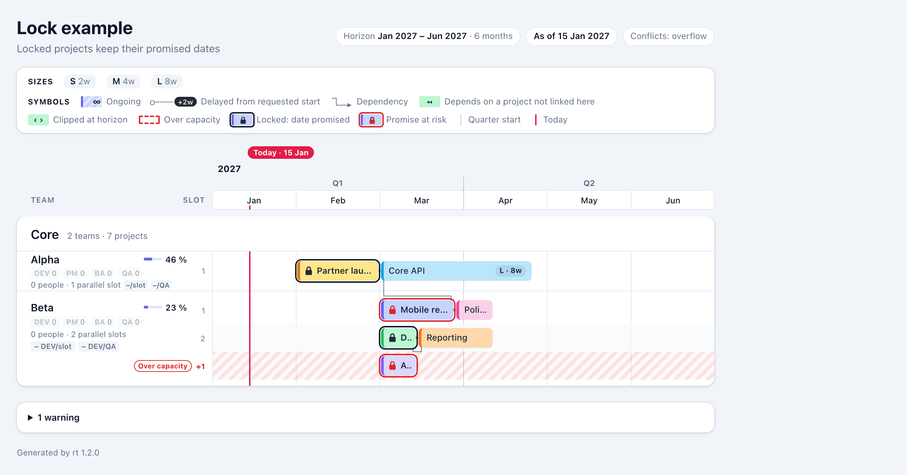

# CR-3: Locked projects (promised dates) — draft spec change for review

Status: **implemented (7 Nov 2026, rt 1.3.0)**. RS (sections listed at its top), ADS (6.2, 6.3, 7.3, 7.4), schema,
both oracles, `lock-example.yaml` and its expected plan, code, AT-75 to AT-86, user manual, cheat sheet and README
updated. Refinements made while building are in section 11.

Requested on 7 Nov 2026: add a lock flag to a project. A locked project has been **promised** to the business, a
customer or a partner. It cannot be moved on the roadmap, and anyone looking at the page must be able to see that
it is locked. This matters most for projects planned in the near or more distant future.

Owner answers taken before drafting (7 Nov 2026):

| # | Question | Answer |
| --- | --- | --- |
| Q1 | What does "cannot be moved" do to scheduling? | **Reserve first:** locked projects are placed before every other project, exactly at their start month. Unlocked projects are scheduled around them and are delayed instead |
| Q2 | What if a locked project cannot keep its date? | **Keep the date and flag it:** the bar stays at the promised date and is marked "promise at risk"; a warning is reported; the page still renders (`--strict` fails) |
| Q3 | Record who it was promised to? | **Yes, optional text:** `promised_to` |
| Q4 | Process | Spec first (this file), then the build |

## 1. Summary

```yaml
projects:
  - name: Partner launch
    team: alpha
    size: M
    start: 2027-02
    locked: true                  # the start month is a promise; rt never moves this bar
    promised_to: Partner X        # optional: who it was promised to
```

- A locked project always starts on the first day of its `start` month. It is never delayed.
- rt places all locked projects first. Every other project is then scheduled around them, as today, and is
  delayed if it has to be.
- If a promise cannot be kept, the bar still stays at its date. rt marks it **at risk** and gives warning W015.
  This happens when a project it depends on ends after the promised start, or when other locked work fills every
  slot of the team.
- On the page, a locked bar has a dark frame and a padlock icon. A bar at risk has a red frame and a red padlock.
  The legend explains both symbols. `--summary` adds a **Commitments** table that lists every promise and its
  status.

Files without `locked` produce exactly the same schedule, colours and warnings as rt 1.2.

## 2. Input format (RS 3.2, 3.1)

Two new optional fields in `projects[]`, written after `ongoing` in the field table:

| Field | Type | Req. | Rules |
| --- | --- | --- | --- |
| `locked` | boolean | No (`false`) | `true` or `false`. A locked project MUST have a `start` (E050). Ongoing projects may be locked |
| `promised_to` | string | No | 1–100 characters; allowed only with `locked: true` (E051). Shown in the tooltip and in the Commitments table |

**Why a boolean and not 0/1.** `true`/`false` is how `ongoing` already works, and YAML 1.2 keeps `0`/`1` as numbers.
`locked: 1` is therefore error E011, with the hint `"locked" must be true or false`. Spreadsheets that use 0/1 are
handled by `rt convert` (section 6).

**Why a start is required.** A promise needs a date. A project without `start` starts "whenever a slot is free",
so there would be nothing to lock.

## 3. Scheduling (RS 4.2: new SC-14, SC-15; SC-5 … SC-8 unchanged for unlocked projects)

- **SC-14 Reserve first.** Scheduling runs in two passes.
  1. **Pass 1, locked projects in file order.** Each one is placed at `R` = the first day of its `start` month,
     whatever its dependencies say. It goes into the lowest regular slot that is free for `[R, R + duration)`
     (`[R, ∞)` for an ongoing project). Only locked projects are on the board at this point. If no regular slot is
     free, the project goes into the first overflow lane that is free at `R`, or into a new one. It still keeps `R`,
     in every `on_conflict` mode.
  2. **Pass 2, every unlocked project in file order.** These are placed exactly as SC-5 … SC-8 and SC-12 describe
     today. The locked intervals are already in the slots, so unlocked projects go around them: a candidate
     date may be the end of a locked interval, backfill works as before, and a requested start that falls on a
     locked interval gives a delay (`capacity`, W001). Overflow mode and error mode (E061) treat unlocked projects
     as today.
- **SC-15 Promise at risk.** After both passes, each locked project gets its earliest start
  `E = max(R, end of every dependency)`, computed as in SC-5 step 1. Its lock risk is:
  - `dependency` when `E > R` (a dependency ends after the promised start);
  - `capacity` when it was placed in an overflow lane;
  - `dependency+capacity` when both apply;
  - `null` otherwise.

  A locked project at risk gets the flag `at_risk` and warning W015. A locked project is **never** `delayed`: its
  `delay_days` is 0 and its `delay_reason` is `null`.
- The dependency rules are unchanged. A dependency must still be written above the project (E037), and it may be
  locked or unlocked. An unlocked project that depends on a locked one waits for it as usual.
- Ongoing work and E060 work as before. A locked ongoing project holds its slot from `R` on. An unlocked project
  that finds every slot held by ongoing work, locked or not, is still E060.

### 3.1 Worked example "LE" (new fixture `lock-example.yaml`, RS 4.6)

Sizes S = 2 w, M = 4 w, L = 8 w. Subdomain *Core*: team **Alpha** has 1 slot, team **Beta** has 2 slots.
Horizon 2027-01 to 2027-06, today 2027-01-15, mode `delay`.

```yaml
projects:
  - name: Core API
    team: alpha
    size: L
    start: 2027-01
  - name: Partner launch
    team: alpha
    size: M
    start: 2027-02
    locked: true
    promised_to: Partner X
  - name: Mobile release
    team: beta
    size: M
    start: 2027-03
    locked: true
    promised_to: Retail bank
    depends_on: [Core API]
  - name: Data migration
    team: beta
    size: S
    start: 2027-03
    locked: true
  - name: Audit
    team: beta
    size: S
    start: 2027-03
    locked: true
    promised_to: Regulator
  - name: Reporting
    team: beta
    size: M
    start: 2027-03
  - name: Polish
    team: beta
    size: S
    depends_on: [Partner launch]
```

| # | Project | Team | Locked | Pass | Lane | Start | End (excl.) | Delay | Lock risk | Flags |
| --- | --- | --- | --- | --- | --- | --- | --- | --- | --- | --- |
| 1 | Core API | Alpha | — | 2 | 1 | 2027-03-01 | 2027-04-26 | 59 d capacity | — | delayed |
| 2 | Partner launch | Alpha | Partner X | 1 | 1 | 2027-02-01 | 2027-03-01 | 0 | — | locked |
| 3 | Mobile release | Beta | Retail bank | 1 | 1 | 2027-03-01 | 2027-03-29 | 0 | dependency (earliest 2027-04-26) | at_risk, locked |
| 4 | Data migration | Beta | yes | 1 | 2 | 2027-03-01 | 2027-03-15 | 0 | — | locked |
| 5 | Audit | Beta | Regulator | 1 | **+1** (lane 3) | 2027-03-01 | 2027-03-15 | 0 | capacity | at_risk, locked, over_capacity |
| 6 | Reporting | Beta | — | 2 | 2 | 2027-03-15 | 2027-04-12 | 14 d capacity | — | delayed |
| 7 | Polish | Beta | — | 2 | 1 | 2027-03-29 | 2027-04-12 | — | — | auto_start |

What the example shows:

- **Reserve first.** Partner launch is written below Core API but keeps 1 February. Core API yields and moves
  to 1 March (W001, 59 days).
- **Dependency risk.** Mobile release keeps its promised 1 March, but Core API now ends on 26 April. The promise
  is at risk (W015).
- **Capacity risk.** Three locked projects ask for Beta's two slots on 1 March. Audit is written last, so it
  goes to an overflow lane, keeps its date and is at risk.
- **Unlocked work.** Reporting finds both regular slots taken on 1 March and starts on 15 March. Polish waits
  for the locked Partner launch, then for a free slot.

Warnings, sorted by line: W001 Core API, W001 Reporting, and two W015:

```
lock-example.yaml:…: warning W015: locked project "Mobile release" cannot keep its promised start 2027-03-01: depends on "Core API", which ends 2027-04-26
lock-example.yaml:…: warning W015: locked project "Audit" cannot keep its promised start 2027-03-01: all 2 slots of team "beta" are taken by locked projects; shown in overflow lane +1
```

The same file in other modes:

- `--on-conflict error`: exit 3, with E061 for Core API and Reporting only. The locked conflict (Audit) stays a
  warning.
- `--on-conflict overflow`: Core API runs in Alpha's lane 2 from 1 January (W011), so it ends on 26 February and
  Mobile release is **on track**. Reporting gets lane 4 from 1 March, because lane 3 is held by Audit.

## 4. Diagnostics (RS 9)

| Code | Condition | Message |
| --- | --- | --- |
| E050 | `locked: true` without `start` | `project "X" is locked but has no start; a locked project needs a start month` |
| E051 | `promised_to` without `locked: true` | `project "X" has promised_to but is not locked; add locked: true or remove promised_to` |
| W015 | Locked project at risk (SC-15) | `locked project "X" cannot keep its promised start 2027-03-01: <why>`. `<why>` is `depends on "Y", which ends 2027-04-26` (the dependency that ends last), `all N slots of team "t" are taken by locked projects; shown in overflow lane +K`, or both joined with `; ` |

The existing codes cover the remaining input mistakes. E011 is for a non-boolean `locked`. E012 is for an
empty `promised_to` or one longer than 100 characters. E002 is for typos such as `lock:`, with the hint
"did you mean "locked"". A locked project in an overflow lane reports W015 **instead of** W011, so the same
problem is not reported twice. With `--strict`, W015 fails the run like any other warning.

## 5. Output

### 5.1 The bar (RS 7.6, new OUT-35 / OUT-36)



The mock-up was made by restyling a rendered page; the final page follows the rules below.

- **OUT-35 Locked.** These rules apply:
  - The bar gets a **2 px solid frame** in the new token `--lock` (light `#0F172A`, dark `#F8FAFC`), 1 px
    outside the bar.
  - A **padlock icon** (inline SVG, 11 × 13 px, in the bar's text colour) appears before the name, and the name
    is weight 600.
  - The padlock shows at every bar width. Tiny bars (under 48 px) show only the padlock, centred, so a locked bar
    is never anonymous.
  - The frame is solid and dark, so it cannot be mistaken for the dashed red over-capacity outline.
  - Fills and colours are unchanged, so product colours keep working.
- **OUT-36 Promise at risk.** The frame and the padlock turn red (`--over`). On bars of 120 px or more, a red pill
  `! at risk` takes the place of the size chip. Narrower bars keep their name and rely on the red frame and
  padlock. An overflow-lane bar shows only the at-risk frame, not the dashed over-capacity outline as well.
- **Tooltip (OUT-18).** A `Locked` line follows `Product` (or `Team`), for example
  `Locked: promised to Partner X · start fixed 1 Feb 2027`, or `Locked: start fixed 1 Feb 2027` when there is no
  `promised_to`. A bar at risk adds `Promise at risk: depends on Core API, which ends 26 Apr 2027` or
  `Promise at risk: no free slot in team Beta (overflow lane +1)`.
- **Legend (7.2).** Two symbols, *Locked: date promised* and *Promise at risk*, appear after "Over capacity",
  **only when the file has locked projects**. Pages of files without locks are unchanged.
- **Print and dark mode.** The frame is drawn in print (colour adjust is exact), and dark mode uses the light
  `--lock` value.

### 5.2 Summary (`--summary`, RS 7.12)

- **KPI row (OUT-30).** Two tiles, `Locked` (count) and `At risk` (count), shown only when the file has locked
  projects.
- **New OUT-37 Commitments table.** It comes after "Team composition" and only when locked projects exist. It
  lists one row per locked project, in file order, with the columns Project · Team · Product · Promised to ·
  Start · Last day · Status. The status is `On track`, or a red `At risk` with the reason as in the tooltip. This
  is the list of everything that has been promised, ready to show to stakeholders.

### 5.3 Hooks (RS 7.10)

| Element | Addition |
| --- | --- |
| Bar | Classes `rt-bar--locked`, `rt-bar--risk`; attribute `data-lock-risk` (`dependency`, `capacity`, `dependency+capacity` or empty); `data-flags` may contain `locked` and `at_risk` |
| Padlock | `rt-bar__lock` (an `svg` with `aria-hidden="true"`; the state is in `aria-label`) |
| Commitments table | `rt-commitments`; rows `rt-commitment` with `data-seq` and `data-status` (`on_track`, `at_risk`) |

### 5.4 Plan JSON (RS 8, new PL-9)

- Each project gains `"locked"` (boolean) and `"promised_to"` (string or `null`) right after `"ongoing"`, and
  `"lock_risk"` (`"dependency"`, `"capacity"`, `"dependency+capacity"` or `null`) right after `"delay_reason"`.
- `flags` may now also contain `at_risk` and `locked`, still sorted alphabetically.
- For a locked project, `earliest_start` is the SC-15 value. It is later than `start` exactly when the lock risk
  includes `dependency`.
- The expected plans of WE, DE and PE change only by `"locked": false, "promised_to": null, "lock_risk": null` on
  every project. Every schedule, colour and warning stays the same.

## 6. `rt convert` (RS 3.4, 6.6)

| Column | Content | Becomes |
| --- | --- | --- |
| `locked` | The same values as `ongoing`: `true/yes/y/1/x/tak/t` or `false/no/n/0/nie`/empty, case-insensitive. **0/1 works here** | `locked: true` when true, else omitted |
| `promised_to` | Free text | `promised_to` |

CV-18 key order becomes `id, name, team, product, start, size, ongoing, locked, promised_to, depends_on,
description, color`. E050 and E051 point to the CSV row and column. Map Polish headers as usual, for example
`--map "Zablokowany=locked,Obiecany dla=promised_to"`.

## 7. New acceptance tests (RS 11.9)

| ID | Given / When | Then |
| --- | --- | --- |
| AT-75 | `rt render LE --plan p.json` | Exit 0; `p.json` equals `lock-example.expected.json` byte for byte (ignoring `rt_version`) |
| AT-76 | Same run | Partner launch keeps 2027-02-01 in Alpha lane 1 although written after Core API; Core API starts 2027-03-01, `delay_days` 59, reason `capacity` |
| AT-77 | Same run | Mobile release: start 2027-03-01, `earliest_start` 2027-04-26, `lock_risk` `dependency`, flags `at_risk locked`, `delay_days` 0; W015 names Core API and 2027-04-26 |
| AT-78 | Same run | Audit: Beta lane 3 (overflow) from 2027-03-01, `lock_risk` `capacity`, flags `at_risk locked over_capacity`; W015 and no W011 |
| AT-79 | `rt render LE --on-conflict error` | Exit 3; E061 for Core API and Reporting only; no HTML |
| AT-80 | `rt render LE --on-conflict overflow --plan p.json` | Core API in Alpha lane 2 from 2027-01-01 (W011); Reporting in Beta lane 4 from 2027-03-01; locked projects keep their dates; Mobile release on track (Core API now ends 2027-02-26), Audit at risk |
| AT-81 | `locked: true` without `start`; `promised_to` without `locked`; `locked: 1`; `promised_to` of 101 characters; key `lock:` | Exit 1; E050, E051, E011, E012, E002 "did you mean "locked"" |
| AT-82 | LE HTML | Locked bars have `rt-bar--locked` and one `rt-bar__lock`; Mobile release and Audit also `rt-bar--risk`; `data-lock-risk` equals the plan; the legend shows both lock symbols; tooltips have the `Locked` and `Promise at risk` lines; a tiny locked bar shows the padlock |
| AT-83 | `rt render LE --summary` | KPI tiles `Locked 4`, `At risk 2`; one `rt-commitments` table with 4 rows in file order, statuses `on_track` / `at_risk` as in the plan |
| AT-84 | EX, WE, DE and PE | Plans equal their expected files, which differ from rt 1.2 only by the three new keys; the HTML has no lock symbol in the legend and no `rt-bar--locked` |
| AT-85 | `rt convert` of a CSV with `locked` cells `1`, `0`, `tak`, `x` and a `promised_to` column | YAML has `locked: true` for 1/tak/x and nothing for 0, plus `promised_to`, in CV-18 key order; a locked row without start gives E050 at that CSV row |
| AT-86 | `rt schema` | Accepts `locked` and `promised_to`; still validates every fixture, LE included |

## 8. Design (ADS)

| Area | Change |
| --- | --- |
| `model.fields` / `types` / `build` | `PROJECT_KEYS` gains `locked`, `promised_to`; `Project.locked: bool`, `Project.promised_to: str \| None`; checks E011, E012, E050, E051 |
| `schedule.scheduler` | Two passes (SC-14). Pass 1 uses `SlotBoard.fit_at` restricted to the start date; pass 2 is today's loop with locked seqs skipped. Then the SC-15 risk check. `Placement` gains `locked`, `lock_risk` |
| `schedule.types` | Flags `LOCKED`, `AT_RISK`; risk reasons reuse the `REASON_*` constants |
| `plan.types` / `build` | `PlannedProject.locked`, `promised_to`, `lock_risk`; W015 in `project_warnings`, suppressing W011 for locked projects |
| `layout.viewmodel` | `BarVM.locked`, `risk`, pill rule (≥ 120 px replaces the chip); tooltip lines; legend flag `has_locks`; `SummaryVM` tiles and `CommitmentsVM` |
| `render` | `_bar.html.j2` padlock SVG; `_legend.html.j2` two conditional symbols; `_summary.html.j2` Commitments table; CSS `--lock` token (light and dark), `rt-bar--locked` / `--risk`, `rt-bar__lock`, `rt-bar__risk`, within the CSS budget |
| `convert` | `locked` (boolean words, as `ongoing`) and `promised_to` columns; emit order |
| schema | `locked` boolean, `promised_to` string 1–100 (`dependentSchemas`: `promised_to` requires `locked: true`) |
| oracle | `reference_plan.py`: two passes, lock risk, new fields; `reference_convert.py`: the two columns |

## 9. Files to change

1. Human-owned (I'll change them on your OK): `docs/requirements.md` (sections 2, 3.1, 3.2, 3.4, 4.2, new 4.6,
   6.6, 7.2, 7.6, 7.8, 7.10, 7.12, 8, 9, new 11.9, 12.1, 13.2) and `docs/architecture.md`. Also
   `docs/fixtures/` (new `lock-example.yaml` and `.expected.json`; the WE/DE/PE expected plans gain the new keys;
   the schema), and `docs/reference/` (both oracles).
2. Code and tests: `src/**`, `tests/**`, `tools/reference_*.py`; release 1.3.0.
3. Documentation: a new manual chapter "Locking promised projects" placed after "When there is more work than
   slots" (later chapters renumbered), cheat sheet, README, the rt-roadmap skill's input reference, and both PDFs
   regenerated.
4. `roadmap.example.yaml` (EX): **no change**, so AT-17 and AT-43 and its single warning stay as they are. LE
   carries the example instead.

## 10. Decisions taken in this draft (please confirm or overrule)

| # | Topic | Proposal | Why |
| --- | --- | --- | --- |
| D1 | Flag type | `locked: true/false` in YAML; 0/1 (and yes/tak/x) only in CSV | Matches `ongoing`; YAML 1.2 keeps 0/1 as numbers |
| D2 | Lock without `start` | Error E050 | A promise needs a date |
| D3 | Locked capacity conflict | Overflow lane in every mode, W015 instead of W011, never E061 | "Keep the date and flag it" (Q2); the bar must never move |
| D4 | Dependencies of a locked project | Still written above it (E037). A late dependency makes the promise at risk; it does not move the bar | Keeps cycles impossible; Q2 |
| D5 | Lock symbols in the legend | Only when the file has locked projects | Pages of existing files stay byte-identical apart from the version |
| D6 | Ongoing projects | May be locked (for example promised support from a date) | No reason to forbid it |
| D7 | Locked projects in the past (start before today) | No special treatment: still framed and padlocked | The page shows plan state, not progress (RS 1.3 out of scope) |
| D8 | Colour | Locking never changes fill colours; only the frame and the padlock | Product colours stay meaningful |

## 11. Implementation notes (7 Nov 2026)

| # | Topic | What was built | Why |
| --- | --- | --- | --- |
| N1 | AT-80 | Corrected while building: in overflow mode Core API is not pushed back, so Mobile release is on track and only Audit is at risk | The draft assumed the delay-mode dates |
| N2 | Tooltip wording | `Promise at risk: depends on Core API (last day 25 Apr 2027)`; W015 keeps the plan's exclusive end (`which ends 2027-04-26`) | People read the last working day; the warning matches the plan JSON |
| N3 | Monthly load | A locked project at risk in an overflow lane counts in the load, so a team can exceed 100 % in delay mode (LE: Beta, March 123 %). RS OUT-32 says so now | Load counts every lane (OUT-32); the overflow lane is real work that was promised |
| N4 | CSS budget | Target raised from 15 KB to 16 KB (ADS 7.4, unit test); the compacted stylesheet is 16,164 bytes (15.8 KiB) | The lock frame, padlock, legend symbols and Commitments table add about 0.9 KB |
| N5 | W015 with one slot | `the only slot of team "a" is taken by locked projects; …` instead of `all 1 slots` | Grammar |
| N6 | `rt convert` | An invalid `locked` cell is E011 and suppresses the follow-up E051 for the same row; `locked` and `promised_to` are valid `--map` targets | Same pattern as `ongoing` (no double reports) |
| N7 | Hooks | `data-lock-risk` on every bar (empty when none), right after `data-delay-reason` | Mirrors the plan, where `lock_risk` follows `delay_reason` |
| N8 | Tests | AT-75 to AT-86 in `tests/acceptance/test_at_locked.py`; scheduler unit tests in `tests/unit/test_sched_locked.py`; catalogue fixtures E050, E051, W015; the differential property test now generates locked projects (about 1 in 4 projects with a start) | Golden, differential and catalogue coverage |
| N9 | EX comment | `roadmap.example.yaml` said team indicators mark values "more than 33 %" from the median; now "50 %" (comment only, line numbers unchanged) | The rule changed to 50 % in CR-2's second round |
| N10 | Short locked bars | A locked bar under 72 px (48 px text threshold + 24 px for the padlock) shows only the padlock, centred, like a tiny bar | Found while writing the manual: a 2-week locked bar with the `↤` glyph had no room left for its name and showed a stray ellipsis |
